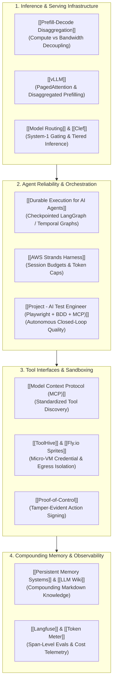

# 🛠️ AI Engineering: Systems, Inference & Reliable Agent Architecture

> **AI Engineering** is the discipline of transitioning artificial intelligence from experimental prompting and non-deterministic scripts into resilient, observable, high-performance production systems. It encompasses computational inference optimization, durable workflow orchestration, tool protocols, and compounding memory architectures.

---

## 🏛️ The Production AI Engineering Spectrum

Production AI engineering operates across four deeply interdependent infrastructure layers:

---

## ⚡ 1. Inference Engineering & Serving Topologies

Inference engineering focuses on the physical placement of computation and memory bandwidth to serve autoregressive models under strict latency and cost constraints:

* **Computational Asymmetry:** Generating text splits into two radically different tasks:
  1. **Prefill (Prompt Processing):** Compute-bound GEMM operations constructing the KV cache.
  2. **Decode (Token Generation):** Memory-bandwidth-bound GEMV operations fetching KV pages step-by-step.
* **Prefill–Decode Disaggregation:** Rather than allowing long prompt prefill bursts to stall concurrent token generation, production clusters decouple prefill workers from decode workers via high-speed KV transfer protocols (e.g. Mooncake, NIXL). See [[Prefill-Decode Disaggregation]] and [[vLLM]].
* **Latency Triad:** Engineering targets must balance **Time to First Token (TTFT)**, **Inter-Token Latency (ITL)**, and total **Throughput**.

---

## 🛡️ 2. Agent Reliability: Durable Execution & Idempotency

Moving from toy chatbots to reliable production agents requires treating workflows as distributed transactions:

* **Durable Workflows:** Using graph engines like LangGraph (with persistent `SqliteSaver` or PostgreSQL) and Temporal to record step boundaries. If a container crashes 15 minutes into a multi-step task, execution rehydrates from the last checkpoint rather than restarting.
* **Human-in-the-Loop Interrupts:** Safely pausing asynchronous execution using native interrupts (`interrupt()`) and resuming when human sign-off arrives (`Command(resume=True)`).
* **Mitigating Duplicate Side Effects:** Applying deterministic idempotency keys (`workflow_id` + `operation_id`) and pre-execution existence queries to prevent duplicated real-world side effects (e.g. double charging cards, duplicate PRs). See [[Durable Execution for AI Agents]].

---

## 🧠 3. Memory Compounding vs. Ephemeral RAG

Rather than relying purely on vector embeddings that force models to re-synthesize domain knowledge from scratch on every turn:
* The **[[LLM Wiki]]** pattern operationalizes knowledge as a persistent, compounding Markdown graph in Obsidian maintained by autonomous agents.
* Cognitive memory is partitioned into active working memory, episodic logs, semantic concepts, and deterministic procedural tool definitions (see [[Persistent Memory Systems]]).

---

## 🔭 4. Full-Lifecycle Observability & Telemetry

Production systems require span-level instrumentation:
* **[[Langfuse]]:** Tracing multi-agent handoffs, separating prefill latency from decode latency, tracking human interrupt duration, and clustering failure modes.
* **[[Token Meter]]:** Measuring dollar cost per successful task completion rather than raw token counts.

---

## 🧭 Vault Navigation & Schema
* **Operating Protocol:** See [[AGENTS.md]] for the AI maintainer schema and fast navigation protocol.
* **Master Architectural Compendium:** Read the [[Master Guide - AI & Open-Source Engineering]].
