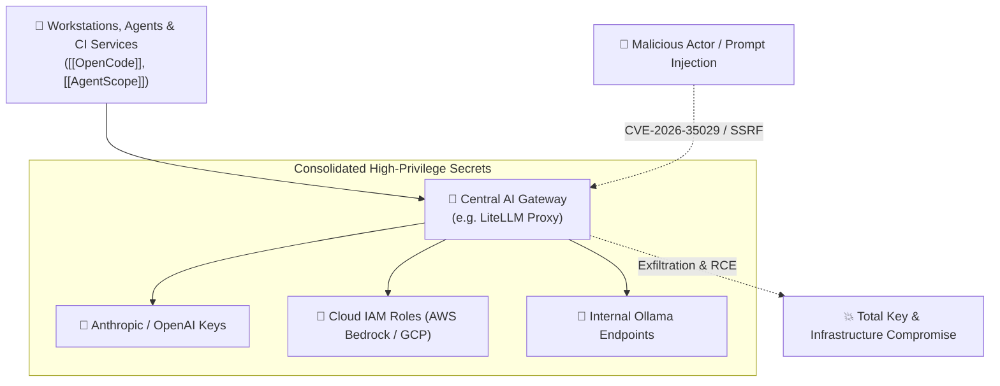

# 🛡️ AI Gateway Security & Threat Vectors

> **AI Gateways** (such as LiteLLM, Portkey, or Cloudflare AI Gateway) serve as centralized routing, authentication, and load-balancing layers between client applications and model providers. Because they aggregate high-privilege credentials and process arbitrary user prompts, they constitute critical attack surfaces.

---

## ⚠️ The Gateway Concentration Risk

In an agentic ecosystem, an AI gateway acts as the single point of credential concentration:

If the gateway is breached, all upstream downstream model tokens, internal prompt transcripts, and private fine-tuned endpoints are compromised simultaneously.

---

## 🔍 Case Study: LiteLLM Vulnerabilities (CVE-2026-35029 & CVE-2026-59823)

In October 2026, Check Point Research published critical advisories regarding access control and request validation weaknesses in LiteLLM:

| CVE Identifier | Vulnerability Class | Impact | Resolution |
| :--- | :--- | :--- | :--- |
| **CVE-2026-35029** | Broken Authentication & Access Control | Unauthorized administrative dashboard takeover and credential extraction | Upgrade to **LiteLLM $\ge$ 1.83.9** |
| **CVE-2026-59823** | Server-Side Request Forgery (SSRF) / Insecure Deserialization | Arbitrary file system access, internal network scanning, and potential Remote Code Execution (RCE) | Upgrade to **LiteLLM $\ge$ 1.83.9** |

---

## 🛡️ Gateway Hardening Checklist

1. **Verify Minimum Safe Versions:** Immediately patch all LiteLLM instances to $\ge 1.83.9$.
2. **Private Network Binding:**
   - Never expose administrative or proxy ports (`:4000`, `:11434`) to the public internet.
   - For local multi-machine setups (e.g. [[OpenCode]] targeting a Mac mini M4), bind strictly to the private local subnet (`192.168.x.x`) behind a router firewall or WireGuard mesh.
3. **Principle of Gateway Minimalism:**
   - Do not introduce an intermediary gateway unless you explicitly require multi-tenant billing, rate-limiting, or cross-provider failover.
   - For 1-to-1 workstation connections, configure client agents to connect directly to the verified local provider endpoint.
4. **Credential Isolation with [[ToolHive]]:** Run proxy gateways inside sandboxed micro-containers with locked outbound egress to prevent SSRF from reaching internal metadata services (e.g. AWS `169.254.169.254`).
