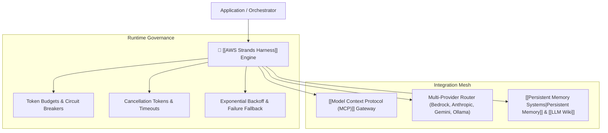

# 🧩 AWS Strands Harness

> **AWS Strands Harness** is an open-source agent runtime and SDK (Python & TypeScript) that standardizes the operational lifecycle of AI agents beyond naive loops.

---

## 🏛️ What Belongs in an Agent Harness?

```text
Harness = Context + State + Tools + Limits + Retries + Memory + Observability + Evaluation
```



---

## 💡 Practical Takeaway

When developing autonomous agents, do not hand-roll raw while-loops. Use a structured harness with explicit budget constraints, telemetry tracing, and cancellation signals.
