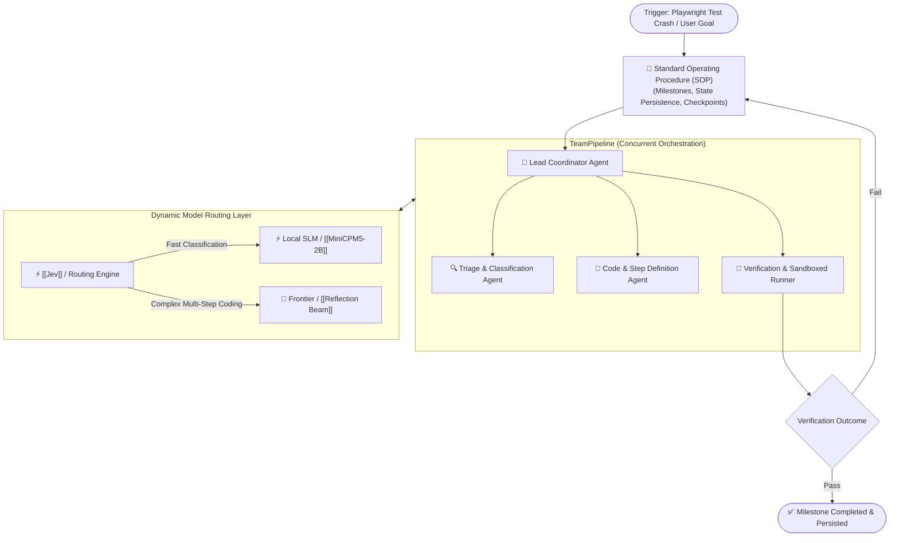
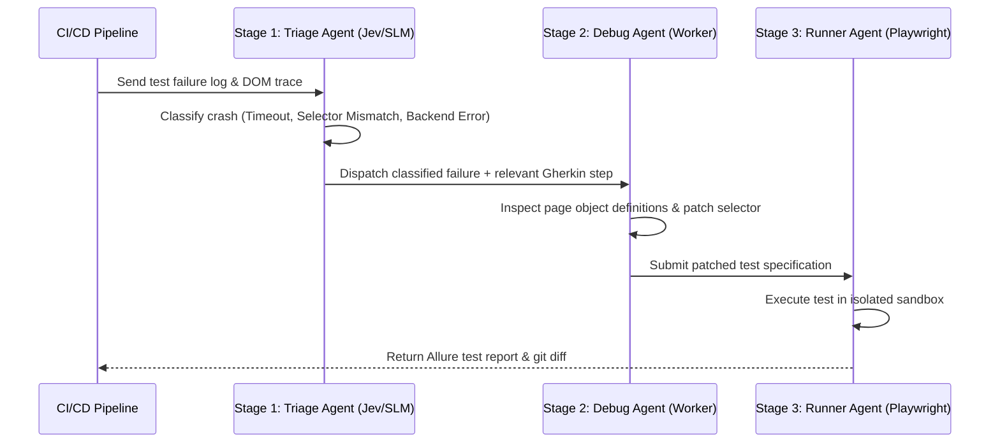

# 👥 AgentScope

> **AgentScope** is an open-source multi-agent orchestration framework developed by Alibaba, engineered to build structured, fault-tolerant agent applications using Standard Operating Procedures (SOPs), concurrent pipelines, and dynamic model routing.

---

## 🏛️ Core Architectural Primitives (v2.0.10)

### 1. Standard Operating Procedures (SOPs)
Unlike loose conversational agents that easily drift off-course, AgentScope enforces industrial **SOPs**:
* Deconstructs complex goals into ordered, discrete milestones.
* Mandates verification gates before allowing an agent to advance to subsequent phases.
* Checkpoints execution state to disk so crashed workflows can resume without losing context.

### 2. TeamPipeline
* Coordinates a lead planner delegating concurrent subtasks across a swarm of specialized worker agents.
* Resolves inter-agent communication, tool-call ID synchronization (specifically patched for Ollama backends in v2.0.10), and unified context aggregation.

### 3. Integrated Decision Intelligence
* Native support for OpenAI Decisions API and typed [[Jev]]-style System-1 decision routing.
* Directs simple extraction and classification tasks to local SLMs while routing complex refactoring to frontier models.

---

## 🧪 Application Blueprint: Autonomous Playwright Test Triage

AgentScope directly maps to autonomous QA engineering workflows, replacing fragile monolithic prompts with an isolated 3-stage pipeline:

1. **Stage 1: Classification:** Fast, typed categorization of failure logs (e.g. selector drift vs timing assertion).
2. **Stage 2: Root-Cause Investigation:** Correlates the Gherkin scenario with actual DOM diffs and step definitions.
3. **Stage 3: Verification:** Executes the proposed fix inside an isolated container and logs verified results.
