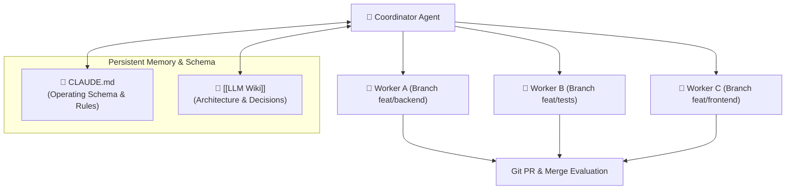

# 🧑‍💻 Claude Code Projects

> **Claude Code Projects** implements a coordinator-worker multi-agent architecture where a primary coordinator delegates subtasks to parallel agent workers operating on isolated Git branches.

---

## 📜 Role of `CLAUDE.md` as Knowledge Schema

In Claude Code, project-level conventions, architecture guidelines, and repository behaviors are governed by `CLAUDE.md`. Under the [[LLM Wiki]] pattern:
* **Operating Schema (Layer 3):** `CLAUDE.md` specifies the directory taxonomy, frontmatter requirements, and workflows for ingesting, querying, and linting project documentation.
* **Persistent Memory (Layer 2):** Agent workers read and compile design decisions, test outcomes, and architectural changes directly into markdown notes, ensuring knowledge compounds across branch merges rather than being lost in closed PR comments.

