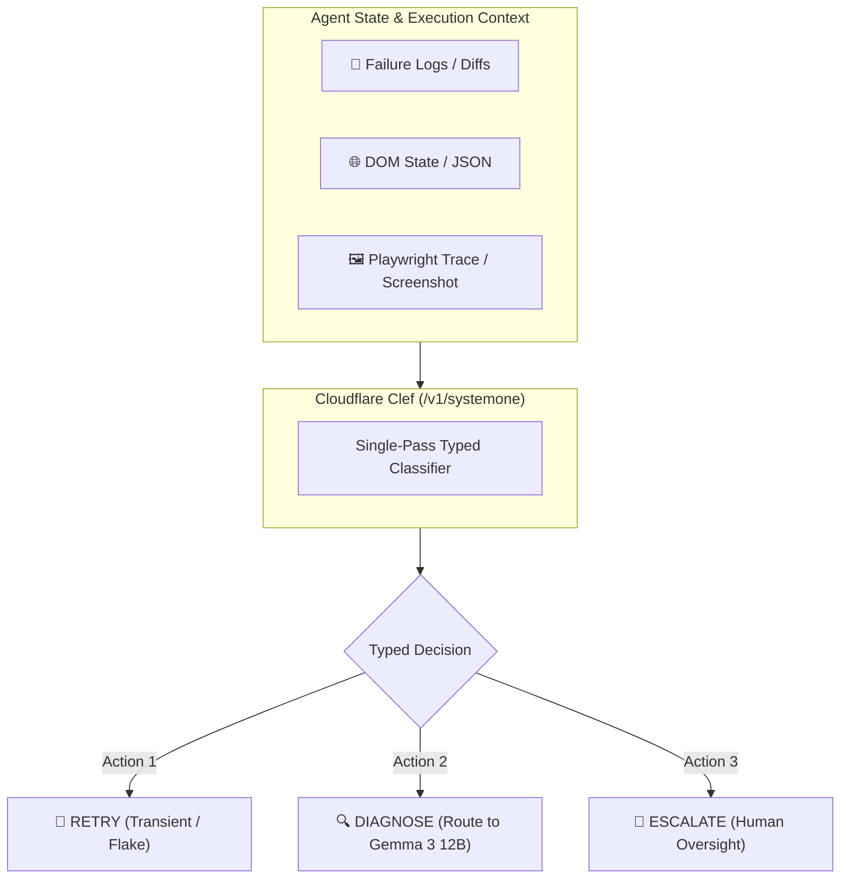

# ⚡ Cloudflare Clef: Specialised Decision Model for AI Agents

> **Cloudflare Clef** is an open-weights, specialized "System One" decision model fine-tuned from **Qwen3.8-27B** (Apache 2.0) and served natively via **Ollama**. Unlike conventional generative LLMs, Clef is engineered to evaluate complex state (text, structured JSON, images) and return typed, single-pass decisions without conversational overhead.

---

## 🏛️ Architecture & Capabilities

* **Base Foundation:** Fine-tuned on top of `Qwen3.8-27B`.
* **License:** Permissive Apache 2.0.
* **Input Modality:** Multi-modal ingestion accepting unstructured log text, structured JSON telemetry, and visual failure artifacts (e.g. screenshots).
* **Output Paradigm:** Discrete classifications, yes/no evaluations, calibrated confidence scores, and action selection.
* **Compact Variant (`Clef-Flash`):** Quantized, smaller parameter footprint optimized for local edge deployment on Apple Silicon unified memory (e.g., Mac mini M4).



---

## ⚙️ Ollama Integration (`/v1/systemone`)

Clef requires **Ollama 0.35.1+** and exposes a dedicated System-1 structured decision endpoint:

### 1. Model Pull
```bash
# Pull full 27B model (or clef:flash for constrained local VRAM)
ollama pull clef
ollama pull clef:flash
```

### 2. Decision Query via `/v1/systemone`
```bash
curl http://192.168.1.23:11434/v1/systemone \
  -H "Content-Type: application/json" \
  -d '{
    "model": "clef",
    "state": {
      "error_message": "TimeoutError: page.waitForSelector timed out after 5000ms",
      "network_status": 200,
      "dom_ready": true,
      "previous_attempts": 0
    },
    "question": "What is the recommended recovery action?",
    "options": ["RETRY", "DIAGNOSE", "ESCALATE"]
  }'
```

**Response:**
```json
{
  "decision": "DIAGNOSE",
  "confidence": 0.94,
  "rationale_code": "DOM_STABLE_SELECTOR_MISSING"
}
```

---

## 💡 System-1 vs. System-2 Model Routing

In production agent runtimes, invoking a 70B+ or frontier model for simple triage causes unnecessary latency, high cost, and token exhaustion:

| Dimension | System-1 Decision Model ([[Clef]] / [[Jev]]) | System-2 Reasoning Model (Gemma 3 12B / [[Reflection Beam]]) |
| :--- | :--- | :--- |
| **Primary Role** | Fast action selection, classification, retry gating | In-depth root-cause analysis, code refactoring, planning |
| **Output Format** | Typed enums, booleans, score float (`0.0 - 1.0`) | Multi-token markdown, code diffs, rationale chains |
| **Latency** | Sub-second (70–400 ms) | Multi-second (2–15+ s) |
| **Compute Profile** | Low memory, single-pass forward sweep | High KV-cache retention, iterative auto-regressive decoding |
| **Token Cost** | Minimal / deterministic | Variable / high token traffic |

---

## 🧪 Applied Use Case: Playwright Test Triage

When integrated into [[Project - AI Test Engineer (Playwright + BDD + MCP)|AI Test Engineer]]:
1. **Playwright test fails** on CI or local runner.
2. **Clef** inspects the failure snippet and screenshot via `/v1/systemone`.
3. If classified as `RETRY` (network blip, transient animation lag), the runner immediately retries without calling frontier models.
4. If classified as `DIAGNOSE` (actual selector change or application crash), the trace is routed to **Gemma 3 12B** running on the local Mac mini M4.
5. Observability telemetry is logged to [[Langfuse]].
