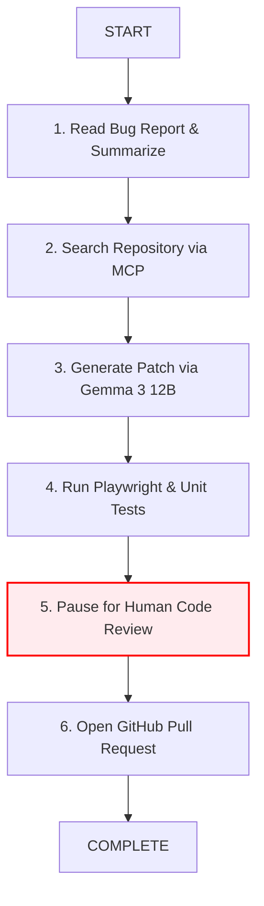
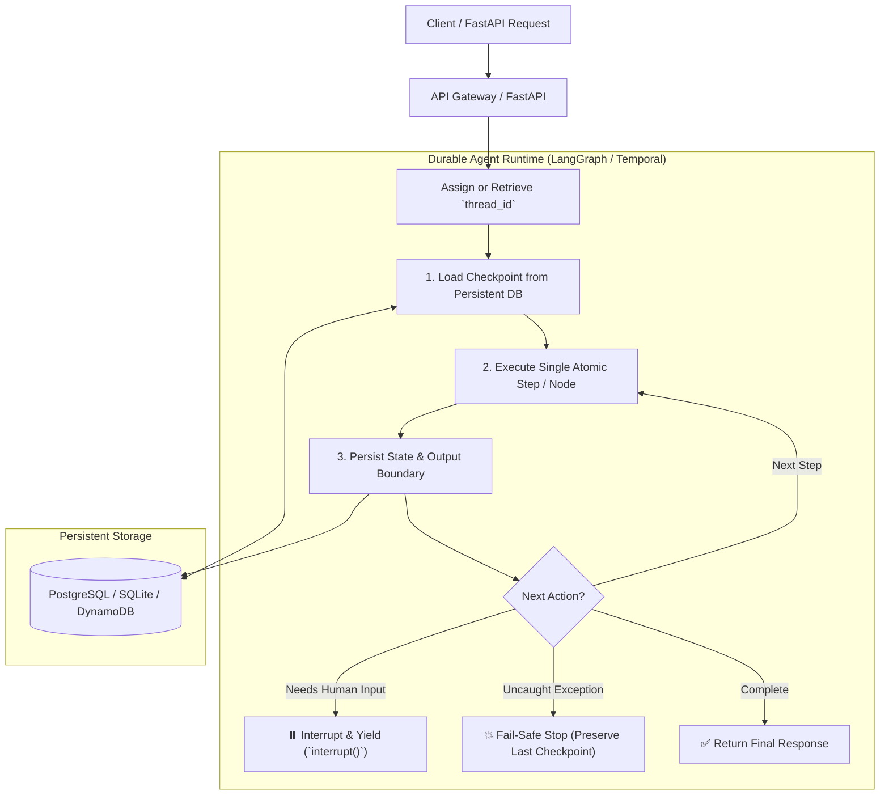
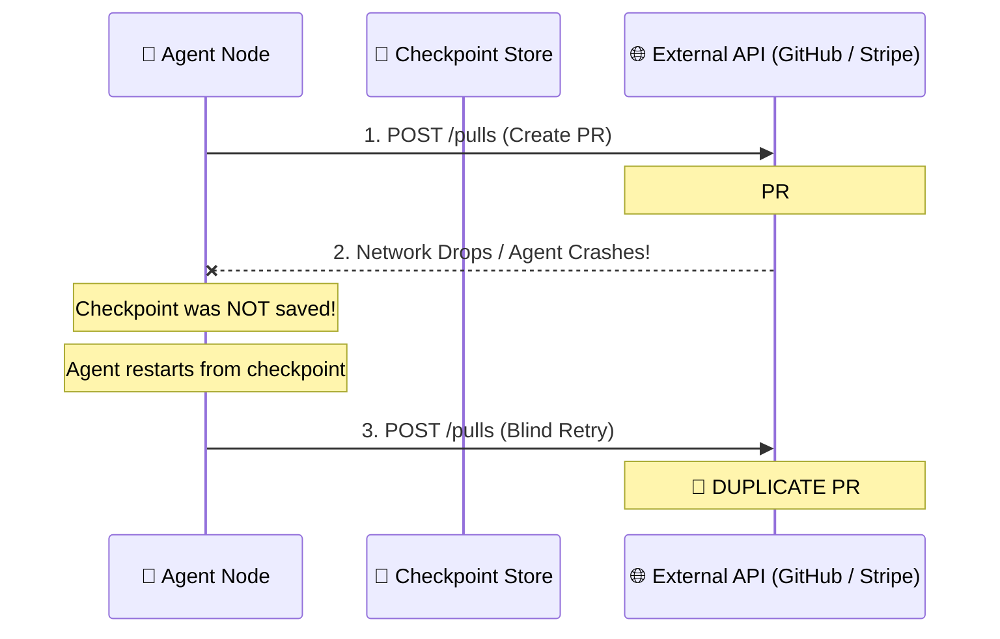

# 🛡️ Durable Execution for AI Agents

> **Durable Execution** is an agentic architectural pattern that records workflow progress at discrete step boundaries into persistent storage, enabling long-running AI agents to survive process crashes, pause for human approval, and resume from checkpoints without re-executing expensive model inferences or triggering duplicate external side effects.

---

## 💡 The Core Problem: The Fragility of Ephemeral Agent Loops

Consider a realistic multi-step autonomous software engineering agent:



In a naive, ephemeral agent implementation:
* All state is stored in memory (RAM) or in an active context window.
* If the process crashes or server restarts at Step 5 (or pauses for 12 hours while waiting for human review), the entire execution state evaporates.
* **The failure mode:** Restarting from scratch repeats 20 minutes of expensive inference, burns tokens, and risks calling external APIs a second time (e.g. creating duplicate branches, duplicate PRs, or duplicate charges).

**Durable Execution** solves this by borrowing core principles from distributed systems: **state checkpointing**, **deterministic graph topologies**, **idempotency keys**, and **rehydration from persistent boundaries**.

---

## 🏛️ Checkpoints vs. Long-Term Memory

A critical architectural distinction must be maintained between execution state and cognitive memory:

| Dimension | Execution Checkpoints ([[Durable Execution for AI Agents]]) | Cognitive Long-Term Memory ([[Persistent Memory Systems]]) |
| :--- | :--- | :--- |
| **Core Question** | *"Where did this workflow stop, and what exact state is needed to resume execution?"* | *"What useful domain facts, user preferences, or past insights should persist across sessions?"* |
| **Scope** | Workflow / thread-scoped (`thread_id`, `workflow_id`) | Global, agent-wide, or user-scoped |
| **Lifespan** | Ephemeral to the workflow duration (cleared or archived upon completion) | Evergreen, compounding continuously across months |
| **Example** | `{"workflow_id": "bugfix-1042", "step": "human_approval", "tests_passed": true}` | Remembering the user prefers TypeScript, or past architecture decisions in Obsidian |
| **Engine** | [[LangGraph]] Checkpointers (`SqliteSaver`, Postgres), [[Temporal]] | Obsidian Markdown vault ([[LLM Wiki]]), Vector stores, semantic graphs |

---

## ⚙️ Architectural Orchestration Pattern

A production-grade durable agent decouples incoming client triggers from state persistence and step execution:



---

## 🛠️ Production Implementations

### 1. LangGraph (Node Checkpointing & Interrupts)
* Breaks agent execution into discrete graph nodes.
* Employs persistent checkpointers (`SqliteSaver`, `PostgresSaver`) keyed by unique `thread_id`.
* **Human-in-the-Loop (`interrupt` / `Command`):** The workflow can cleanly yield control back to the client (`interrupt({"message": "Approve patch?"})`) and resume asynchronously hours later (`graph.invoke(Command(resume=True), config=config)`).

#### Working Reference Implementation (`durable_agent.py`)

```python
from langgraph.checkpoint.sqlite import SqliteSaver
from langgraph.graph import END, START, StateGraph
from langgraph.types import Command, interrupt
from typing_extensions import TypedDict

class WorkflowState(TypedDict, total=False):
    draft: str
    approved: bool

def approval_step(state: WorkflowState):
    # Workflow suspends execution here and yields to caller
    decision = interrupt({
        "message": "Approve this generated patch?",
        "draft": state.get("draft", ""),
    })
    return {"approved": bool(decision)}

builder = StateGraph(WorkflowState)
builder.add_node("approval", approval_step)
builder.add_edge(START, "approval")
builder.add_edge("approval", END)

# Persist checkpoints to disk
with SqliteSaver.from_conn_string("agent_checkpoints.sqlite") as checkpointer:
    graph = builder.compile(checkpointer=checkpointer)
    config = {"configurable": {"thread_id": "bugfix-1042"}}

    # Phase 1: Start workflow -> Pauses at interrupt
    first_result = graph.invoke(
        {"draft": "Fix session-expiry login handling"},
        config=config,
    )
    print("Initial (Paused) Result:", first_result)

    # Phase 2: Resume workflow from stored checkpoint
    final_result = graph.invoke(
        Command(resume=True),
        config=config,
    )
    print("Resumed Result:", final_result)
```

### 2. Temporal (Event-Sourced Durable Workflows)
* Workflows are defined as deterministic code; all non-deterministic external operations (model calls, API writes, tool runs) must be wrapped inside **Activities**.
* State is reconstructed via event sourcing. Retries, timeouts, and backoffs are handled transparently by the Temporal cluster.

---

## 🚨 The Critical Distributed Systems Challenge: Duplicate Side Effects

Checkpoints preserve workflow state, but **they do not automatically guarantee exactly-once execution for external tool actions**.

### The Danger Scenario:
1. Agent node calls GitHub API to create Pull Request #102.
2. The GitHub API creates the PR successfully.
3. The network connection drops before the agent receives the HTTP 200 response, or the agent process crashes before saving the checkpoint.
4. The agent restarts, reads the prior checkpoint, assumes the step never finished, and calls the API again $\rightarrow$ **Duplicate PR created**.



### The Solution: Idempotency Keys & Pre-Flight Invariant Checks
To ensure safety in durable agentic systems:
1. **Deterministic Idempotency Keys:** Include the workflow identifier and step hash in the request header:
   ```json
   {
     "workflow_id": "bugfix-1042",
     "operation_id": "create-pr-bugfix-1042"
   }
   ```
2. **Pre-Execution Invariant Verification:** Before executing any side-effecting external tool, query the external system:
   *"Does a pull request with head branch `bugfix-1042` already exist?"* If yes, adopt the existing entity and record the result rather than re-creating it.
3. **Signed Execution Evidence:** Pair with [[Proof-of-Control]] to sign and log tool execution receipts.

---

## ⚖️ Architectural Comparison Matrix

| Capability | Naive Ephemeral Loop | Durable Execution Agent |
| :--- | :--- | :--- |
| **Process Crash Resilience** | Complete state loss; restart from scratch | Recovers to exact step boundary from disk/database |
| **Human-in-the-Loop** | Fragile long-polling or in-memory holding | Native asynchronous pause, yield, and resume |
| **API Failure Retries** | Retries whole multi-turn prompt sequence | Retries isolated step with exponential backoff |
| **Cost Efficiency** | High waste (re-runs expensive LLM inference) | Zero repeated inference for completed nodes |
| **Observability** | Unstructured console logs | Discrete step checkpoints traced in [[Langfuse]] |
| **Duplicate Side Effects**| Common under retries | Mitigated via idempotency keys and state queries |

---

## ⚠️ Common Pitfalls

1. **Assuming Checkpoints Guarantee Exactly-Once Tool Calls:** A crash between external action and state persistence causes duplicate actions unless guarded by idempotency keys.
2. **Storing Only Conversation Transcripts:** Transcripts do not capture whether external systems accepted side effects. Always store structured typed state.
3. **Coarse-Grained Steps:** If a single node performs 5 distinct operations before checkpointing, a failure on the 5th operation forces all 5 to repeat. Break graphs into fine-grained atomic nodes.
4. **Using In-Memory Persistence in Production:** Memory checkpointers (`MemorySaver`) vanish on process restart. Always back with PostgreSQL or SQLite.
