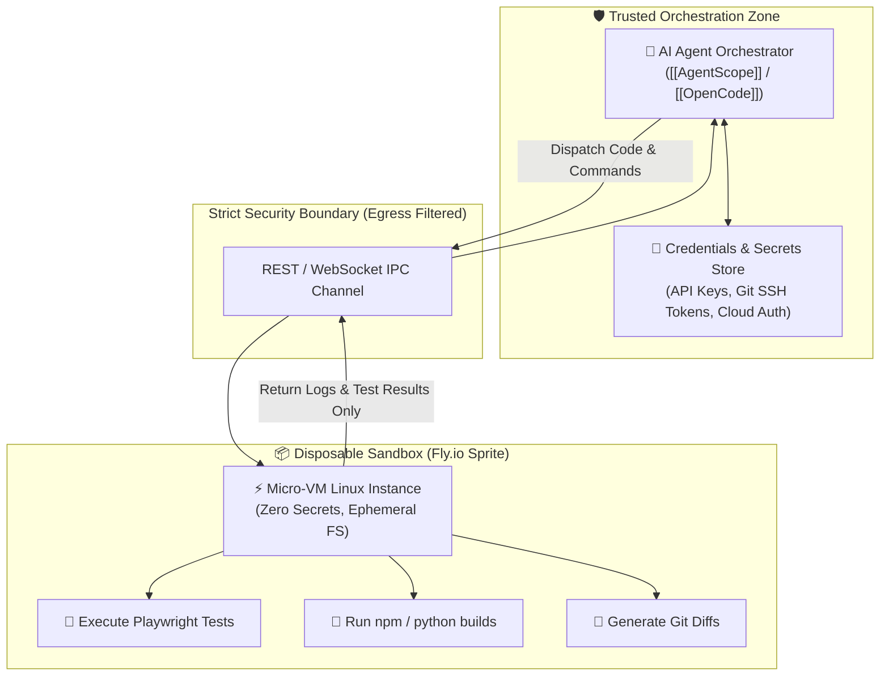

# 📦 Fly.io Sprites

> **Fly.io Sprites** are lightweight, disposable Linux micro-virtual machines engineered to run untrusted AI agent commands, script executions, and automated test runners inside strict security boundaries.

---

## 🏛️ Credential Boundary Isolation Pattern

Autonomous agents inherently execute shell commands, install dependencies (`npm`, `pip`), and edit code. Model safety alignment does not protect against catastrophic local script execution or prompt-injection attacks. 

The **Sprite Sandboxing Pattern** strictly separates credentials from execution environments:

---

## 📊 Sandboxing Comparison: Local vs. Cloud

| Dimension | Disposable Local Docker | [[ToolHive]] | Fly.io Sprites |
| :--- | :--- | :--- | :--- |
| **Environment** | Local Docker daemon | Containerized MCP Gateway | Hosted Linux Micro-VM |
| **Isolation Level** | Container (Shared kernel) | Container + network egress proxy | Micro-VM (Hardware virtualization) |
| **Credential Risk** | Can leak host socket if misconfigured | Locked by security policy | Zero host access; isolated network |
| **Compute Cost** | Free (Local CPU/RAM) | Free (Local runtime) | Metered cloud execution |
| **Best Use-Case** | Local development on Mac/Linux | MCP tool call sandboxing | Remote autonomous test runners |

---

## 💡 Practical Blueprint for AI Test Engineers

When building autonomous test generation pipelines:
1. **Never pass production credentials or root privileges to the agent container.**
2. **Mount source code as read-only or copy it into an ephemeral workspace.**
3. **Capture output through a structured telemetry channel** (e.g. Allure test reports, standard error traces) without allowing the runner to persist changes outside the designated branch.
