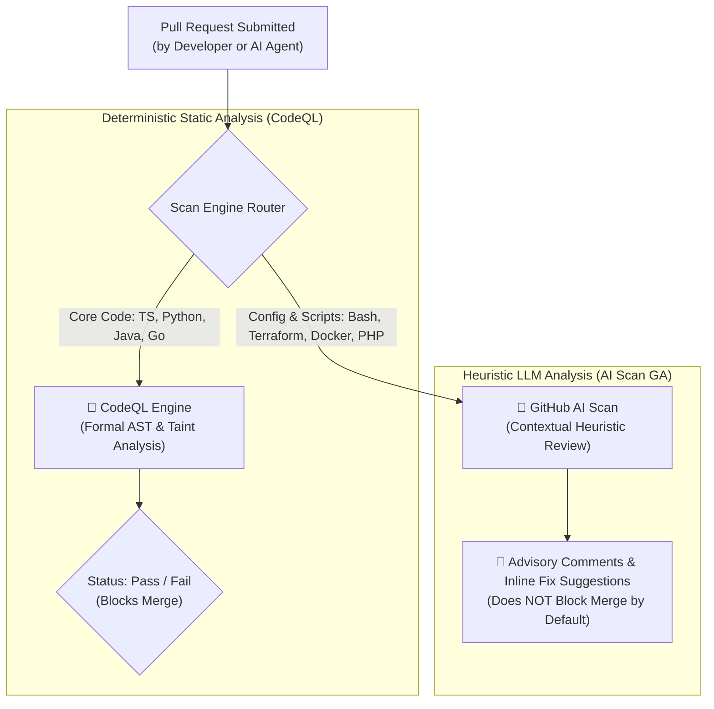

# 🔍 GitHub AI Scan for Pull Requests

> **GitHub AI Scan** is an automated pull request security analysis engine that leverages LLMs to identify potential vulnerabilities, configuration risks, and security flaws across languages and configuration formats not traditionally covered by AST-based static analyzers like CodeQL.

---

## 🏛️ Static Analysis (CodeQL) vs. AI PR Scanning

---

## 🔑 Key Features & Architectural Scope

1. **Extended Language & Format Coverage:**
   * Analyzes Shell/Bash scripts (`.sh`), infrastructure-as-code (`.tf` / Terraform HCL), Dockerfiles, PHP, and JSP.
   * Catches misconfigured container capabilities, unescaped shell variable substitutions, and exposed cloud resource declarations.
2. **Context-Aware Advisory Comments:**
   * Findings include plain-English explanations and inline one-click patch recommendations.
3. **Advisory Non-Blocking Nature:**
   * **Critical Caveat:** AI Scan findings do **not** automatically mark the GitHub status check as failed. They are advisory comments intended for human reviewers.

---

## 🛡️ Multi-Layer Defense Matrix for Autonomous Agent PRs

As coding agents like [[OpenCode]] and [[Claude Code Projects]] submit automated pull requests, relying on advisory AI scan comments alone is insufficient. Organizations should implement a four-layer verification gate:

| Verification Layer | Tooling | Enforcement |
| :--- | :--- | :--- |
| **1. Syntax & Typing** | `eslint`, `tsc --noEmit`, `shellcheck` | Hard block on CI |
| **2. Dynamic Functional Verification**| Playwright end-to-end and unit tests | Hard block on CI |
| **3. Deterministic AST Security** | CodeQL, Trivy container scanning | Hard block on CI |
| **4. Advisory Heuristic Review** | **GitHub AI Scan**, Peer Review | Advisory guidance |
