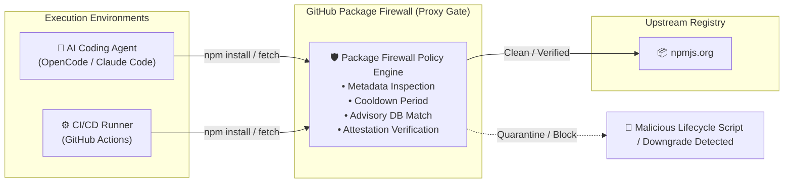

# 🛡️ GitHub Package Firewall: In-Line Supply-Chain Defense

> **GitHub Package Firewall** is an enterprise-grade security gateway that intercepts package installation traffic between endpoints (such as CI runners, developer machines, and autonomous AI coding agents) and upstream package registries (starting with npm) to prevent supply-chain poisoning.

---

## 🏛️ Threat Context: Autonomous Agents & Package Exploits

Autonomous coding agents (e.g. [[OpenCode]], Claude Code, Hermes) routinely execute package manager commands (`npm install`, `pnpm add`, `pip install`) to resolve missing modules and build projects. 

This introduces novel attack surfaces:
* **Pre/Post-Install Lifecycle Exploits:** Malicious npm packages can execute arbitrary bash scripts during the installation phase (`preinstall`, `postinstall`), stealing environment secrets, SSH keys, or cloud credentials *before* any application code is tested.
* **Typosquatting & Hallucinated Packages:** Agents may attempt to install non-existent packages suggested by hallucination, creating opportunities for attackers to register poisoned placeholder libraries.
* **Compromised Maintainers & Attestation Downgrades:** Upstream packages may experience credential hijacking or malicious tag updates.

---

## 🛡️ Core Defense Capabilities

1. **Configurable Cooldown Periods:** Temporarily blocks newly published package versions (e.g. 24–72 hours old) from being installed by automated agents, allowing community analysis and vulnerability disclosures to surface threats.
2. **Advisory Database Correlation:** Live cross-referencing against the GitHub Advisory Database before payloads reach disk.
3. **Attestation Downgrade Detection:** Flags packages whose cryptographic build provenance or signing attestations have been stripped or regressed.
4. **Lifecycle Script Inspection:** Analyzes install-time hooks (`node-gyp`, bash scripts) for suspicious exfiltration patterns.

---

## 💡 Practical Security Hardening for Agent Workflows

Even without GitHub Enterprise Cloud access, open-source AI workflows should implement defensive hardening:
* **Pin Exact Versions:** Avoid open ranges (`^` or `~`) in agent-generated `package.json` updates.
* **Enforce Immutable Lockfiles:** Run `npm ci` rather than `npm install` in automated harnesses.
* **Disable Scripts by Default:** Use `--ignore-scripts` during automated agent dependency resolution (`npm install --ignore-scripts`).
* **Micro-VM Isolation:** Sandbox agent command execution inside [[Fly.io Sprites]] or [[ToolHive]] container boundaries.
