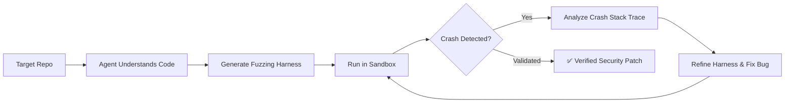

# 🧪 GitHub Taskflow Agent (AI Fuzzing & Feedback Loops)

> **GitHub Security Lab's Taskflow Agent** is an open-source framework that autonomous fuzzing harnesses through continuous, closed-loop execution.

---

## 🔄 The Closed Execution Loop

### Direct Application to Playwright:
Replace raw generation with an **execution-feedback loop**: generate test $
ightarrow$ run in browser $
ightarrow$ inspect Playwright trace on failure $
ightarrow$ auto-heal selectors $
ightarrow$ re-run until passing.
