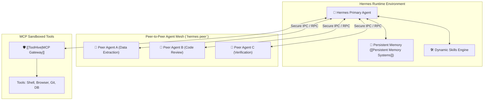

# 🐍 Hermes Agent

> **Hermes Agent** is an open-source autonomous agent framework featuring peer-to-peer agent messaging (`hermes peer`), native skill libraries, secure MCP authorization, and persistent file-backed memory.

---

## 🏛️ Architecture & Peer Coordination

---

## 🔑 Key Features & Subsystems

1. **Peer-to-Peer Messaging (`hermes peer`):** Enables decentralized agent-to-agent task delegation without requiring a monolithic global orchestrator.
2. **Persistent Memory Subsystem:** Stores operational heuristics, user preferences, and project context in local Markdown files, interoperating directly with the [[LLM Wiki]] and [[Persistent Memory Systems|Persistent Memory]] standards.
3. **MCP Tool Integration:** Connects to [[Model Context Protocol (MCP)]] servers with strict privilege separation, secret redaction, and user confirmation prompts.
4. **Autonomous Skills Engine:** Encapsulates domain-specific workflows (e.g. Git workflows, Playwright browser automation) as modular, version-controlled skill directories.
5. **Bot Mode & Daemon Execution:** Can run headlessly in background daemons or as interactive terminal companions.
