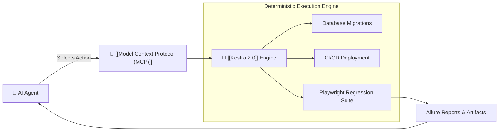

# 🧩 Kestra 2.0 (Deterministic Workflows as MCP)

> **Kestra 2.0** (Apache 2.0) is an open-source orchestration platform that exposes deterministic workflows directly as **Model Context Protocol (MCP) tools**.

---

## 🏛️ Architecture: AI Selection + Deterministic Execution

---

## 💡 Practical Takeaway for Playwright AI Engineer
Never let the LLM ad-hoc script complex test runners or database reset sequences in bash. Expose a pre-validated **Kestra Workflow** via MCP and allow the agent to trigger and monitor it deterministically.
