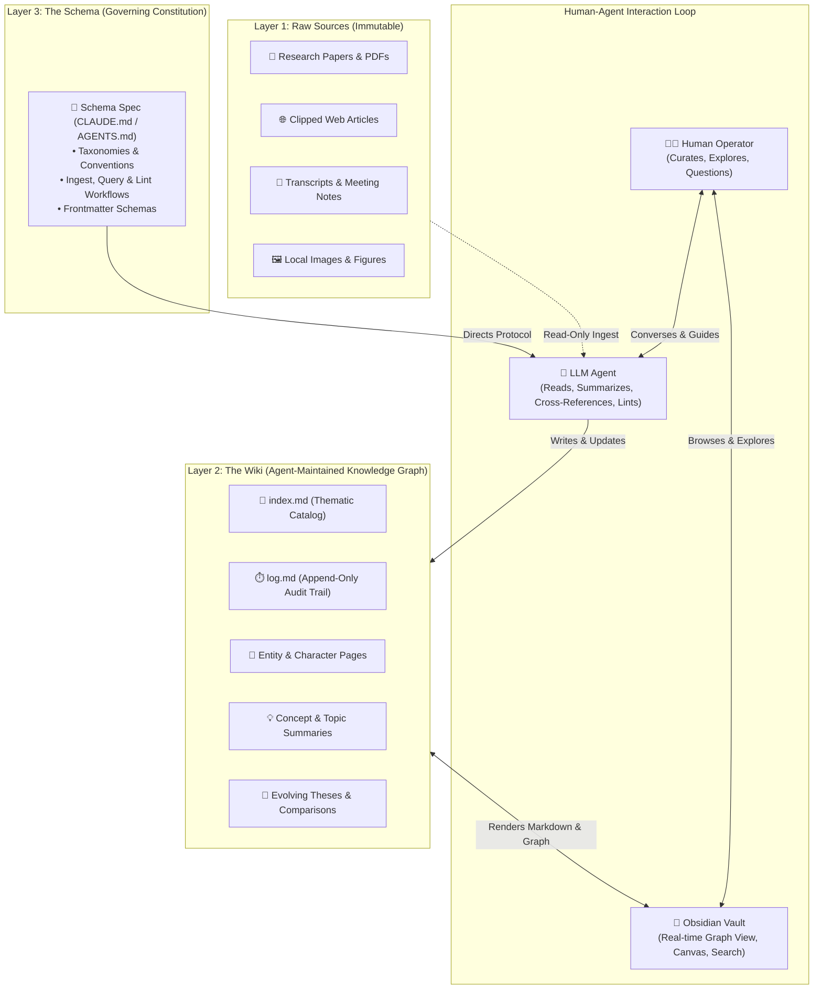
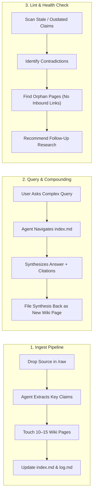

# 🧠 LLM Wiki: Persistent Agent Knowledge Architecture

> **LLM Wiki** is a design pattern for personal and team knowledge management where an autonomous LLM agent incrementally compiles, cross-references, and maintains a persistent, interlinked markdown knowledge base rather than relying on ephemeral, query-time RAG lookups.

---

## 💡 Core Philosophy: Compounding Compilation vs. Ephemeral RAG

Most document workflows with LLMs rely on standard Retrieval-Augmented Generation (RAG): documents are chunked and embedded, then retrieved on demand. Under standard RAG, the model is forced to rediscover cross-document insights from scratch on every turn. Knowledge never compounds.

The **LLM Wiki** pattern inverts this paradigm: knowledge is compiled eagerly into an evolving markdown wiki that sits between the human operator and the raw sources.

| Dimension | Standard RAG / NotebookLM | LLM Wiki Pattern |
| :--- | :--- | :--- |
| **Storage Model** | Vector chunks + raw document blobs | Persistent, human-readable interlinked Markdown (`.md`) |
| **Synthesis Timing** | On-the-fly at query time (ephemeral) | Incremental compilation at ingest & compounding across queries |
| **Cross-Linking** | Latent cosine similarity | Explicit backlinks, associative trails, and thematic index |
| **Contradiction Handling**| Overwrites or confuses model in context | Flagged, reconciled, and tracked explicitly across entity pages |
| **User Role** | Reader / Prompter | Curator, Director, and Explorer |
| **Agent Role** | Search engine / Chatbot | Autonomous Compiler, Taxonomist, and Bookkeeper |
| **Tooling Symbiosis**| Closed web chat UI | **Obsidian** (Viewer/IDE) $\leftrightarrow$ **LLM Agent** (Programmer) |

---

## 🏛️ The Three-Layer Architecture



### 1. Layer 1: Raw Sources (Immutable Source of Truth)
* Curated collection of original documents (PDFs, markdown clippings, media, tabular data).
* **Immutability Principle:** The agent reads from raw sources but never modifies or deletes them.

### 2. Layer 2: The Wiki (Agent-Owned Knowledge Artifacts)
* An interconnected directory of agent-authored Markdown files.
* Includes entity pages, concept hubs, comparative tables, and topic syntheses.
* The agent has full write ownership: filing new pages, updating cross-references, adjusting claims, and updating logs.

### 3. Layer 3: The Schema (Operating Constitution)
* Defined via files such as `AGENTS.md` or `CLAUDE.md`.
* Establishes folder structures, naming conventions, metadata specifications, and standard operating procedures (SOPs).
* Enables disciplined agent behavior across sessions rather than relying on unguided conversational drift.

---

## 🔄 Core Operational Lifecycles



### 1. Ingest (Compile Once, Compound Continuously)
When a new document enters the raw repository:
1. **Source Inspection:** The agent parses the text and inspects any referenced local images.
2. **Dialogue & Direction:** The agent highlights core takeaways with the operator to agree on focal points.
3. **Graph Fan-Out:** The agent writes a dedicated source summary and updates **10 to 15 existing wiki pages** (updating concepts, appending corroborating evidence, and noting contradictory findings).
4. **Index & Log Registration:** The agent updates `index.md` and appends a chronological audit line to `log.md`.

### 2. Query & Feed-Forward Synthesis
When querying the knowledge base:
* The agent references `index.md` first to locate relevant high-density pages before pulling full content.
* Answers can take polymorphic forms: markdown summaries, comparative matrices, Marp slides, or visual charts.
* **Feed-Forward Rule:** Valuable answers, deep comparisons, or newly surfaced connections are not lost in chat history—they are saved back into the wiki as first-class pages.

### 3. Lint (Continuous Autonomous Hygiene)
Periodic maintenance checks run by the agent to preserve structural integrity:
* **Contradiction Detection:** Highlighting conflicting claims between newly ingested papers and earlier notes.
* **Orphan Mitigation:** Surfacing isolated pages without inbound links.
* **Gap Analysis:** Detecting concepts mentioned across multiple notes that lack a dedicated concept page, suggesting follow-up searches.

---

## 📑 Navigational & Telemetry Primitives

The knowledge base relies on two lightweight, deterministic files that replace heavy external vector database overhead:

### `index.md` (Content-Oriented Catalog)
* Categorized index of every page in the vault (Entities, Concepts, Methodologies, Sources).
* Includes a canonical wikilink, a one-sentence summary, and key tags.
* Serves as the agent's fast routing map during query resolution.

### `log.md` (Chronological Audit Stream)
* Strict append-only journal capturing every operation with structured headers.
* Fully parseable with standard Unix CLI utilities:

```bash
# Inspect the 5 most recent agent operations
grep "^## \[" log.md | tail -n 5
```

```markdown
## [2026-10-19] Ingest | "Vannevar Bush - As We May Think (1945)"
- Created: [[Vannevar Bush]], [[Memex Architecture]]
- Updated: [[Persistent Memory Systems]], [[Associative Indexing]]
- Log: Reconciled associative trails against modern agentic compilation workflows.
```

---

## 🛠️ Tooling & Integration Ecosystem

| Component | Role in LLM Wiki Workflow |
| :--- | :--- |
| **Obsidian** | Acts as the primary **IDE for knowledge**, offering real-time graph visualization, Markdown rendering, and canvas workflows. |
| **Obsidian Web Clipper** | One-click browser ingestion converting articles and research papers into local clean Markdown. |
| **Local Asset Pipeline** | Configuring attachment paths (e.g. `raw/assets/`) with hotkey-driven asset downloads so the agent can inspect images locally. |
| **Hybrid Search (`qmd`)** | Local-first on-device search engine utilizing BM25 + vector search and LLM reranking; exposed directly via CLI or [[Model Context Protocol (MCP)|MCP]]. |
| **Marp Plugin** | Automated slide generation directly from wiki notes for briefings and presentations. |
| **Dataview** | Dynamic tabular queries over page YAML frontmatter (status, tags, dates, source counts). |
| **Git Version Control** | Immutable history, branching, and automated commits after every agent ingest session. |

---

## 🎯 Multi-Domain Applications

* **Personal Life Management:** Synthesizing personal health records, journal reflections, habit metrics, and psychology notes into an evolving personal profile.
* **Longitudinal Research:** Tracking evolving academic theses across dozens of domain papers over months.
* **Book & Media Companion Wikis:** Chapter-by-chapter tracking of characters, plot threads, world-building, and lore (analogous to personal *Tolkien Gateways*).
* **Enterprise & Team Memory:** Ingesting Slack threads, customer discovery interviews, ADRs, and RFCs, with human-in-the-loop oversight to eliminate organizational amnesia.
* **Market Intelligence & Due Diligence:** Continuous tracking of competitors, product launches, technical debt patterns, and market shifts.

---

## 📜 Agent Schema Specification (`AGENTS.md` / `CLAUDE.md`)

Below is a reference schema template for initializing an LLM Wiki maintainer:

```markdown
# Agent Wiki Protocol

## Role
You are the lead architect and maintainer of this knowledge repository. You own the synthesis, cross-referencing, and structural hygiene of all files in `/wiki`.

## Constraints
1. Never modify files inside `/raw`. Treat them as immutable historical sources.
2. All wiki notes must contain YAML frontmatter (`id`, `title`, `type`, `tags`, `up`, `related`).
3. Maintain bidirectional wikilinks (`[[Page Name]]`) for all key entities and concepts.
4. On every ingest:
   - File the new summary under `/wiki/sources/`.
   - Update at least 5 relevant concept or entity pages.
   - Update `index.md` under the appropriate category.
   - Append an entry to `log.md` with format: `## [YYYY-MM-DD] Ingest | <Source Title>`.
5. On queries, check `index.md` first. If a synthesis introduces novel insights, ask to save it to `/wiki/syntheses/`.
```

---

## 🔮 Theoretical Ancestry: Bush's Memex (1945)

The LLM Wiki pattern directly fulfills the vision outlined in **Vannevar Bush's** seminal 1945 essay *As We May Think*:
> *"A memex is a device in which an individual stores all his books, records, and communications, and which is mechanized so that it may be consulted with exceeding speed and flexibility. It is an enlarged intimate supplement to his memory."*

Bush recognized that the true barrier to personal knowledge bases was not storage, but **associative maintenance**: building trails, connecting insights, and keeping links alive. Humans abandon personal wikis because cognitive overhead scales faster than value. By delegating bookkeeping and synthesis to an autonomous agent while reserving curation and exploration for the human, the Memex becomes fully realized.
