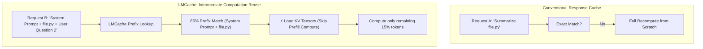
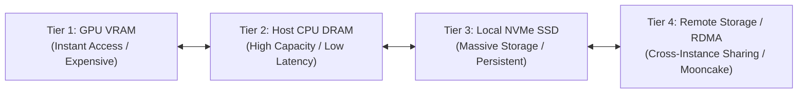

# 💾 LMCache: Cross-Request & Multi-Tier KV-Cache Sharing

> **LMCache** is an open-source, modular caching layer that externalizes, stores, and shares **Key-Value (KV) attention caches** across requests, sessions, memory hierarchies, and serving instances, decoupling intermediate model computation from ephemeral engine lifecycles.

---

## 💡 The Core Intuition: Reusing Computation vs. Caching Answers

In standard web architectures, caching stores final text or HTML responses. If a query differs by a single character, traditional caching misses entirely.

During the prefill phase, a transformer processes all input tokens and computes key and value tensors. In multi-turn agent interactions (e.g. [[OpenCode]] repeatedly querying a codebase with a large system prompt and repository constitution like [[AGENTS.md]]):
* 80–95% of the input tokens are identical across successive agent turns.
* Without cross-session caching, the serving engine recalculates the exact same matrix multiplications on every turn.
* **LMCache preserves these intermediate tensor representations**, allowing engines to skip redundant prefill FLOPs and emit the first token almost instantaneously.

---

## 🏛️ Multi-Tier Hierarchical Storage Topology

LMCache organizes KV caches across four memory tiers with configurable eviction policies:

1. **Tier 1 (GPU VRAM):** Active KV cache pages managed by [[vLLM]] PagedAttention or [[SGLang]] RadixAttention.
2. **Tier 2 (Host CPU DRAM):** Demoted when GPU memory is saturated; offloaded via fast PCIe DMA without dropping state.
3. **Tier 3 (Local NVMe SSD):** Persistent disk cache that survives serving engine restarts.
4. **Tier 4 (Remote Cluster Fabric):** Shared across distributed nodes in a cluster (supporting NVIDIA CUDA, AMD ROCm, and Intel XPU backends).

---

## ⚖️ Performance Impact on AI Coding Agents

| Metric | Monolithic Engine Without LMCache | Engine Instrumented with LMCache |
| :--- | :--- | :--- |
| **System Prompt Prefill** | Recomputed on every single agent turn | Reused directly from memory tier (0 FLOPs) |
| **Time to First Token (TTFT)** | Scales linearly with context length (e.g. 3,500ms for 32k context) | Constant sub-200ms lookup latency |
| **Compute / Energy Cost** | High GPU tensor core utilization | Dramatically reduced prefill power draw |
| **Instance Portability** | KV cache trapped in single worker process | Cache portable across worker restarts and reboots |

---

## ⚠️ Architectural Guardrails & Compatibility

1. **Strict Model Alignment:** KV caches are tied to exact model weights, quantization formats (FP16, BF16, FP8), RoPE positional configurations, and attention layer counts. A cache generated from Gemma 3 12B cannot be loaded into Qwen or Llama.
2. **Tokenizer Determinism:** Any variation in tokenization (whitespace, special tokens, formatting) invalidates subsequent prefix tokens in the cache tree.
3. **Hardware-Specific Nightly Builds:** LMCache distributes hardware-accelerated kernels targeting Intel XPU, AMD ROCm, and NVIDIA CUDA; local Apple Silicon experiments should currently rely on SGLang or Ollama native prefix caching.
