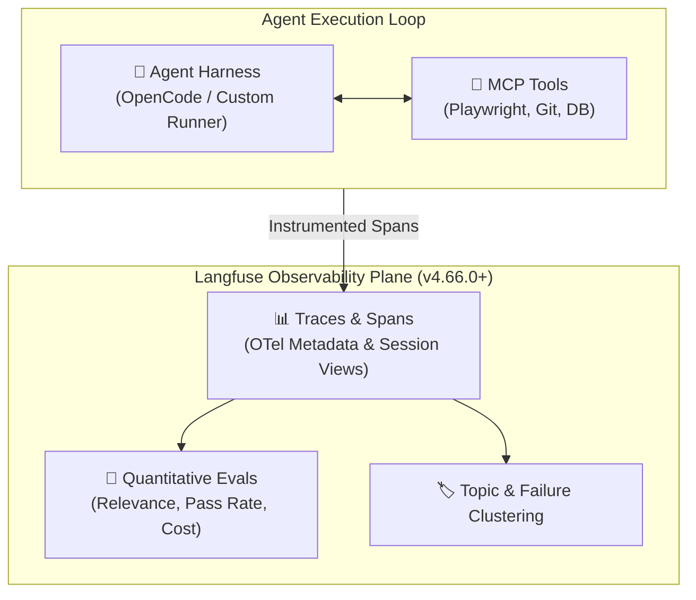

# 🔭 Langfuse: Open-Source AI Observability & Evaluations

> **Langfuse** is an open-source engineering platform providing end-to-end tracing, metrics collection, session replay, and quantitative evaluation pipelines for complex agentic workflows and RAG systems.

---

## 🏛️ Core Architectural Capabilities

As AI systems evolve from single prompt-completion calls to autonomous, multi-turn agentic loops, observability must trace:
1. **Tool Invocation Sequences:** Capturing tool arguments, raw outputs, and error states across [[Model Context Protocol (MCP)|MCP]] servers.
2. **Multi-Model Orchestration:** Tracking handoffs between System-1 decision gates ([[Clef]], [[Jev]]) and System-2 reasoning models (Gemma 3 12B).
3. **OpenTelemetry (OTel) Compatibility:** Native metadata propagation across microservices and agent harnesses.
4. **Session & Thread Visualizers:** Inspecting multi-turn execution graphs, state mutations, and cost/latency breakdowns.



---

## 🚀 Evolution & Release Milestones

### Langfuse v4.70.0 & Agent Observability Ecosystem (October 2026)
* **Official [[OpenCode]] Plugin:** Dedicated agent-level instrumentation tracking user turns, model generations, tool calls, retry loops, thinking/reasoning output, and context compaction.
* **Granular Agent Tracing:** Distinguishes whether total elapsed time stems from model latency, slow MCP tool execution, or repeated agent retry loops.
* **Topic Clustering (v4.66.0):** Automated semantic clustering and tagging of user/agent interaction topics.
* **Enhanced OTel Metadata:** Deeper span contextualization for distributed multi-agent runtimes.

---

## 📊 RAG & Agent Evaluation Metrics (HTML-to-Gherkin / Test Engineering)

For automated test generation (e.g., HTML-to-Gherkin BDD pipelines or Playwright failure triage), Langfuse provides tracking for 4 mission-critical metrics:

| Metric | What It Measures | Target Indicator |
| :--- | :--- | :--- |
| **Retrieval Relevance** | Did vector/hybrid retrieval surface the correct step definitions and selectors? | Precision@K $\ge 0.85$ |
| **Step Validity** | Did generated Gherkin scenarios match pre-existing step definitions rather than hallucinating new ones? | 100% syntactically valid steps |
| **Test Pass Rate** | Did synthesized test scenarios successfully execute without runtime failures? | Executable scenario pass rate $\ge 90\%$ |
| **Token & Latency Cost** | Exact token volume, prompt caching efficiency, and dollar cost per passing scenario. | Telemetry per successful task |

---

## 💻 Python Instrumentation Example

```python
from langfuse import Langfuse
from langfuse.decorators import observe, langfuse_context

langfuse = Langfuse()

@observe(name="playwright_triage_pipeline")
def triage_test_failure(error_log: str, screenshot_path: str):
    # 1. System-1 Decision Gate (Clef via Ollama)
    decision = call_clef_systemone(error_log)
    langfuse_context.update_current_observation(
        metadata={"decision": decision["decision"], "confidence": decision["confidence"]}
    )
    
    if decision["decision"] == "DIAGNOSE":
        # 2. Deep reasoning via local Gemma 3 12B
        diagnosis = call_gemma_local(error_log, screenshot_path)
        return diagnosis
    elif decision["decision"] == "RETRY":
        return {"action": "retry_immediately"}
    else:
        return {"action": "escalate_to_human"}
```

---

## 🛡️ Tracing Durable Execution & Checkpoint Spans

When integrated with **[[Durable Execution for AI Agents]]** (e.g. LangGraph with SQLite checkpoints or Temporal workflows), Langfuse acts as the centralized audit plane:

1. **Step-Boundary Span Mapping:** Each node execution maps to a discrete child span tagged with `workflow_id` and `checkpoint_id`.
2. **Human-in-the-Loop Interrupt Tracking:** When an agent yields execution at `interrupt()`, Langfuse captures the pending state, measuring the exact duration between interrupt and human approval `Command(resume=True)`.
3. **Inference Latency Profiling:** Separates prefill duration (`prompt_eval_duration`) from generation duration (`eval_duration`), surfacing when prefill bottlenecks occur (see [[Prefill-Decode Disaggregation]]).
4. **Idempotency & Retries:** Spans record `operation_id` and retry counters, providing immediate visual verification that interrupted steps did not execute duplicate side effects.

