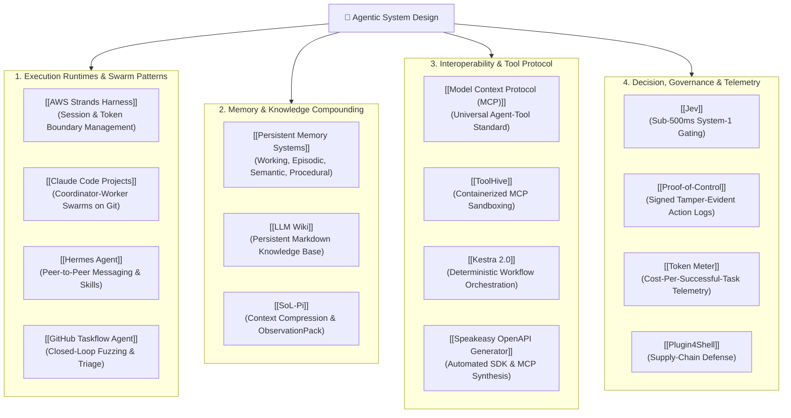

# 🤖 MOC - Agentic System Design

> **Map of Content** covering the foundational architectural patterns, coordination paradigms, tool protocols, and persistent memory fabrics required to build autonomous, reliable multi-agent systems.

---

## 🗺️ Architectural Topology

---

## 📚 Core System Design Pillars

### 1. Execution Runtimes & Multi-Agent Swarms
* [[AWS Strands Harness]]: Industrial runtime managing agent lifecycles, cancellation tokens, and model fallbacks.
* [[Claude Code Projects]]: Isolated worker branches coordinated by a lead agent for concurrent code synthesis.
* [[Hermes Agent]]: Autonomous local-first agent implementing peer-to-peer delegation, bot modes, and skill discovery.
* [[GitHub Taskflow Agent]]: Closed-loop bug triage and autonomous regression testing.

### 2. Memory Fabrics & Persistent Knowledge
* [[LLM Wiki]]: Inverting ephemeral RAG by having agents incrementally compile and maintain interlinked markdown vaults.
* [[Persistent Memory Systems]]: Layered cognitive architectures separating active context from durable episodic and semantic stores.
* [[SoL-Pi]]: High-efficiency observation packing and context window optimization.

### 3. Tool Standardization & Execution Sandboxing
* [[Model Context Protocol (MCP)]]: Open protocol standardizing how models discover, invoke, and inspect tools.
* [[ToolHive]]: Secure micro-VM and container sandbox preventing hostile code execution during tool calls.
* [[Kestra 2.0]]: Coordinating deterministic multi-step pipelines as agent tools.
* [[Speakeasy OpenAPI Generator]]: Transforming RESTful APIs into validated MCP tool servers.

### 4. Decision Intelligence, Security & Telemetry
* [[Jev]]: Fast, typed System-1 decision intelligence preventing unnecessary frontier model invocations.
* [[Proof-of-Control]]: Cryptographic action signing ensuring auditability of agent executions.
* [[Token Meter]]: Local observability tracking cost-per-successful-task and context saturation.
* [[Plugin4Shell]]: Mitigating unpinned dependencies and prompt injection in dynamic tool ecosystems.
