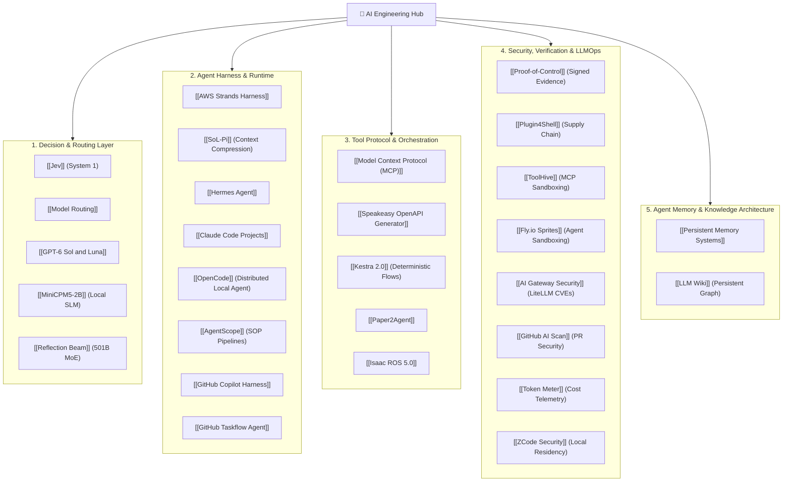

# 🧠 MOC - Artificial Intelligence & Agentic Engineering

> **Central Map of Content** for agent architectures, inference systems, local SLMs, security governance, and automated testing runtimes.

---

## 🗺️ Visual Ecosystem Topology

---

## 📚 Core Knowledge Categories

### 1. Decision & Routing Engines
* [[Jev]]: Fast, typed System-1 decision intelligence (70–500ms) for action gating and failure triage.
* [[Model Routing]]: Dynamic cost/latency allocation across local SLMs and frontier models.
* [[GPT-6 Sol and Luna]]: Economic model tiering ($0.10 Luna vs $2.00 Sol).
* [[MiniCPM5-2B]]: High-performance local small language model for discrete tasks.
* [[Reflection Beam]]: Open-weight 501B/23B MoE model focused on high-efficiency useful work per token.

### 2. Agent Runtimes & Harness Optimization
* [[OpenCode]]: Terminal-native coding agent supporting remote Ollama backends over LAN and MCP servers.
* [[AgentScope]]: Industrial multi-agent framework enforcing Standard Operating Procedures (SOPs) and TeamPipelines.
* [[AWS Strands Harness]]: Enterprise agent SDK managing token limits, cancellation, and sessions.
* [[SoL-Pi]]: Context compression, action fusion, and ObservationPack saving 45–50% token volume.
* [[Hermes Agent]]: Multi-agent peer-to-peer communication and persistent execution.
* [[GitHub Taskflow Agent]]: Closed-loop fuzzing, crash triage, and automated harness refinement.
* [[Claude Code Projects]]: Coordinator-worker patterns with Git branch isolation.

### 3. Tool Protocols & Deterministic Orchestration
* [[Model Context Protocol (MCP)]]: The universal open standard for AI agent-tool interfaces.
* [[Speakeasy OpenAPI Generator]]: Auto-generation of type-safe SDKs, CLIs, and MCP servers from OpenAPI specs.
* [[Kestra 2.0]]: Executing deterministic CI/CD and test workflows exposed as MCP tools.
* [[Paper2Agent]]: Automated tool synthesis and verification against reference test suites.
* [[Isaac ROS 5.0]]: Domain-specific agent skills for complex robotics and automation pipelines.

### 4. Security, Verification & Telemetry
* [[Fly.io Sprites]]: Disposable micro-VM execution sandboxes separating agent credentials from command execution.
* [[AI Gateway Security]]: Threat modeling, SSRF defenses, and CVE-2026-35029/59823 mitigation in AI routing proxies.
* [[GitHub AI Scan]]: Contextual LLM security analysis for pull request scripts, Terraform, and Dockerfiles.
* [[Proof-of-Control]]: Open standard for tamper-evident action interception and signed evidence trails.
* [[Plugin4Shell]]: Critical supply-chain vulnerability in AI agent commit-pinning resolution.
* [[ToolHive]]: Containerized MCP gateway and egress network sandboxing.
* [[Token Meter]]: Open-source local telemetry dashboard tracking cost-per-successful-task.
* [[ZCode Security]]: Codebase privacy, local indexing, and zero-data-retention practices.

### 5. Agent Memory & Knowledge Architecture
* [[LLM Wiki]]: Persistent agent-compiled Markdown knowledge base replacing ephemeral RAG.
* [[Persistent Memory Systems]]: Multi-tier episodic, semantic, and procedural long-term memory architectures.

---

## 📚 Master Guides & Thematic Syntheses
* [[Master Guide - AI & Open-Source Engineering|📚 Master Engineering Guide]]
* [[Synthesis - Agent Runtimes & MCP Sandboxing|Synthesis: Agent Runtimes & MCP Sandboxing]]
* [[Synthesis - Multi-Agent Swarms & Governed Loops|Synthesis: Multi-Agent Swarms & Governed Loops]]
* [[Synthesis - Decision Layers & Execution Verification|Synthesis: Decision Layers & Execution Verification]]
* [[Synthesis - Context Compression & Supply-Chain Security|Synthesis: Context Compression & Supply-Chain Security]]
* [[Synthesis - Closed Feedback Loops & Auto-Generated MCP Tools|Synthesis: Closed Feedback Loops & Auto-Generated MCP Tools]]
