# 🤖 Master Guide: AI & Open-Source Engineering

> **Engineering Scope:** [[AI Engineering]], [[Open-Source AI]], [[Coding Agents]], [[LLMOps]], [[Model Context Protocol (MCP)]], [[Local AI]], [[Inference Infrastructure]], [[Agent Security]], and practical software-engineering applications.

---

## ⚡ Master Architectural Map

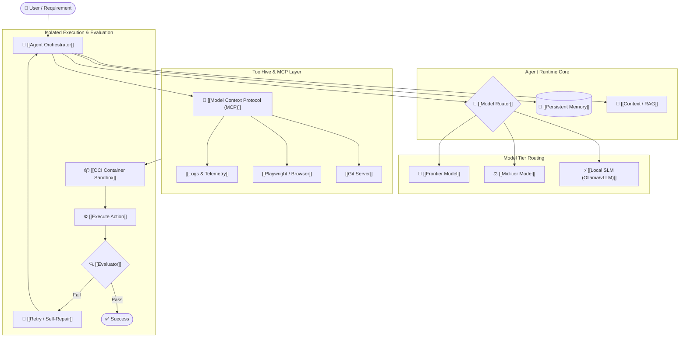

---

## 📚 Core Topic Syntheses

| Synthesis Topic | Knowledge Hub Link | Key Architectural Breakthroughs |
|---|---|---|
| **Agent Runtimes & MCP Sandboxing** | [[Synthesis - Agent Runtimes & MCP Sandboxing]] | Open-source agent harnesses, MCP standard, ToolHive micro-VM sandboxing, RAG to Playwright |
| **Multi-Agent Swarms & Governed Loops** | [[Synthesis - Multi-Agent Swarms & Governed Loops]] | Claude Code coordinator-worker patterns, Atlassian governed loops, Hermes v0.21.3 peer messaging, Paper2Agent |
| **Decision Layers & Execution Verification** | [[Synthesis - Decision Layers & Execution Verification]] | Jev System-1 sub-500ms decision layer, AWS Strands Harness, Isaac ROS 5.0 skills, Token Meter, Proof-of-Control |
| **Context Compression & Supply-Chain Security** | [[Synthesis - Context Compression & Supply-Chain Security]] | GPT-6 Sol/Luna economic routing, SoL-Pi ObservationPack compression, Plugin4Shell CVE mitigation, Kestra 2.0 workflows |
| **Closed Feedback Loops & Auto-Generated MCP Tools** | [[Synthesis - Closed Feedback Loops & Auto-Generated MCP Tools]] | GitHub Taskflow AI fuzzing, MiniCPM5-2B local SLMs, Speakeasy OpenAPI-to-MCP generation, Playwright test agents |

---

# 1. Executive Summary

The strongest theme across the AI briefings is a fundamental paradigm shift:

> **From:** *“Which LLM is best?”*  
> **To:** *“How do I build a reliable engineering system around an LLM?”*

### The Key Engineering Layers:
1. **[[Foundation Models]]** *(Commoditized / Replaceable)*
2. **[[Agentic Harness]]**
3. **[[Context Management & RAG]]**
4. **[[Persistent Memory Systems]]**
5. **[[Model Context Protocol (MCP)|Tools & MCP]]**
6. **[[Model Routing]]**
7. **[[Execution Environment & Sandboxing]]**
8. **[[Agent Security & Guardrails]]**
9. **[[Continuous Evaluation]]**
10. **[[Observability & Tracing]]**
11. **[[Inference Infrastructure]]**

> [!important] Core Takeaway
> The model is increasingly a **replaceable component**. The durable IP lives in the harness, tools, routing, and verification layers.

---

# 2. Major AI Engineering Trends

## 2.1 The Agent Harness is the Real Moat

The agent harness determines what the model sees, what it remembers, what tools it can access, what permissions it has, where it runs code, and how failures are repaired.

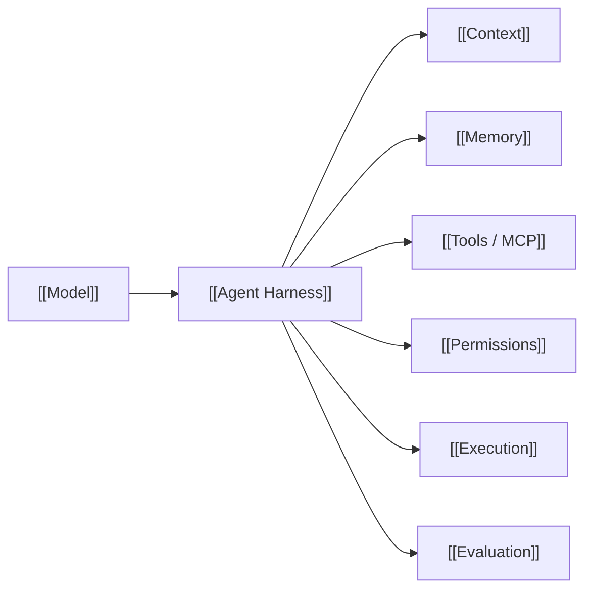

## 2.2 Coding Agents Beyond Autocomplete

The recurring workflow shifts from inline autocomplete to autonomous loop execution:

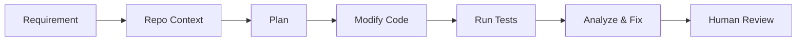

* **The Developer's New Role:** Task decomposer, architect, reviewer, evaluator, and agent orchestrator.
* **Target Metric:** *Task Completion Rate* (percentage of complete engineering tickets solved without human intervention).

## 2.3 Model Routing as a Core Discipline

Route tasks dynamically based on complexity, latency, privacy, and cost:

```mermaid
flowchart TD
    Task[Incoming Task] --> Router{"[[Model Router]]"}
    Router -->|System-1 Triage & Gating (70-400ms)| ClefGate["⚡ [[Clef]] / [[Jev]]\n(Ollama /v1/systemone)"]
    Router -->|Classification / Unit Tests| Local["[[Local SLM (Ollama)]] / Gemma 3 12B"]
    Router -->|Summarization / Tests| Mid["[[Medium Model]]"]
    Router -->|Complex Reasoning & Architecture| Frontier["[[Frontier LLM (Claude/GPT)]]"]
    Router -->|Sensitive / Airgapped| Private["[[Private Local Model]]"]
```

* **Core Optimization Metric:** **Cost per successful task** (factoring token spend, retries, latency, and tool calls).
* **System-1 vs System-2 Splitting:** Use specialized decision models ([[Clef]], [[Jev]]) to triage flakes and route actions in sub-second timeframes, preserving high-parameter reasoning models for true anomalies.
* **Hardware Portability:** Evaluate backends like AWS [[TorchNeuron]] alongside local Apple Silicon Metal (`mps`) to avoid vendor hardware lock-in.

---

# 3. Open-Source Coding Agents

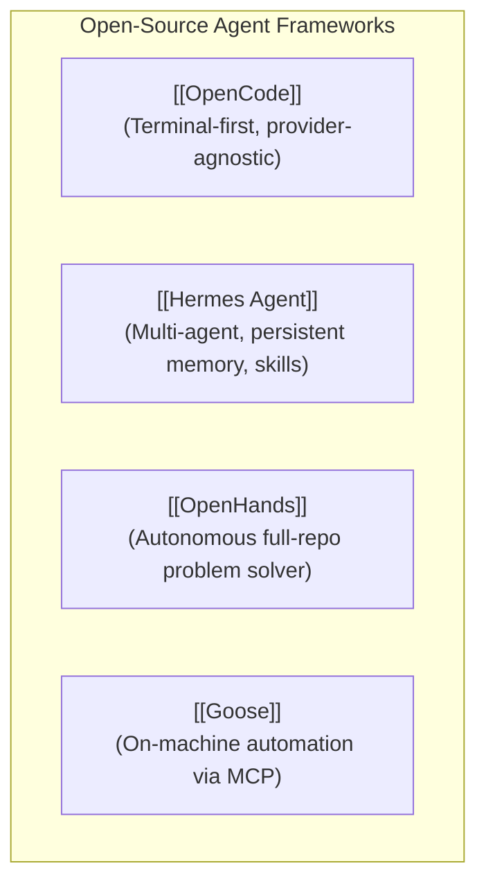

### 3.1 [[OpenCode]]
- Terminal-based development environment for local and remote multi-model workflows.
- Complete provider abstraction (GPT, Claude, Gemini, DeepSeek, Local models via Ollama).
- Native [[Model Context Protocol (MCP)]] and session management.
- **v1.19.3 Improvements:** Granular configuration of model reasoning variants with override preservation; local benchmarking harness across architecture explanation, bug remediation, and test generation.
- **Agent Observability Plugin ([[Langfuse]]):** Native instrumentation capturing user turns, model generations, tool calls, retry loops, reasoning traces, and context compaction.

### 3.2 [[Hermes Agent]]
- Multi-agent swarm reference architecture: `Coordinator -> Research + Coding + Test + Debug -> Evaluator`.
- Primitives: Persistent vector/session memory, dynamically loaded skills, bot-to-bot messaging, and background scheduled agents.

### 3.3 [[OpenHands]]
- Evaluates agents on entire repository lifecycle tasks (cloning, building, reproducing bugs, verifying fixes).

### 3.4 [[Goose]]
- Model-agnostic desktop/terminal automation emphasizing local tool calling and MCP integrations.

### 3.5 [[Paperclip]]
- Open-source control plane for multi-agent teams separating agent execution from orchestration.
- Capabilities: Persistent cryptographic identities, private scoped tasks, and MCP-governed task workflows.

---

# 4. MCP — Model Context Protocol

Instead of point-to-point hardcoded integrations, MCP provides a universal standard:

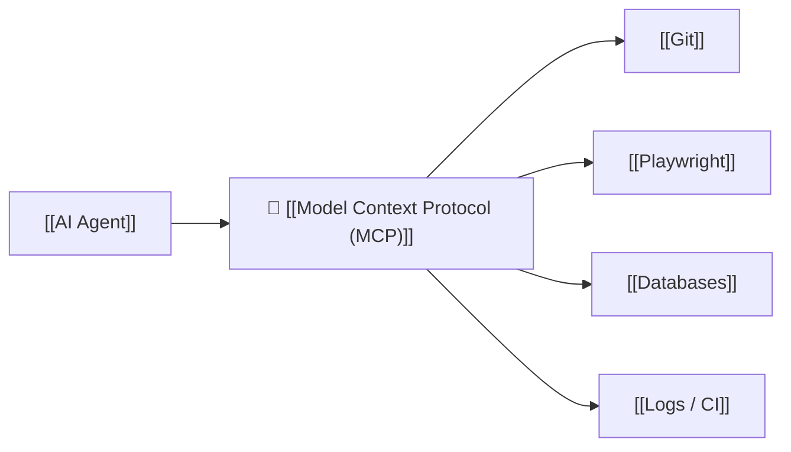

### Recommended Tool Design: Narrow over Monolithic
* ✅ **Small, modular tools:** `navigate`, `inspect_dom`, `capture_screenshot`, `run_test`, `create_branch`.
* ❌ **Monolithic anti-pattern:** `do_everything`.
* *Why:* Small tools are significantly easier to audit, permission, test, and reason about.

---

# 5. MCP and Agent Security

> [!danger] Fundamental Security Principle
> **Never rely on the model itself to enforce security boundaries.** Permissions must be strictly enforced at the infrastructure/sandbox layer.

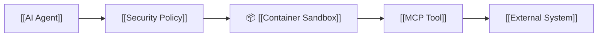

### Agent Red Teaming Checklist
```text
✓ Can it access unauthorized files? (e.g. ~/.ssh, ~/.aws, .env)
✓ Can it access or exfiltrate secrets via outbound webhooks?
✓ Can it invoke administrative/destructive tools without approval?
✓ Can indirect prompt injection in scraped web pages alter its instructions?
✓ Can it escape the container/sandbox boundary?
✓ How does it recover when a tool returns 403 Forbidden?
```

---

# 6. ToolHive (MCP Security Gateway)

[[ToolHive]] (by Stacklok) isolates MCP servers in secure containers:

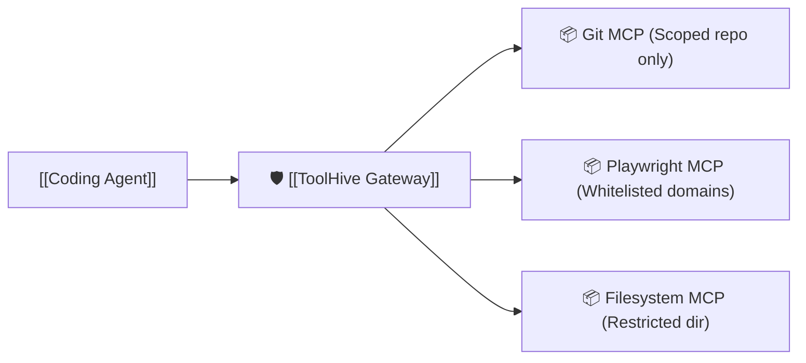

* **Enforces:** Filesystem jail boundaries, network egress filtering, secret masking, and blocking destructive commands (`rm -rf`, `DROP TABLE`).

---

# 7. Local AI & Open Models

> [!tip] Rule of Thumb
> **Use the smallest model that reliably completes the task.**

* **Target Models:** [[DeepSeek]], [[Qwen]], [[Gemma]], [[K2 Horizon]].
* **Best workloads for local SLMs:** Code search, AST parsing, classification, log parsing, test generation, and sensitive data processing.

---

# 8. Ollama

[[Ollama]] simplifies local model runtime serving:
* Teaches core mechanics: context windows, quantization ($4$-bit/$8$-bit), memory limits, and local REST APIs.
* **Routing Formula:**
  - *Routine / Deterministic / Sensitive* $\rightarrow$ [[Ollama]] Local SLM
  - *High-complexity / Architectural* $\rightarrow$ Frontier Cloud Model

---

# 9. NVIDIA PAIR (Distributed Local Inference)

> [!note] Architecture Clarification
> **PAIR distributes independent inference requests across devices** rather than pooling GPU VRAM into a single logical cluster.

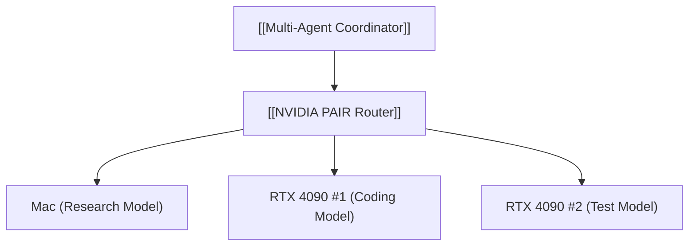

---

# 10. Production Inference: SGLang and vLLM

Understanding AI infrastructure requires mastering the serving layer:

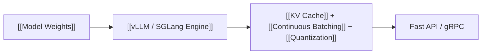

### Key Inference Optimization Techniques:
1. **[[KV Cache]]:** Avoids recomputing attention matrices over unchanged prefix tokens.
2. **[[Continuous Batching]]:** Dynamically schedules incoming token generation to maximize GPU saturation.
3. **[[Speculative Decoding]]:** Employs a tiny draft model to propose tokens validated in parallel by the target model.
4. **[[Quantization]]:** FP8, AWQ, and GPTQ methods reducing memory footprint.

---

# 11. Low-Level Acceleration: GPU & Rust

* **Emerging Frameworks:** `cuda-oxide`, `cutile-rs`.
* **Learning Order:** GPU Memory Management $\rightarrow$ Kernels $\rightarrow$ KV Cache $\rightarrow$ Batching $\rightarrow$ Quantization $\rightarrow$ Parallelism $\rightarrow$ Rust/CUDA.

---

# 12. Paper2Agent (Automated Tool Synthesis)

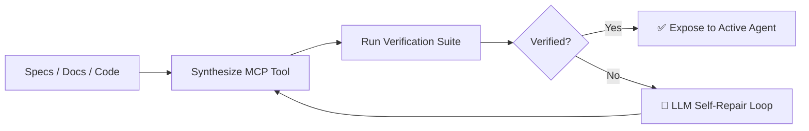

* **BDD/Playwright Application:** Extract Gherkin step definitions into [[FastMCP]] tools, run reference tests against your web app, and register only 100% passing tools.

---

# 13. Model Routing + Agent Orchestration Topology

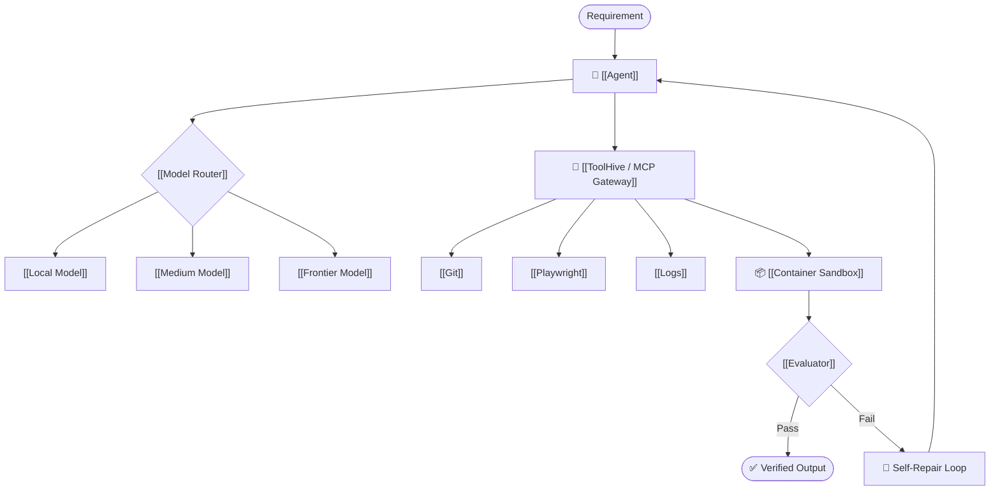

---

# 14. Continuous Loop Software Development

```text
Ticket -> Agent Context -> Code Synthesis -> Automated Tests -> Security Check -> AI Code Review -> Human Sign-off
```

* Shift from **lines of code generated** to **fully verified task completion**.

---

# 15. Agent Security as a Software Engineering Problem

An autonomous agent with `Shell + Git + Browser + Filesystem + Network + Secrets` is a highly privileged process. Security must be managed via infrastructure isolation (OCI containers, firewall egress blocks, short-lived tokens).

---

# 16. LLMOps Metrics Dashboard

| Category | Key Metrics |
|---|---|
| **Model** | Latency (TTFT, ITL), tokens/sec, token volume, inference cost |
| **Agent** | Task completion rate, tool call count, loop retries, total task duration |
| **Retrieval** | Precision@K, context relevance, hallucination/groundedness score |
| **Security** | Blocked tool calls, policy violations, injection detections, secret leaks |
| **Primary KPI** | 🎯 **Cost per successful task** |

---

# 17. Tech Stack Priority Matrix

| Technology | Core Learning Objective | Priority | Link |
|---|---|:---:|---|
| **[[Model Context Protocol (MCP)]]** | Standard agent-to-tool API standard | ⭐⭐⭐⭐⭐ | [[Model Context Protocol (MCP)]] |
| **[[ToolHive]]** | MCP security, sandboxing & permission gateway | ⭐⭐⭐⭐⭐ | [[ToolHive]] |
| **[[Hermes Agent]]** | Memory, skills, and multi-agent coordination | ⭐⭐⭐⭐⭐ | [[Hermes Agent]] |
| **[[OpenCode]]** | Deterministic coding-agent harness | ⭐⭐⭐⭐⭐ | [[OpenCode]] |
| **[[OpenHands]]** | End-to-end repository engineering agents | ⭐⭐⭐⭐ | [[OpenHands]] |
| **[[Goose]]** | Desktop & terminal tool orchestration | ⭐⭐⭐⭐ | [[Goose]] |
| **[[Ollama]]** | Fast local model runtime | ⭐⭐⭐⭐ | [[Ollama]] |
| **[[SGLang]] / [[vLLM]]** | High-performance inference engine | ⭐⭐⭐⭐ | [[vLLM]] |
| **[[Paper2Agent]]** | Automated tool synthesis & test verification | ⭐⭐⭐⭐ | [[Paper2Agent]] |
| **[[SoL-Pi]]** | Harness optimization & context compression (45-50% savings) | ⭐⭐⭐⭐⭐ | [[SoL-Pi]] |
| **[[Jev]]** | System 1 fast decision layer (70–500ms triage) | ⭐⭐⭐⭐⭐ | [[Jev]] |
| **[[AWS Strands Harness]]** | Enterprise lifecycle agent SDK & token budgets | ⭐⭐⭐⭐⭐ | [[AWS Strands Harness]] |
| **[[Kestra 2.0]]** | Deterministic workflow engine as MCP tools | ⭐⭐⭐⭐⭐ | [[Kestra 2.0]] |
| **[[Token Meter]]** | Local-first coding agent cost & token observability | ⭐⭐⭐⭐⭐ | [[Token Meter]] |
| **[[Proof-of-Control]]** | Tamper-evident, signed agent execution verification | ⭐⭐⭐⭐⭐ | [[Proof-of-Control]] |
| **[[GitHub Taskflow Agent]]** | AI fuzzing loops & runtime crash analysis | ⭐⭐⭐⭐⭐ | [[GitHub Taskflow Agent]] |
| **[[MiniCPM5-2B]]** | High-efficiency local SLMs for bounded agent tasks | ⭐⭐⭐⭐⭐ | [[MiniCPM5-2B]] |
| **[[Speakeasy OpenAPI Generator]]** | Auto-generating MCP servers & SDKs from OpenAPI contracts | ⭐⭐⭐⭐⭐ | [[Speakeasy OpenAPI Generator]] |
| **[[NVIDIA PAIR]]** | Distributed multi-device inference | ⭐⭐⭐ | [[NVIDIA PAIR]] |

---

# 18. Six-Phase Learning Roadmap

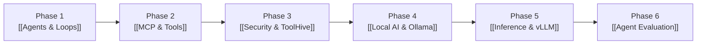

1. **Agents:** Loops, tool schemas, memory, structured outputs (`Python + Google ADK`).
2. **MCP:** Server development, tool discovery, Playwright integration.
3. **Security:** Docker sandboxing, network egress rules, secret vaults (`ToolHive`).
4. **Local AI:** Quantization, local endpoints, latency profiling (`Ollama`).
5. **Inference:** KV caching, continuous batching, speculative decoding (`vLLM/SGLang`).
6. **Evaluation:** Task-based benchmark suites, agent trajectories, regression testing.

---

# 19. Capstone Project: Autonomous AI Test Engineer

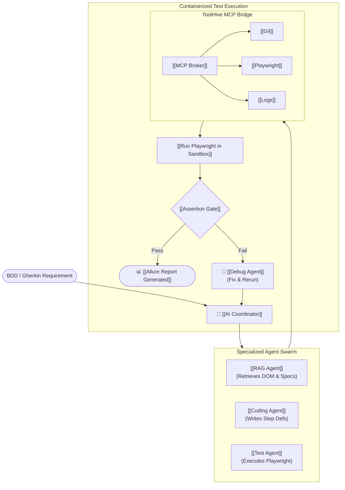

---

# 20. Suggested Project Repository Architecture

```text
ai-test-engineer/
├── agent/                # Coordinator, Coding, Test, Debug, Evaluator agents
├── mcp/                  # Playwright, Git, Logs, and Filesystem MCP servers
├── rag/                  # Ingestion, vector store, and DOM retrieval
├── models/               # Local Ollama config and model router
├── evaluation/           # Benchmark trajectories and security tests
├── sandbox/              # Dockerfiles, seccomp policies, and ToolHive config
├── observability/        # Tracing, latency, and cost telemetry
└── tests/                # Unit, integration, E2E, and agent security test suites
```

---

# 21. The 10 Core Maxims to Remember

1. **The model is a replaceable commodity.**
2. **Agent harnesses are critical engineering infrastructure.**
3. **MCP is the universal standard interface for AI tools.**
4. **Tool access fundamentally changes the security posture.**
5. **Never trust the LLM to enforce its own sandbox.**
6. **Model routing maximizes the cost/quality frontier.**
7. **Local open models are production-ready for bounded tasks.**
8. **Inference infrastructure (KV cache, batching) controls latency and cost.**
9. **Agent evaluation must test complete task trajectories.**
10. **The ultimate goal is deterministic task completion, not text generation.**

---

# 22. Master Stack Ontology Index

### 🔼 Parent (MOCs)
- [[MOC - Artificial Intelligence]]
- [[MOC - Agentic System Design]]
- [[MOC - LLMOps & Infrastructure]]
- [[MOC - DevSecOps & Security]]

### ◀️ Related Technologies
- [[Hermes Agent]] • [[ToolHive]] • [[Model Context Protocol (MCP)]] • [[Paper2Agent]]
- [[OpenCode]] • [[OpenHands]] • [[Goose]] • [[Ollama]] • [[vLLM]] • [[SGLang]] • [[Playwright]]
- [[Clef]] • [[Jev]] • [[Langfuse]] • [[TorchNeuron]] • [[GitHub Package Firewall]]

### 🔽 Applied Blueprints & Projects
- [[Project - AI Test Engineer (Playwright + BDD + MCP)]]
- [[Guide - Hardening MCP Servers with ToolHive]]
- [[Playbook - Agent Security Red Teaming]]
