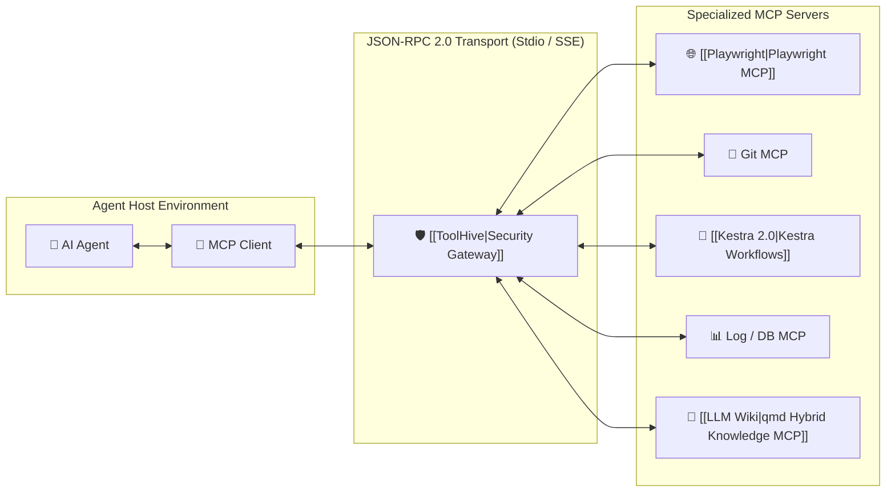

# 🔌 Model Context Protocol (MCP)

> **MCP (Model Context Protocol)** is the open, universal standard created to connect AI agents with external tools, data sources, and execution environments safely and uniformly.

---

## 🏛️ Architecture



---

## 🔑 Key Concepts
1. **Resources:** Read-only data endpoints (file trees, logs, schemas) that provide passive context.
2. **Prompts:** Pre-packaged prompt templates and workflows exposed by the server.
3. **Tools:** Executable functions callable by the model with JSON Schema parameter definitions.

---

## 🛠️ Implementation Example (FastMCP in Python)

```python
from mcp.server.fastmcp import FastMCP
import subprocess

mcp = FastMCP("Playwright-Test-Runner")

@mcp.tool()
def run_playwright_test(spec_path: str, browser: str = "chromium") -> dict:
    """Executes a Playwright test specification and returns structured results."""
    cmd = ["npx", "playwright", "test", spec_path, f"--browser={browser}", "--reporter=json"]
    proc = subprocess.run(cmd, capture_output=True, text=True)
    return {
        "exit_code": proc.returncode,
        "stdout": proc.stdout[:2000],
        "failed": proc.returncode != 0
    }

if __name__ == "__main__":
    mcp.run()
```

---

## 🛡️ Security & Supply Chain Checklist
* Run servers inside isolated containers (e.g. [[ToolHive]]).
* Enforce strict input validation via JSON schema.
* Cryptographically audit server code to prevent [[Plugin4Shell]] supply-chain hijacking.
* Record every tool invocation into [[Proof-of-Control]] verifiable audit trails.
