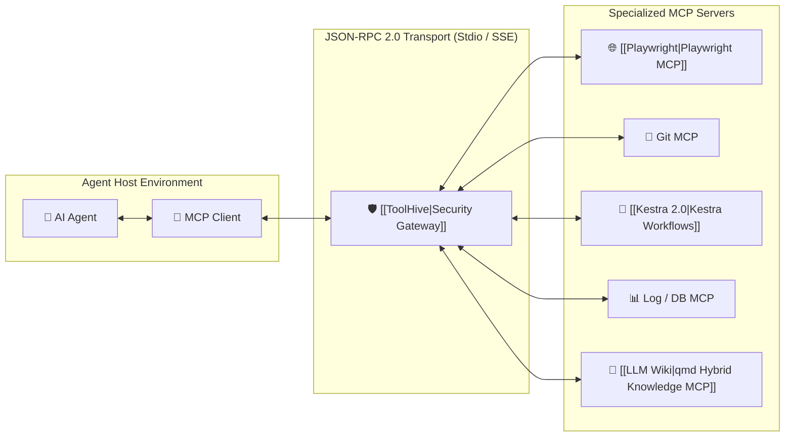

# 🔌 Model Context Protocol (MCP)

> **MCP (Model Context Protocol)** is the open, universal standard created to connect AI agents with external tools, data sources, and execution environments safely and uniformly.

---

## 🏛️ Architecture



---

## 🔑 Key Concepts
1. **Resources:** Read-only data endpoints (file trees, logs, schemas) that provide passive context.
2. **Prompts:** Pre-packaged prompt templates and workflows exposed by the server.
3. **Tools:** Executable functions callable by the model with JSON Schema parameter definitions.

---

## 🛠️ Implementation Example (FastMCP in Python)

```python
from mcp.server.fastmcp import FastMCP
import subprocess

mcp = FastMCP("Playwright-Test-Runner")

@mcp.tool()
def run_playwright_test(spec_path: str, browser: str = "chromium") -> dict:
    """Executes a Playwright test specification and returns structured results."""
    cmd = ["npx", "playwright", "test", spec_path, f"--browser={browser}", "--reporter=json"]
    proc = subprocess.run(cmd, capture_output=True, text=True)
    return {
        "exit_code": proc.returncode,
        "stdout": proc.stdout[:2000],
        "failed": proc.returncode != 0
    }

if __name__ == "__main__":
    mcp.run()
```

---

## 🛡️ Security, Governance & Tool Auditing
* **Empirical Threat Exposure:** BeyondTrust (October 2026) revealed that 85% of active coding-agent users invoke at least one MCP server, averaging 4.35 servers per user.
* **Pre-Execution Scanning:** Audit MCP servers, configurations, and skills with `[[mcp-scan]]` (`uvx mcp-scan@latest --skills`) to detect hidden prompt injections and tool poisoning before connecting.
* **Container Sandboxing:** Run tools inside isolated micro-VM sandboxes via [[ToolHive]] or [[Fly.io Sprites]].
* **Supply-Chain Immutability:** Pin exact git commit hashes to prevent [[Plugin4Shell]] dependency hijacking.
* **Cryptographic Provenance:** Record every tool execution receipt using [[Proof-of-Control]] and enforce agent identities using [[Paperclip]].

