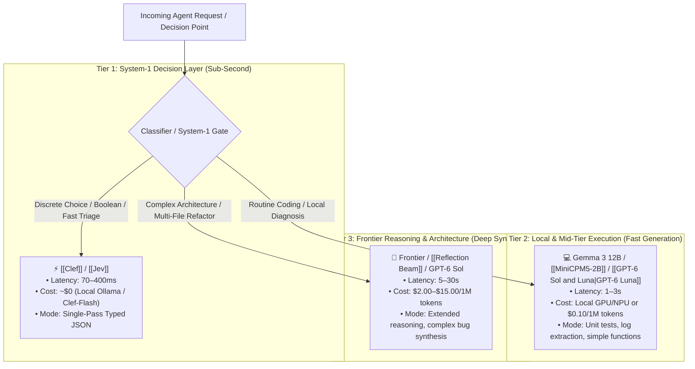

# 🔀 Model Routing & Tiered Inference Architectures

> **Model Routing** is the architectural practice of dynamically dispatching incoming prompts, agent decisions, and tool executions to the most cost-effective and latency-appropriate model tier rather than funneling all queries into a single monolithic frontier model.

---

## 🏛️ The Three-Tier Model Routing Hierarchy

---

## ⚖️ Routing Tradeoff Matrix

| Tier | Candidate Models | Ideal Tasks | Latency | Relative Cost |
| :--- | :--- | :--- | :--- | :--- |
| **System-1 Decision** | [[Clef]] (Ollama), [[Jev]] | Retry vs Escalate, schema validation, sentiment | 70–400 ms | $\sim 0 \times$ |
| **Workhorse Local SLM** | Gemma 3 12B, [[MiniCPM5-2B]] | Playwright test debug, single-file code gen, RAG summaries | 1–3 s | $1 \times$ |
| **Frontier Reasoning** | Claude 3.7 Sonnet, GPT-6 Sol, [[Reflection Beam]] | System architecture, complex distributed debugging | 5–20 s | $20–50 \times$ |

---

## ⚡ Inference Serving Topology: Disaggregation vs. Monolithic Serving

Model routing decisions should not only consider model parameter size, but also the serving engine's **computational topology**:

* **Asymmetric Token Ratios:** A prompt with 30,000 input tokens and a 500-token response places severe demand on prompt evaluation (prefill). Routing this request into a monolithic engine executing active user streams degrades the **Inter-Token Latency (ITL)** of concurrent users.
* **Prefill-Decode Disaggregation:** In clusters managed via [[vLLM]] or SGLang, routing systems dispatch prefill workloads to compute-dense nodes and generation to memory-bandwidth-dense nodes, transferring intermediate KV caches across fast interconnects (Mooncake/NIXL). See [[Prefill-Decode Disaggregation]] for architecture details.

---

## 💡 Practical Implementation in Local Workstations

On a Mac mini M4 paired with Ollama:
1. Use **Clef** (or `clef:flash`) via `/v1/systemone` for immediate task branching.
2. Route passing or solvable failures to local **Gemma 3 12B**.
3. Fall back to cloud models only when confidence is low or retries are exhausted.
4. Record latency, token expenditure, and routing decisions in [[Langfuse]].
