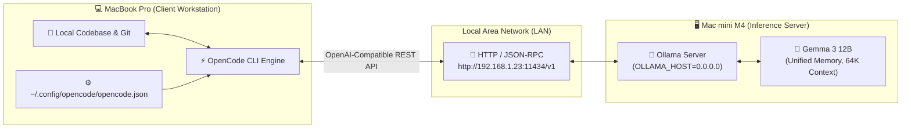

# 💻 OpenCode

> **OpenCode** is an open-source, terminal-native AI coding agent runtime that supports multi-model routing, tool execution, and local-first LLMs through standard OpenAI-compatible endpoints and [[Model Context Protocol (MCP)|MCP servers]].

---

## 🏛️ Distributed Local Architecture: MacBook Pro $\leftrightarrow$ Mac mini M4

When executing local coding agents, running both IDE tools and large language models on the same machine can cause memory and thermal contention. The distributed LAN topology decouples **client-side orchestration** from **heavy tensor inference**:



* **Client (MacBook Pro):** Runs the OpenCode agent, reads local files, executes git commands, runs test suites, and coordinates tools.
* **Server (Mac mini M4):** Dedicated to high-throughput matrix multiplication via Apple Silicon unified memory without competing for workstation RAM.

---

## ⚙️ Configuration Specification (`opencode.json`)

On the client machine (`~/.config/opencode/opencode.json`), register Ollama as an `@ai-sdk/openai-compatible` custom provider:

```json
{
  "$schema": "https://opencode.ai/config.json",
  "provider": {
    "ollama": {
      "npm": "@ai-sdk/openai-compatible",
      "name": "Ollama - Mac Mini",
      "options": {
        "baseURL": "http://192.168.1.23:11434/v1"
      },
      "models": {
        "gemma3:12b": {
          "name": "Gemma 3 12B - Local",
          "limit": {
            "context": 65536,
            "output": 8192
          }
        }
      }
    }
  },
  "model": "ollama/gemma3:12b"
}
```

---

## 🚀 Operational & Verification Workflows

### 1. Verify LAN Connectivity
On the Mac mini, ensure Ollama listens across all network interfaces (`OLLAMA_HOST=0.0.0.0:11434`). From the MacBook, verify the HTTP endpoint:
```bash
curl http://192.168.1.23:11434/v1/models
```
Output must return the JSON model list including `gemma3:12b`.

### 2. Launch OpenCode
```bash
# Interactive mode targeting the Mac mini model
opencode -m ollama/gemma3:12b

# Direct headless execution
opencode run -m ollama/gemma3:12b "Explain this repository architecture"
```

### 3. Verify Model Discovery in REPL
Within the interactive OpenCode terminal:
```text
/models
# Output will display: ollama/gemma3:12b
```

---

## ⚠️ Critical Engineering Considerations

1. **Context Window Ceiling (`num_ctx`):**
   Coding agents require substantial context to ingest file hierarchies, AST summaries, and tool definitions. OpenCode recommends at least **64,000 tokens (64K)**. If tool calling fails or outputs get truncated, ensure Ollama's `Modelfile` defines:
   ```text
   PARAMETER num_ctx 65536
   ```
2. **Automated Onboarding:**
   Ollama now features an auto-configuration command:
   ```bash
   ollama launch opencode
   ```
   *Note: For remote multi-machine configurations, the explicit `opencode.json` method above is preferred over auto-discovery.*
3. **Provider Discovery Edge-Cases:**
   If `/models` fails to list `ollama/gemma3:12b` despite `/v1/models` returning HTTP 200, pass the model explicitly via the CLI flag (`--model ollama/gemma3:12b`) to bypass local caching bugs.

---

## 🛡️ Production Tiered Architecture (Local + MCP + Cloud Fallback)

In production engineering setups, OpenCode should be configured with a resilient multi-tier fallback:

```json
{
  "$schema": "https://opencode.ai/config.json",
  "provider": {
    "ollama": {
      "npm": "@ai-sdk/openai-compatible",
      "options": { "baseURL": "http://192.168.1.23:11434/v1" }
    },
    "anthropic": {
      "options": { "apiKey": "env:ANTHROPIC_API_KEY" }
    }
  },
  "model": "ollama/gemma3:12b",
  "fallbacks": ["anthropic/claude-3-7-sonnet"],
  "mcpServers": {
    "knowledge": {
      "command": "qmd",
      "args": ["mcp"]
    }
  }
}
```
