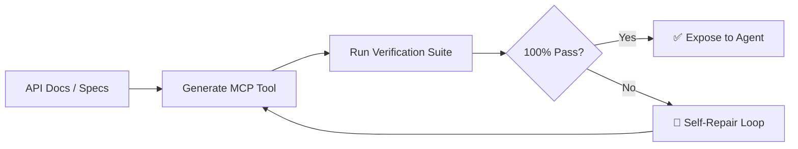

# 🧪 Paper2Agent (Automated Tool Synthesis & Verification)

> **Paper2Agent** (Nature, 2026) is an automated framework that converts technical documentation, papers, and APIs into validated MCP tools using self-repairing test suites.

