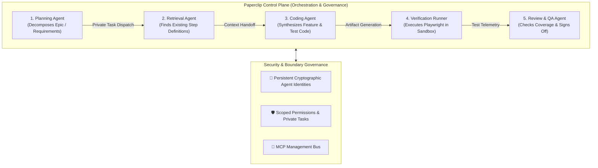

# 📎 Paperclip: Open-Source Control Plane for Multi-Agent Teams

> **Paperclip** is an open-source agent orchestration and control-plane framework designed to manage, govern, and coordinate collaborative swarms of specialized AI agents through **persistent cryptographic identities**, fine-grained task privacy, and **[[Model Context Protocol (MCP)|MCP-driven]]** task lifecycle management.

---

## 💡 The Core Distinction: Agent Execution vs. Agent Orchestration

Most AI developer tools focus strictly on **Agent Execution** (e.g. an individual coding assistant writing a function). As systems scale to complex organizational pipelines, the primary bottleneck shifts to **Agent Orchestration**:

* **Execution Layer (Workers):** Individual tool invocations, shell executions, and model inference passes.
* **Orchestration Layer (Paperclip):** Decides *which* agent executes each step, manages task dependencies, enforces permission boundaries, prevents data leakage between private tasks, and verifies results.

---

## 🚀 Key Features in Paperclip v2026.1023.0

1. **Persistent Cryptographic Identities:** Each autonomous agent in the swarm is provisioned with a cryptographic keypair, enabling non-repudiable audit trails, signed task handoffs, and tamper-evident receipts (complementing [[Proof-of-Control]]).
2. **Private Tasks & Multi-Tenant Isolation:** Enforces strict boundary isolation between tasks, preventing sensitive repository secrets or user context from leaking into unprivileged worker agents.
3. **MCP Integration Bus:** Connected assistants can programmatically query the task queue, update task statuses, trigger subagents, and alter configuration via standard [[Model Context Protocol (MCP)|MCP]] tools.
4. **Provider-Agnostic Model Routing:** Allows binding distinct model endpoints to specific roles (e.g., routing triage tasks to [[SGLang]] Decisions API / [[Clef]], coding tasks to Gemma 3 12B, and architectural planning to Claude 3.7 Sonnet).

---

## 🧪 Application: Multi-Stage AI Test Engineering Pipeline

In [[Project - AI Test Engineer (Playwright + BDD + MCP)]], Paperclip acts as the workflow supervisor separating privileges:

| Swarm Role | Assigned Model | Permitted Capabilities | Restrictions |
| :--- | :--- | :--- | :--- |
| **Test Planner** | Claude 3.7 Sonnet | Read requirements, create task DAG | No shell / execution access |
| **Step Retriever** | Local SLM (Gemma 3 12B) | Read repo step definitions via MCP | Read-only filesystem access |
| **Gherkin Author** | Gemma 3 12B | Write `.feature` test files | No browser / network access |
| **Playwright Runner** | Clef (Triage) | Execute Playwright via [[ToolHive]] | Sandboxed network, signed logs |
| **QA Sign-off** | Human / Review Agent | Verify Langfuse traces, approve PR | Requires cryptographic signature |

---

## 🔗 Cross-Links & Framework Comparisons
* **Checkpointed Recovery:** Connect with [[Durable Execution for AI Agents]] for SQLite/PostgreSQL checkpointing.
* **Peer-to-Peer Messaging:** Compare with [[Hermes Agent]] for decentralized bot-to-bot messaging.
* **SOP Multi-Agent Pipelines:** Compare with [[AgentScope]] for structured corporate pipeline execution.
