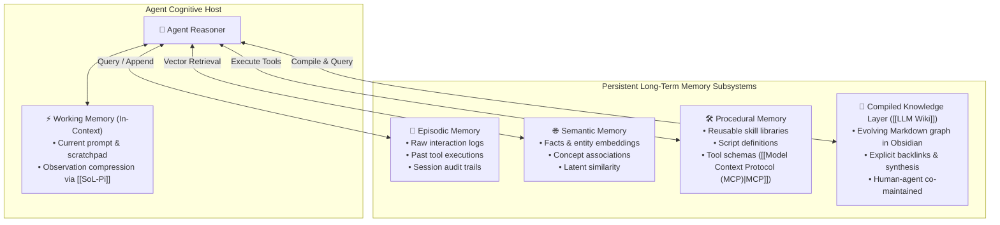

# 🧠 Persistent Memory Systems

> **Persistent Memory Systems** provide autonomous AI agents with cross-session recall, state accumulation, and structured synthesis, decoupling agent cognition from transient context window limits and preventing catastrophic amnesia.

---

## 🏛️ Cognitive Memory Taxonomy for Agents

Human cognitive science partitions memory into working, episodic, semantic, and procedural systems. Modern agentic architecture adapts this taxonomy into four operational tiers plus an eager compiled knowledge layer:

---

## 📊 Comparison of Agent Memory Implementations

| Architecture Tier | Mechanism | Storage Backing | Key Advantage | Major Bottleneck |
| :--- | :--- | :--- | :--- | :--- |
| **Working Memory** | Active context window | Model KV Cache / RAM | Instant zero-latency attention | Hard token ceiling, cost escalation |
| **Episodic Memory** | Session log replay & summaries | Append-only files (`log.md`), SQLite | High-fidelity auditability | Context bloat, noise accumulation |
| **Semantic Vector RAG** | Dense vector embeddings (Cosine) | Qdrant, Chroma, pgvector | Fast retrieval over millions of chunks | Loss of global synthesis; no explicit reasoning trails |
| **Procedural Memory** | Skill files, MCP tool catalogs | Executable scripts, JSON Schemas | Deterministic action repeatability | Requires rigorous interface governance |
| **Compiled Markdown Wiki** | Interlinked Markdown files (`[[LLM Wiki]]`) | Local Git repository / Obsidian vault | **Compounding insight, zero opaque state, human-in-the-loop inspectability** | Write amplification (one ingest touches 10–15 files) |

---

## 🛡️ Execution Checkpoints vs. Cognitive Long-Term Memory

A crucial architectural distinction is between **workflow execution checkpoints** and **cognitive long-term memory**:

* **Execution Checkpoints ([[Durable Execution for AI Agents]]):** Answer *"Where did this workflow stop, and what state is needed to resume it?"* Managed via graph frameworks (e.g. LangGraph with `SqliteSaver`, Temporal). Thread-scoped, deterministic, and cleared/archived once the workflow terminates. Prevents duplicated external actions (e.g., duplicate PR creation) and avoids repeating expensive model inferences after a crash.
* **Cognitive Long-Term Memory:** Answers *"What facts, insights, or preferences should the agent retain across distinct tasks and conversations?"* Managed via vector embeddings, episodic logs, and compiled knowledge graphs (`[[LLM Wiki]]`). Cross-thread, cumulative, and persistent indefinitely.

---

## 🔄 Interaction with the [[LLM Wiki]] Pattern

While traditional agent memory systems treat memory as an opaque vector database or hidden key-value store, the [[LLM Wiki]] pattern operationalizes long-term memory as a **transparent, human-readable filesystem**:

1. **Memory as Code:** Memory artifacts are plain Markdown (`.md`) files tracked under Git version control.
2. **Eager Synthesis vs. Lazy Recall:** Rather than retrieving raw disparate memories at query time, the agent updates entity and concept notes during ingestion.
3. **Associative Link Traversal:** By utilizing explicit Obsidian wikilinks (`[[Page Name]]`), the agent traverses structured relationship graphs without requiring vector search for local clusters.
4. **Symbiotic Verification:** The human inspects the graph in Obsidian while the agent acts as the dedicated memory compiler and archivist.

---

## 🛠️ Framework Implementations

* **[[Hermes Agent]]:** Implements file-backed memory profiles (`memories.md`), peer-to-peer state sharing (`hermes peer`), and persistent skill registries.
* **[[Claude Code Projects]]:** Uses `CLAUDE.md` memory schemas, git branch state persistence, and coordination agents to maintain cross-session engineering memory.
* **[[SoL-Pi]]:** Compresses active working memory using observation packing and action fusion, preserving context capacity before persisting summaries to disk.
* **[[Model Context Protocol (MCP)]]:** Exposes persistent memory servers (e.g. SQLite, local Markdown directories, or Knowledge Graphs) as standard tools and resources.

---

## 📋 Best Practices for Persistent Memory Design

1. **Enforce Immutability on Raw Evidence:** Never allow agents to overwrite raw transcripts, source documents, or user inputs.
2. **Standardize Frontmatter Schemas:** Tag all memory notes with dates, source references, status (`seed`, `growing`, `evergreen`), and bidirectional parent links (`up: "[[...]]"`).
3. **Automate Memory Hygiene (Linting):** Periodically instruct agents to reconcile contradictory claims across notes and surface orphaned memories.
4. **Pair with Context Compression:** Use techniques like [[SoL-Pi]] to prevent working memory saturation during long-running multi-turn memory compilation passes.
