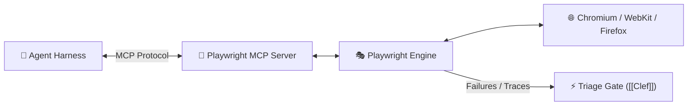

# 🎭 Playwright: Agentic Browser Automation & Test Execution

> **Playwright** is a cross-browser automation framework developed by Microsoft that serves as the primary execution engine for AI browser agents, automated testing pipelines, and synthetic end-to-end user verification.

---

## 🏛️ Playwright in Autonomous Agent Architectures

In modern AI engineering stacks, Playwright is accessed via two primary modalities:
1. **MCP Tool Server:** Exposing browser interactions (click, type, screenshot, evaluate DOM, inspect network) as standardized [[Model Context Protocol (MCP)|MCP]] tools for coding agents (OpenCode, Claude Code).
2. **Automated Test Harness:** Executing synthesized test suites (e.g. Cucumber BDD or Jest/Vitest specs) and emitting traces and failure artifacts for automated triage.

---

## 💡 Triaging Playwright Failures with AI

Common Playwright failure modes and routing strategies:
* **Flaky Network / Timing Timeouts:** Best handled via single-pass System-1 decision gates ([[Clef]], [[Jev]]) to trigger controlled retries without spinning up deep reasoning loops.
* **DOM Mutations / Selector Drifts:** Require System-2 reasoning agents (Gemma 3 12B, Claude 3.7) to analyze DOM diffs and generate updated robust selectors (e.g. migrating from fragile XPath to resilient ARIA roles or `data-testid`).
* **Environment Failures:** Handled via escalation protocols when backend microservices or databases are unreachable.
