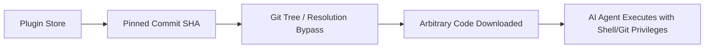

# 🛡️ Plugin4Shell (AI Agent Supply-Chain Security)

> **Plugin4Shell** is a critical supply-chain vulnerability affecting AI coding agent plugin systems (Claude Code, OpenAI Codex, GitHub Copilot, Gemini CLI) where malicious repositories manipulate Git commit resolution to execute unreviewed code despite SHA pinning.

---

## ⚠️ The Threat Vector

---

## 🛡️ Agent Supply-Chain Hardening Checklist
1. **Never rely solely on commit SHAs;** verify local directory trees and file hashes.
2. **Containerize all MCP servers** with restricted network egress (e.g. via [[ToolHive]]).
3. **Enforce path-aware permission policies** before executing local CLI tools.
4. **Log signed action trails** using [[Proof-of-Control]].
