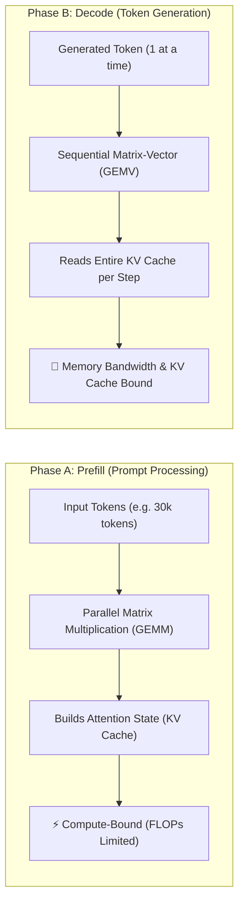
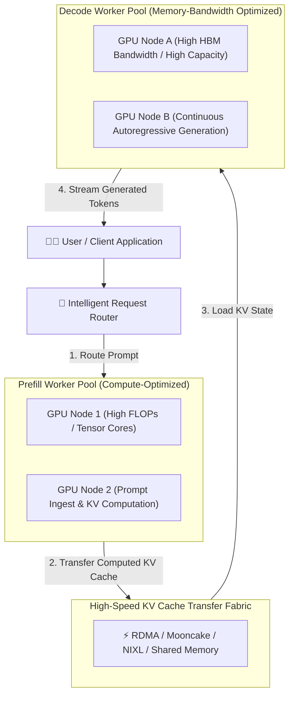

# ⚡ Prefill–Decode Disaggregation (Disaggregated Inference)

> **Prefill–Decode Disaggregation** is an inference serving architecture that separates compute-intensive prompt evaluation (**prefill**) from memory-bandwidth-constrained token generation (**decode**) into independently scaled, specialized worker pools linked by high-speed KV cache transfer fabrics.

---

## 💡 The Core Intuition: Asymmetric Computational Profiles

When serving an autoregressive Large Language Model (LLM), request execution splits into two computationally distinct phases:



* **Phase A: Prefill (Prompt Processing):** The model ingests all input tokens simultaneously, calculating representations and constructing the key-value (KV) attention state. This phase is compute-heavy (FLOPs-bound) and exhibits high arithmetic intensity.
* **Phase B: Decode (Autoregressive Token Generation):** The model emits one token per step, fetching the entire accumulated KV cache from HBM/VRAM to generate each subsequent token. This phase is strictly memory-bandwidth and cache-capacity bound.

In conventional monolithic inference engines (e.g. vanilla vLLM or standard Ollama), both phases execute on the same GPU. When a long prompt arrives, its compute-heavy prefill cycle interrupts or delays the ongoing memory-bound decoding of active requests, causing severe latency spikes.

---

## 🏛️ Disaggregated Architecture Topology



By disaggregating prefill and decode:
1. **Prefill Workers:** Sized and provisioned for maximum FP16/BF16/FP8 matrix-multiplication throughput.
2. **Decode Workers:** Allocated based on high HBM memory bandwidth and large VRAM pools to maximize concurrent generation streams.
3. **KV Cache Transfer Fabric:** State is streamed between pools via RDMA-accelerated transfer protocols such as **Mooncake** or **NIXL**.

---

## 📊 Performance Metrics & Interference Dynamics

| Metric | Full Name | Operational Definition | Primary Bottleneck / Influences |
| :--- | :--- | :--- | :--- |
| **TTFT** | Time to First Token | Duration from request dispatch until the first token arrives at the client | Prompt size, prefill queuing, scheduler priority, prefill compute capacity |
| **ITL** | Inter-Token Latency | Duration between successive emitted tokens during generation | Memory bandwidth (HBM/VRAM), KV cache read speed, decode batch size |
| **Throughput** | Output Tokens / Second | Aggregate tokens processed and emitted across the entire cluster | Hardware concurrency, batching strategy, network transfer overhead |

### The Interference Problem
In a shared, monolithic engine, when **Request A** (e.g., a 30,000-token PDF summary) arrives while **Request B** is halfway through generating a 2,000-token answer:
* Under naive scheduling, Request A's massive prefill stalls Request B's token stream, resulting in a spike in ITL (user perceives a freeze).
* Under chunked prefill, prefill computation is sliced across decode steps, which preserves ITL but degrades TTFT for Request A.
* **Disaggregation solves this conflict:** Request A executes on dedicated prefill nodes without interfering with Request B's ongoing generation on decode nodes.

### Workload Asymmetry Matching
* **Document Analysis / RAG (Request A):** 30,000 input tokens $\rightarrow$ 500 output tokens. Needs heavy prefill capacity; light decode capacity.
* **Code Synthesis / Creative Writing (Request B):** 500 input tokens $\rightarrow$ 5,000 output tokens. Needs minimal prefill capacity; massive decode capacity.
* Separate worker pools allow operators to scale prefill and decode hardware independently to match dynamic traffic profiles.

---

## 🛠️ Production Implementations

### 1. [[vLLM]] (Disaggregated Prefilling)
* Supported in **vLLM v0.7.2+**.
* Decouples prompt evaluation instances from token generation instances.
* **Key Architectural Insight:** Disaggregation is engineered primarily to manage **latency characteristics (TTFT and ITL)**. It does not automatically guarantee higher total throughput due to the KV-cache serialization and transport tax across nodes.

### 2. SGLang
* Implements prefill–decode disaggregation with specialized KV-cache transfer subsystems:
  * **Mooncake:** Distributed KV-cache storage engine and transport architecture.
  * **NIXL:** High-throughput network interface for inter-worker state transfer.
* Features fine-grained worker coordination, dynamic request routing, and automatic failover handling if a decode node stalls.

---

## 🧪 Local Experimentation: Profiling on Mac mini M4

While Apple Silicon uses Unified Memory Architecture (UMA) rather than discrete multi-GPU clusters, you can directly measure the fundamental asymmetry between prompt evaluation (prefill) and token generation (decode) using **Ollama** and **Gemma 3 12B**.

### Profiling Harness (`inference_profile.py`)

```python
import statistics
import time
import requests

OLLAMA_URL = "http://localhost:11434/api/generate"
MODEL = "gemma3:12b"

TESTS = [
    {
        "name": "Short input, short output",
        "prompt": "Explain HTTP caching in 3 sentences.",
        "num_predict": 100,
    },
    {
        "name": "Long input (Prefill-Heavy)",
        "prompt": (
            "Analyze this technical text:\n"
            + ("HTTP caching reduces repeated network requests. Cache-Control defines caching behavior. " * 300)
            + "\nSummarize the main ideas."
        ),
        "num_predict": 100,
    },
    {
        "name": "Longer output (Decode-Heavy)",
        "prompt": "Explain HTTP caching with practical examples and code snippets.",
        "num_predict": 400,
    },
]

def run_test(test):
    started = time.perf_counter()
    response = requests.post(
        OLLAMA_URL,
        json={
            "model": MODEL,
            "prompt": test["prompt"],
            "stream": False,
            "options": {
                "temperature": 0,
                "num_predict": test["num_predict"],
            },
        },
        timeout=600,
    )
    response.raise_for_status()
    elapsed = time.perf_counter() - started
    result = response.json()
    
    prompt_tokens = result.get("prompt_eval_count", 0)
    output_tokens = result.get("eval_count", 0)
    prefill_seconds = result.get("prompt_eval_duration", 0) / 1e9
    decode_seconds = result.get("eval_duration", 0) / 1e9
    
    return {
        "test": test["name"],
        "wall_seconds": round(elapsed, 3),
        "prompt_tokens": prompt_tokens,
        "output_tokens": output_tokens,
        "prefill_seconds": round(prefill_seconds, 3),
        "decode_seconds": round(decode_seconds, 3),
        "prefill_tokens_per_sec": round(prompt_tokens / prefill_seconds, 2) if prefill_seconds else None,
        "output_tokens_per_sec": round(output_tokens / decode_seconds, 2) if decode_seconds else None,
    }

if __name__ == "__main__":
    for test in TESTS:
        print(run_test(test))
```

### Key Telemetry to Inspect
* `prompt_eval_duration`: Time spent reading and compiling the KV cache.
* `eval_duration`: Time spent generating tokens sequentially.
* `output_tokens_per_second`: Memory bandwidth ceiling during generation.

---

## ⚠️ Common Pitfalls & Architectural Trade-offs

1. **Assuming Disaggregation Automatically Maximizes Aggregate Throughput:**
   The KV cache for a 32k-context model can be gigabytes in size. Transferring this across PCIe or network switches introduces serialization, bandwidth, and synchronization latency. If the network fabric is slow, KV-cache transport overhead negates the gains.
2. **Optimizing TTFT While Blind to ITL:**
   A system tuned aggressively for prompt throughput may starve decode workers, leading to low initial latency but sluggish, stuttering text streams. Both metrics must be monitored simultaneously.
3. **Ignoring Workload Distribution:**
   Workloads consisting of short prompts and short responses (e.g. simple chatbot turns) gain virtually nothing from disaggregation and suffer from transfer latency. Disaggregation excels under high asymmetry and heavy concurrency.
4. **Treating KV Cache as Generic Application Data:**
   The KV cache contains complex, model-specific intermediate tensor layouts (page tables, quantization formats, attention heads). Transferring it requires exact memory-layout alignment between prefill and decode worker engines.
