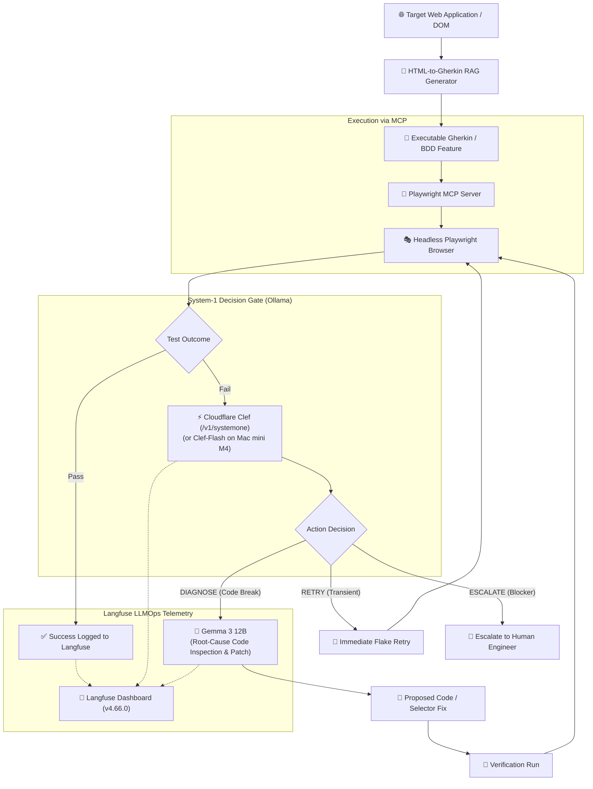
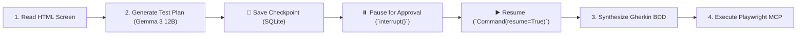

# 🧪 Project: AI Test Engineer (Playwright + BDD + MCP)

> **AI Test Engineer** is an autonomous quality engineering runtime that synthesizes Gherkin BDD scenarios from web DOMs, executes tests via Playwright over [[Model Context Protocol (MCP)|MCP]], triages failures using System-1 decision models ([[Clef]] on Ollama), conducts root-cause debugging with local SLMs (Gemma 3 12B), and tracks evaluation metrics in [[Langfuse]].

---

## 🏛️ End-to-End System Architecture



---

## ⚡ The Decision-Model-Powered Triage Pipeline

Rather than routing every test failure to an expensive, slow reasoning model, the pipeline employs a two-tier model routing architecture:

### 1. Step 1: System-1 Triage via Cloudflare Clef or SGLang Decisions API
When a Playwright test fails, the runner avoids calling a full generative model. Instead, it queries a dedicated decision endpoint:
* **Option A: Cloudflare [[Clef]] via Ollama (`/v1/systemone`):** Single-pass classification evaluated on the Mac mini M4.
* **Option B: [[SGLang]] Decisions API (`/v1/decisions`):** Native logit-scoring endpoint (v0.5.22+) evaluating discrete action candidates (`RETRY`, `DIAGNOSE`, `ESCALATE`) in sub-100ms with Rust-based prefix caching.

```json
{
  "model": "clef",
  "state": {
    "test_name": "User Checkout Flow",
    "error": "TimeoutError: locator.click: Timeout 5000ms exceeded waiting for locator('#checkout-button')",
    "network_errors": [],
    "dom_visible": true,
    "attempt_count": 1
  },
  "question": "Select the optimal action.",
  "options": ["RETRY", "DIAGNOSE", "ESCALATE"]
}
```

### 2. Step 2: System-2 Deep Investigation via Gemma 3 12B
If Clef classifies the failure as `DIAGNOSE`:
* The full Playwright trace, console logs, and step definitions are dispatched to **Gemma 3 12B** running on the local Mac mini M4 server.
* The model inspects recent code changes, detects DOM selector migrations (e.g. `#checkout-btn` renamed to `[data-testid="checkout-btn"]`), and suggests an updated step definition or code fix.

---

## 📊 RAG Quality & Test Generation Telemetry in Langfuse

For the **HTML-to-Gherkin RAG generator**, every generation run streams four core evaluation metrics to **[[Langfuse]]**:

| Evaluation Metric | Telemetry Description | Health Target |
| :--- | :--- | :--- |
| **Retrieval Relevance** | Did the retrieval step identify the correct pre-existing step definitions from the step repository? | $\ge 90\%$ Precision |
| **Step Validity** | Did the generated Gherkin scenario strictly adhere to existing cucumber steps without inventing invalid grammar? | $100\%$ valid steps |
| **Test Pass Rate** | Did the generated scenarios successfully execute and pass against the actual web application? | $\ge 85\%$ first-pass pass rate |
| **Token & Latency Cost** | Token expenditure (prompt + completion) and elapsed time per successfully verified test case. | Sub-5s latency, minimal tokens |

---

## 🛡️ Crash-Resilient Test Planning: Durable Workflow Architecture

To prevent losing progress during multi-stage test generation, the HTML-to-Gherkin pipeline integrates **[[Durable Execution for AI Agents]]** powered by **LangGraph** with a persistent SQLite checkpointer:



1. **Step-Boundary Checkpointing:** The agent ingests the HTML DOM, synthesizes a structured test plan, saves the draft to `agent_checkpoints.sqlite`, and pauses via `interrupt()` awaiting QA engineer approval.
2. **Crash Recovery:** If the test server crashes while waiting for human sign-off, reloading the workflow with `thread_id: "testplan-<screen-id>"` instantly restores the plan without re-prompting Gemma 3 12B.
3. **Side-Effect Idempotency:** The runner assigns an `operation_id: "exec-test-<test_run_id>"` before initiating Playwright browser runs, preventing duplicate executions if an API connection flickers.
4. **Langfuse Trace Telemetry:** Every step's status, model latency breakdown (prefill vs decode durations), and human interrupt wait time are recorded as parent/child spans in [[Langfuse]].
5. **Multi-Agent Governance & Tool Auditing:** The test pipeline roles (Planner $\rightarrow$ Retriever $\rightarrow$ Author $\rightarrow$ Verifier) are coordinated via [[Paperclip]] using cryptographic agent identities, while all tool configurations are scanned via `[[mcp-scan]]` (`uvx mcp-scan@latest --skills`) to prevent prompt injection and tool poisoning.

---

## 🎯 Practical Action Plan & Experiment Roadmap

1. **Seed Dataset:** Collect 20–30 historical Playwright test failure artifacts (traces, videos, error logs) from real test runs.
2. **Ground Truth Labeling:** Manually annotate each failure with its expected action (`RETRY`, `DIAGNOSE`, `ESCALATE`).
3. **Benchmark Clef vs Gemma:**
   * Evaluate classification accuracy and false-retry rates using `clef` vs `clef:flash`.
   * Measure latency reduction compared to prompting Gemma 3 12B directly for triage.
4. **Automated Closed Loop:** Connect Playwright MCP execution with automatic retry/diagnosis dispatch, verifying that fixes result in passing tests recorded in Langfuse.
