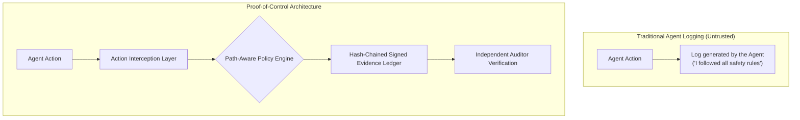

# 🔐 Proof-of-Control (Verifiable Agent Execution)

> **Proof-of-Control** is an open verification standard stewarded by the **Linux Foundation Decentralized Trust** and Advanced AI Society providing tamper-evident, cryptographically signed evidence that an autonomous agent complied with authorized policies.

---

## 🛡️ Self-Reported Logs vs. Cryptographic Evidence



---

## 📋 Verifiable Evidence Schema
Every executed action logs a tamper-evident record:
```json
{
  "task_id": "pw-run-8492",
  "agent_id": "test-engineer-alpha",
  "model": "gpt-6-sol",
  "tool": "playwright.click",
  "args_hash": "a4f8...b12",
  "policy_verdict": "ALLOWED",
  "execution_result_hash": "c92e...77a",
  "timestamp": "2026-09-29T01:23:40Z",
  "signature": "MEQCIF6x..."
}
```
