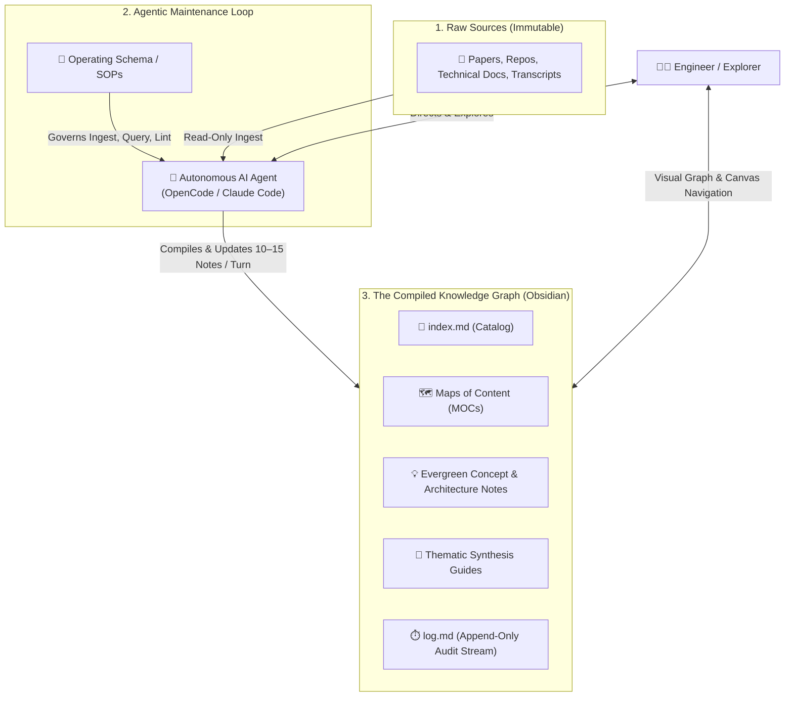
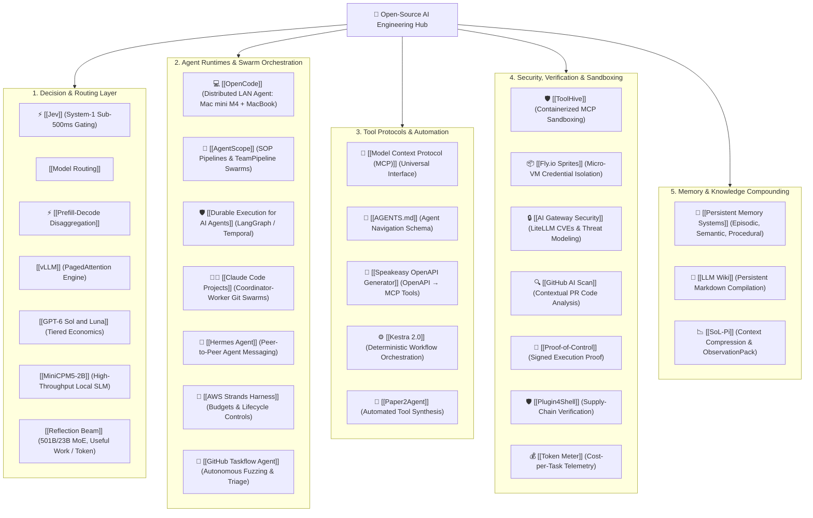

# 🧠 Open-Source AI & Agentic Engineering Knowledge Base

> A persistent, compounding, and interlinked **[[LLM Wiki]]** architecture covering autonomous AI agents, open-source models, local inference topologies, tool protocols (MCP), and sandboxed execution environments.

[](https://obsidian.md)
[-blue?style=flat-square)](Model%20Context%20Protocol%20(MCP).md)
[](LICENSE)

---

## 💡 The Core Philosophy: The LLM Wiki Pattern

Traditional document workflows with LLMs rely on ephemeral Retrieval-Augmented Generation (RAG): documents are chunked and retrieved on-the-fly, forcing the model to rediscover insights from scratch on every turn. 

This repository implements the **[LLM Wiki Pattern](LLM%20Wiki.md)**:
* **Compiled Once, Compounding Continuously:** As new sources arrive, an autonomous LLM compiles key insights directly into an interconnected Markdown knowledge graph.
* **Persistent associative trails:** Backlinks, contradictions, and evolving syntheses are tracked as durable Markdown files.
* **Symbiotic Collaboration:** **Obsidian** serves as the human IDE and real-time graph viewer; the **LLM Agent** serves as the compiler, bookkeeper, and taxonomist.



---

## 🗺️ Architectural Ecosystem Topology



---

## 📚 Key Vault Modules & Guides

### 🗺️ Maps of Content (MOCs) & Catalogs
* **[`AGENTS.md`](AGENTS.md):** Autonomous agent operating protocol, fast lookup workflow, and LLM Wiki constitution.
* **[`index.md`](index.md):** The master catalog categorizing every node for deterministic routing.
* **[`MOC - Artificial Intelligence.md`](MOC%20-%20Artificial%20Intelligence.md):** Central map of content for AI engineering, models, tools, and telemetry.
* **[`MOC - Agentic System Design.md`](MOC%20-%20Agentic%20System%20Design.md):** Architecture patterns for multi-agent coordination, harnesses, and memory fabrics.
* **[`log.md`](log.md):** Append-only audit stream tracking all knowledge ingests, linting passes, and refactors.

### 📖 Master Engineering Guides & Thematic Syntheses
* **[`Master Guide - AI & Open-Source Engineering.md`](Master%20Guide%20-%20AI%20&%20Open-Source%20Engineering.md):** Comprehensive compendium covering the 22 core engineering layers of agentic systems.
* **[`Synthesis - Agent Runtimes & MCP Sandboxing.md`](Synthesis%20-%20Agent%20Runtimes%20&%20MCP%20Sandboxing.md):** Open-source harnesses, MCP servers, and containerized tool gating.
* **[`Synthesis - Multi-Agent Swarms & Governed Loops.md`](Synthesis%20-%20Multi-Agent%20Swarms%20&%20Governed%20Loops.md):** Coordinator-worker swarms, `hermes peer`, and governed CI/CD loops.
* **[`Synthesis - Decision Layers & Execution Verification.md`](Synthesis%20-%20Decision%20Layers%20&%20Execution%20Verification.md):** Sub-second System-1 decision intelligence and signed execution evidence.
* **[`Synthesis - Context Compression & Supply-Chain Security.md`](Synthesis%20-%20Context%20Compression%20&%20Supply-Chain%20Security.md):** Token compression via SoL-Pi and agent supply-chain defense.
* **[`Synthesis - Closed Feedback Loops & Auto-Generated MCP Tools.md`](Synthesis%20-%20Closed%20Feedback%20Loops%20&%20Auto-Generated%20MCP%20Tools.md):** Closed-loop AI fuzzing and automated OpenAPI-to-MCP synthesis.

### 🛠️ Runtime & Implementation Notes
* **[`Durable Execution for AI Agents.md`](Durable%20Execution%20for%20AI%20Agents.md):** Checkpointed crash recovery, LangGraph SQLite persistence, human approval interrupts, and idempotency.
* **[`Prefill-Decode Disaggregation.md`](Prefill-Decode%20Disaggregation.md):** Serving architecture decoupling compute-heavy prefill from memory-bandwidth decode (vLLM, SGLang, Mooncake).
* **[`vLLM.md`](vLLM.md):** High-throughput LLM serving engine with PagedAttention and disaggregated prefilling.
* **[`OpenCode.md`](OpenCode.md):** Distributed client-server configuration pointing a MacBook Pro agent to a remote Mac mini M4 Ollama endpoint.
* **[`AgentScope.md`](AgentScope.md):** Alibaba's multi-agent framework implementing industrial SOPs and autonomous Playwright test triage.
* **[`Persistent Memory Systems.md`](Persistent%20Memory Systems.md):** Multi-tier cognitive memory architecture separating working memory from compiled Markdown graphs.
* **[`Model Context Protocol (MCP).md`](Model%20Context%20Protocol%20(MCP).md):** Universal standard for connecting agents to tools, databases, and environments.

---

## 🚀 How to Use This Knowledge Base

### 1. In Obsidian (Human-First Navigation)
1. Clone this repository into your Obsidian vaults directory:
   ```bash
   git clone git@github.com:ashishcas/opensourceAI.git
   ```
2. Open the folder in **[Obsidian](https://obsidian.md)**.
3. Use the **Graph View** (`Cmd+G` / `Ctrl+G`) to explore associative clusters between models, agents, security controls, and protocols.

### 2. With AI Coding Agents (LLM-First Operation)
Point your terminal agent (e.g. `Claude Code`, `OpenCode`, or `Hermes Agent`) at this directory:
* **To query:** Ask questions against the graph; the agent navigates [`index.md`](index.md) first to pull relevant notes without vector database overhead.
* **To ingest:** Feed raw articles or PDFs to the agent and instruct it to follow the **[`LLM Wiki Protocol`](LLM%20Wiki.md)** to fan out updates across existing concept pages and register entries in [`log.md`](log.md).
