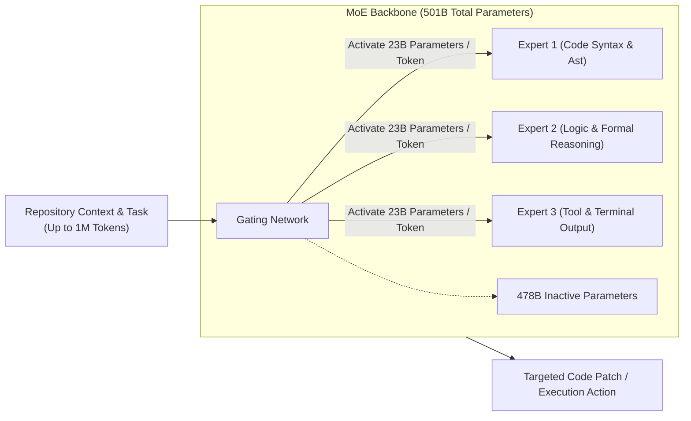

# 💎 Reflection Beam

> **Reflection Beam** is an open-weight Mixture-of-Experts (MoE) foundation model developed by Reflection AI under the Apache 2.0 license, specifically optimized for autonomous software engineering, long-running agent loops, and high-efficiency reasoning.

---

## 🏛️ Model Architecture & Specifications

| Specification | Metric / Detail |
| :--- | :--- |
| **Total Parameters** | **501 Billion** |
| **Active Parameters** | **23 Billion per token** (high inference efficiency) |
| **License** | **Apache 2.0** (Fully open weights) |
| **Context Window** | **1,000,000 Tokens (1M)** |
| **Target Workload** | Repository navigation, test-driven iteration, long-running agent workflows |
| **Hosting & Access** | Ollama Cloud; too large for consumer chips (e.g. Mac mini M4) |

---

## 💡 Paradigm: "Useful Work Per Token"

Conventional reasoning models often produce excessively long internal chain-of-thought traces, which rapidly inflates token counts and exhausts context budgets during iterative tool use. 

Beam introduces a different optimization objective:
* **Token Efficiency:** Benchmarked to achieve reasoning parity with models like GLM-5.2 while using **$3\times$ to $4\times$ less inference compute**.
* **Agentic Iteration:** Designed for the agent harness loop (reading files, executing bash commands, parsing crash traces, and refining diffs) without generating conversational fluff.

---

## 🛠️ Deployment & Experimentation

* **Local Feasibility:** Because 501B weights require high-end multi-GPU clusters (e.g. $8\times\text{H100}$ / $\text{A100}$ nodes), running Beam locally on Apple Silicon unified memory is impractical.
* **Ollama Cloud Integration:** Accessible via Ollama Cloud API endpoints for evaluation and benchmarking against local SLMs like [[MiniCPM5-2B]] or local mid-sized models like Gemma 3 12B in [[OpenCode]].
