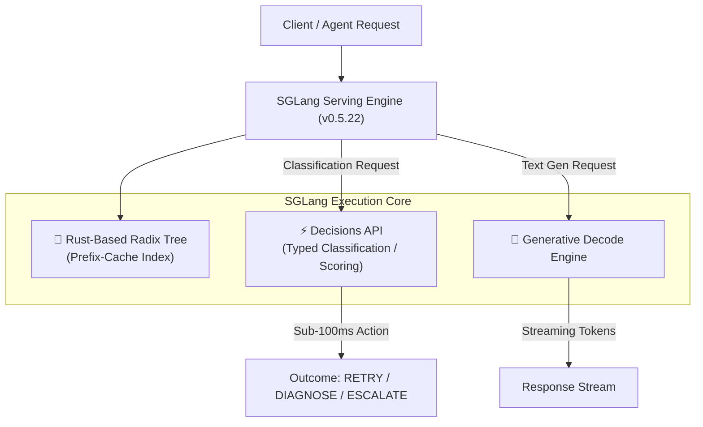

# ⚡ SGLang: High-Performance Structured Inference Engine

> **SGLang** is an open-source, ultra-high-throughput LLM serving framework designed for complex prompting workflows, structured output decoding, prefix-caching via **RadixAttention**, and distributed **[[Prefill-Decode Disaggregation]]**.

---

## 🏛️ Core Architectural Innovations

### 1. RadixAttention (Automatic KV Cache Reuse)
Unlike standard serving engines that discard or linearly search previous KV caches, SGLang maintains a Radix tree of past tokens:
* Automatically reuses the KV cache across requests that share system prompts, few-shot examples, or multi-turn dialogues.
* Eliminates redundant prefill compute, drastically reducing **Time to First Token (TTFT)**.

### 2. SGLang v0.5.22 Enhancements (October 2026)
* **Decisions API:** A dedicated high-performance endpoint for classification and scoring (e.g., scoring actions `RETRY`, `DIAGNOSE`, `ESCALATE`) natively inside the serving engine without verbose conversational generation overhead.
* **Rust-Based Prefix Cache:** Re-implemented prefix-cache lookups in Rust for microsecond-level cache index traversal under heavy concurrent load.
* **Apple Silicon Support:** Native execution on macOS / Apple Silicon (e.g. Mac mini M4) utilizing PyTorch backends alongside Apple MLX.



---

## ⚡ Decisions API vs. Conversational Prompting

In multi-agent systems and automated testing runtimes (such as [[Project - AI Test Engineer (Playwright + BDD + MCP)]]), asking a full generative model to produce verbose conversational explanations for every triage step wastes tokens and latency.

| Capability | Conversational LLM Generation | SGLang Decisions API |
| :--- | :--- | :--- |
| **Output Type** | Freeform markdown / streaming text | Discrete logit probabilities, scores, typed enum |
| **Decoding Overhead** | Autoregressive token-by-token loop | Single forward pass / logit scoring |
| **Latency** | 1,500ms – 5,000ms | 50ms – 250ms |
| **Determinism** | Vulnerable to hallucinated schema formatting | Strictly typed output |
| **Ideal Use Case** | Root-cause code fix synthesis | Test failure triage, routing gates, guardrail checks |

---

## 🛠️ Prefill–Decode Disaggregation & Transport Fabrics

In distributed multi-GPU deployments, SGLang separates prefill and decode workers into independent clusters connected via specialized transfer subsystems:
* **Mooncake:** Distributed KV-cache store enabling elastic tiering between GPU memory and network memory.
* **NIXL:** High-throughput network interface for zero-copy inter-worker tensor streaming.
* See [[Prefill-Decode Disaggregation]] for comprehensive architecture diagrams.

---

## 🧪 Practical Experiment: Playwright Failure Classification

Compare SGLang's Decisions API against local SLMs (Gemma 3 12B) for Playwright test failure triage:

```python
import requests

SGLANG_DECISION_URL = "http://localhost:30000/v1/decisions"

payload = {
    "model": "meta-llama/Llama-3.2-3B-Instruct",
    "input": "TimeoutError: locator.click: Timeout 5000ms exceeded waiting for locator('#checkout-button')",
    "candidates": ["RETRY", "DIAGNOSE", "ESCALATE"]
}

response = requests.post(SGLANG_DECISION_URL, json=payload)
result = response.json()
print("Selected Action:", result["best_candidate"])
print("Confidence Scores:", result["scores"])
```
