# 🧠 SoL-Pi (Context Compression & Harness Optimization)

> **SoL-Pi** is an open-source (MIT) research project from **NVIDIA, NTU, and MIT** designed to optimize agent harnesses through aggressive context compression, achieving **44.7%–49% token traffic reduction** and **~33% cost reduction** without sacrificing accuracy.

---

## 📉 Why Coding Agents Waste Tokens

In long testing and debugging sessions, agents repeatedly append redundant raw terminal logs, DOM dumps, and intermediate steps into the active context window:

```mermaid
flowchart TD
    subgraph NaiveHarness ["Naive Agent Execution"]
        A1["Action 1: Run Test"] --> L1["Appends 40k lines of stdout"]
        L1 --> A2["Action 2: Inspect DOM"] --> L2["Appends 100k tokens of HTML"]
        L2 --> Cost["💥 Exploding Context Window ($$$$)"]
    end
    
    subgraph SolPiHarness ["SoL-Pi Optimized Harness"]
        B1["Action Fusion"] --> Reducer["Evidence-Preserving Reducer"]
        Reducer --> B2["ObservationPack (Extracts exact failure diffs)"]
        B2 --> Savings["📉 45-50% Less Tokens & Sub-second Prompts"]
    end
```

---

## 🛠️ Key Architectural Techniques
1. **Action Fusion:** Merges consecutive tool operations into batched calls.
2. **Online Context Compact:** Prunes superseded intermediate thoughts and historical tool inputs.
3. **ObservationPack & Evidence Reducer:** Filters raw logs down to stack traces, relevant error lines, and assertion failures.

---

## 💡 Practical Takeaway for Agent Architectures
1. **Working Memory Hygiene:** Preserve only **failure evidence + assertion errors + active DOM diffs**. Aggressively prune raw HTML hierarchies.
2. **Handoff to Long-Term Memory:** Once a session or subtask is resolved, the compressed findings are compiled directly into the [[LLM Wiki]] and registered in [[Persistent Memory Systems]], preventing context saturation across future turns.

