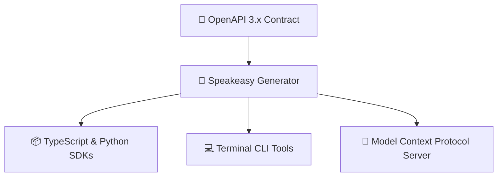

# 🧩 Speakeasy OpenAPI Generator

> **Google and Speakeasy's Open-Source Code Generator** automatically turns **OpenAPI 3.x specifications** into type-safe client SDKs, CLIs, and **Model Context Protocol (MCP) servers** across 7 languages.

---

## 🚀 The Single-Contract Workflow

Eliminates manual wrapper authoring by compiling API contracts directly into verifiable AI agent tools.
