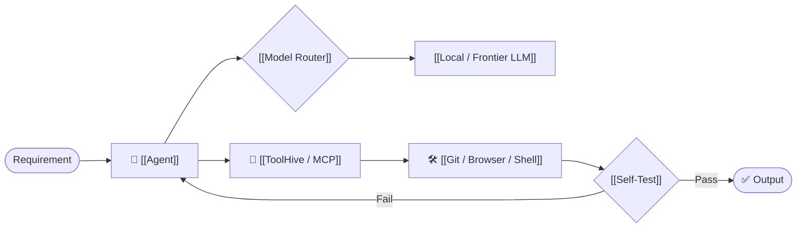
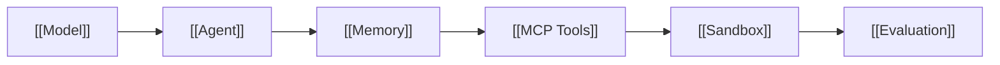
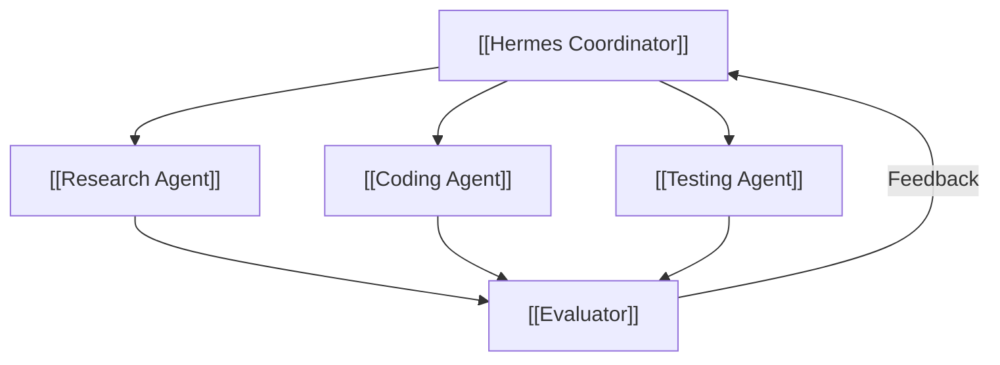
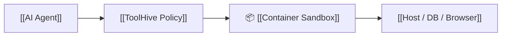
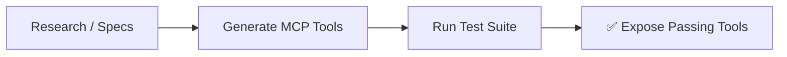

# 🏗️ Synthesis: Agent Runtimes & MCP Sandboxing
> **Architecture Focus:** Open-source agent runtimes, tool-call protocols via [[Model Context Protocol (MCP)|MCP]], and defense-in-depth container sandboxing with [[ToolHive]]. • 📚 **Master Guide:** [[Master Guide - AI & Open-Source Engineering]]

---

## ⚡ Quick Concept Map

---

## 1. 🧩 The Harness Race
> **The Model is swappable. The Harness is the moat.**

* **Core Idea:** Build applications so the underlying LLM can be swapped anytime without breaking your tools or memory.
* **Recommended Setup:** `Python Agent` + `[[FastMCP|MCP]]` + `[[Playwright]]` + `[[Ollama|Local Model]]` (with Cloud fallback).

---

## 2. 🧠 Hermes Agent (Multi-Agent Blueprint)

* **Key Strengths:** Persistent memory, dynamic skills, isolated child agents, and multi-provider support.
* **Takeaway:** Isolate subagents into their own runtimes so they don't pollute the main conversation memory.

---

## 3. 🔐 ToolHive (MCP Security)

* **Problem:** MCP tools grant agents powerful permissions (Shell, Git, DB). Direct access is dangerous.
* **Solution:** Run MCP tools inside isolated containers with strictly scoped filesystem paths and blocked egress network.

---

## 4. 🧪 Paper2Agent (Verified Tool Synthesis)

* **Core Idea:** Automatically convert specs and APIs into MCP tools, but **only** expose them after automated tests verify they work.
* **Application:** Use this pattern to convert [[Playwright]] step definitions into reliable, self-tested agent tools.

---

## 5. 🚨 Agent Security Checklist

An agent with `Git + Filesystem + Browser + Shell + Network` is a privileged process. Test for:

- [ ] **Canary Leaks:** Can prompt injection trick the agent into reading `.env` or credentials?
- [ ] **Network Egress:** Can the agent reach unauthorized public webhooks?
- [ ] **Sandbox Escape:** Is shell access strictly contained in a container?
- [ ] **Safe Degradation:** Does the agent handle denied (403) actions gracefully?

---

## 🎯 Tech Stack Summary

| Technology | Role | Priority | Link |
|---|---|:---:|---|
| **[[Hermes Agent]]** | Multi-agent framework with memory & skills | ⭐⭐⭐⭐⭐ | [[Hermes Agent]] |
| **[[ToolHive]]** | Containerized MCP security & policy gate | ⭐⭐⭐⭐⭐ | [[ToolHive]] |
| **[[Model Context Protocol (MCP)]]** | Universal agent-to-tool interface | ⭐⭐⭐⭐⭐ | [[Model Context Protocol (MCP)]] |
| **[[OpenCode]]** | Deterministic coding-agent harness | ⭐⭐⭐⭐⭐ | [[OpenCode]] |
| **[[SGLang]] / [[vLLM]]** | High-throughput local inference | ⭐⭐⭐⭐ | [[vLLM]] |
| **[[Ollama]]** | Fast local experimentation | ⭐⭐⭐⭐ | [[Ollama]] |

---

## 🔗 Knowledge Hub Connections

- **Master Document:** [[AI & Open-Source Engineering — Master Briefing]]
- **Parent:** [[MOC - Artificial Intelligence]]
- **Related:** [[Model Context Protocol (MCP)]] • [[Hermes Agent]] • [[ToolHive]] • [[Agent Security]] • [[Playwright]]
