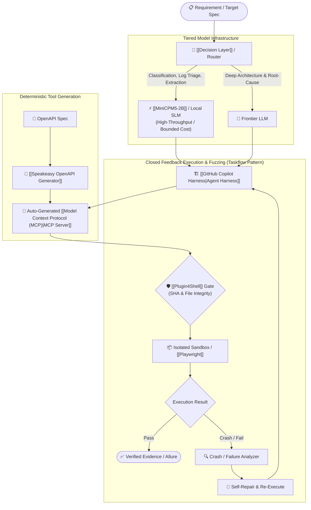
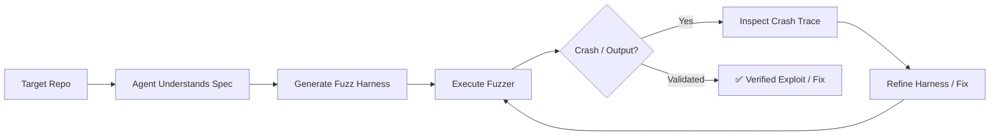
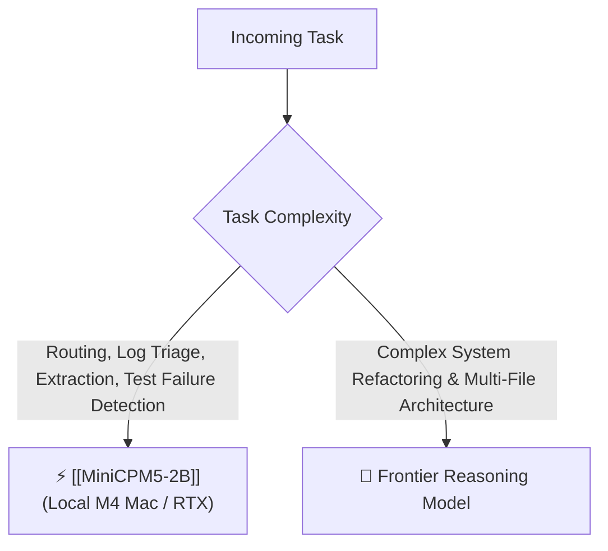
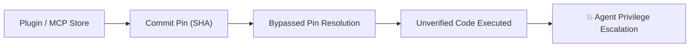
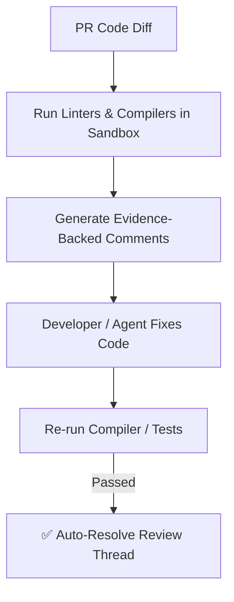
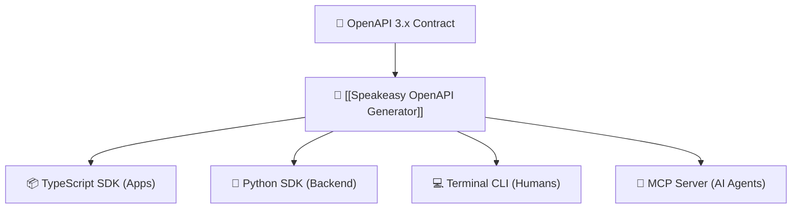

# 🔄 Synthesis: Closed Feedback Loops & Auto-Generated MCP Tools
> **Architecture Focus:** Closed feedback execution loops (AI fuzzing), high-efficiency small local models (SLMs), supply-chain verification for agent plugins, and deterministic OpenAPI-to-MCP generation. • 📚 **Master Guide:** [[Master Guide - AI & Open-Source Engineering]]

---

## ⚡ Daily Architectural Map



---

## 1. 🧪 GitHub Security Lab: AI-Powered Fuzzing Taskflow

GitHub published an AI-powered fuzzing workflow for its open-source **Taskflow Agent** framework:
* The agent ingests the target codebase, synthesizes fuzzing harnesses, executes the fuzzer in a loop, inspects crashes/unexpected inputs, and dynamically refines the harness.
* **Core Insight:** Moves beyond raw code generation into a **closed-loop feedback engineering cycle** where runtime execution signals drive iteration.



> [!tip] Practical Takeaway for AI Test Engineer
> Apply the exact closed-loop fuzzing architecture to your **Playwright automation pipeline**:
> $$\text{Gherkin Spec} \longrightarrow \text{Generate Playwright Test} \longrightarrow \text{Execute Browser} \longrightarrow \text{Inspect Trace / Failure} \longrightarrow \text{Auto-Repair} \longrightarrow \text{Re-run}$$
> Measure progress not by "clean-looking Gherkin", but by **execution passes against real web state**.

---

## 2. 🧠 MiniCPM5-2B: The Rise of Efficient Small Local Models (SLMs)

OpenBMB's **MiniCPM5-2B** achieved a 53.9 average across 34 benchmarks (spanning coding, tool use, reasoning, long-context understanding, and agentic workflows), demonstrating that specialized compact models can outperform older, larger models on bounded tasks.

```text
2024 Paradigm: Bigger Model = Universally Better
2026 Paradigm: Specialized SLM (2B–8B) + Precision Training + Optimized Harness = High-Speed, Low-Cost Local Agent
```



> [!tip] LLMOps Mindset Shift
> On your M4 Mac Mini / NVIDIA setup, don't just ask *"What is the largest model my VRAM can fit?"*  
> Ask: **"What is the smallest model that can reliably accomplish this discrete subtask?"**

---

## 3. 🔐 Plugin4Shell: Agent Dependencies are Software Supply-Chain Risks

The **Plugin4Shell** disclosure across major AI coding platforms (Claude Code, Codex, GitHub Copilot, Gemini CLI) demonstrates that **Git commit/SHA pinning alone can be bypassed** if plugin installation paths fail to verify downloaded file integrity against resolved trees:
* **Ecosystem Shift:** Giving agents shell, Git, filesystem, and CI access elevates MCP tools and agent plugins into **privileged software dependencies**.



> [!warning] Agent Defense Standard
> Enforce multi-tier supply chain validation:
> 1. **Verify repository remote & commit signatures.**
> 2. **Cryptographic hash audit of local extracted files.**
> 3. **Container sandboxing with strict network egress controls.**
> 4. **Least-privilege permission grants per tool.**

---

## 4. 🏗️ GitHub Copilot Harness: Autonomous Execution & Review Loops

Microsoft made the **GitHub Copilot Harness** generally available in Copilot Studio with support for agent skills, persistent memory, MCP servers, and enterprise context.
* GitHub's **Code-Review Agent** now utilizes active shell tools to run compilers/linters to validate comments before publishing, and **automatically resolves comment threads** once human or AI fixes are verified.



---

## 5. 🧩 Google + Speakeasy: Deterministic OpenAPI $\rightarrow$ MCP & SDK Generation

Google and Speakeasy open-sourced an **OpenAPI Code-Generation Suite** capable of generating type-safe SDKs, CLIs, and **Model Context Protocol (MCP) servers** across 7 languages directly from OpenAPI specs:
* Eliminates boilerplate glue code needed to make enterprise REST APIs accessible to AI agents.



> [!tip] Practical Takeaway
> When creating internal testing or backend microservices:
> 1. Define a strict **OpenAPI contract** first.
> 2. Auto-generate the **TypeScript test client** and **MCP server** simultaneously.
> 3. Hand the MCP server to your Playwright agent without writing custom wrappers.

---

## 🔥 Tech Stack Watchlist

| Technology | Focus Area | Priority | Link |
|---|---|:---:|---|
| **[[GitHub Taskflow Agent]]** | Closed-loop AI fuzzing and dynamic harness generation | ⭐⭐⭐⭐⭐ | [[GitHub Taskflow Agent]] |
| **[[MiniCPM5-2B]]** | High-efficiency local SLM for extraction, routing & triage | ⭐⭐⭐⭐⭐ | [[MiniCPM5-2B]] |
| **[[Speakeasy OpenAPI Generator]]** | Auto-generating MCP servers & SDKs from OpenAPI specs | ⭐⭐⭐⭐⭐ | [[Speakeasy OpenAPI Generator]] |
| **[[GitHub Copilot Harness]]** | Enterprise agent harness with skills, memory & MCP | ⭐⭐⭐⭐⭐ | [[GitHub Copilot Harness]] |
| **[[Plugin4Shell]] Guardrails** | Cryptographic supply-chain security for AI tools | ⭐⭐⭐⭐⭐ | [[Plugin4Shell]] |

---

## 🎯 Master Engineering Takeaway

$$\mathbf{Autonomous\ Engineering} = \mathbf{Deterministic\ Tooling\ (OpenAPI \rightarrow MCP)} + \mathbf{Efficient\ Local\ SLMs} + \mathbf{Closed\ Feedback\ Loops\ (Fuzz/Test)}$$

Move away from treating LLMs as raw text generators. Treat them as **orchestration engines executing against verifiable runtime feedback loops**.

---

## 🔗 Knowledge Graph Connections

- **Master Document:** [[Master Guide - AI & Open-Source Engineering]]
- **Related Syntheses:** [[Synthesis - Context Compression & Supply-Chain Security]] • [[Synthesis - Decision Layers & Execution Verification]]
- **Parent Hub:** [[MOC - Artificial Intelligence]] • [[MOC - Agentic System Design]]
- **Related Nodes:** [[GitHub Taskflow Agent]] • [[MiniCPM5-2B]] • [[Plugin4Shell]] • [[GitHub Copilot Harness]] • [[Speakeasy OpenAPI Generator]] • [[Model Context Protocol (MCP)]] • [[Playwright]]
