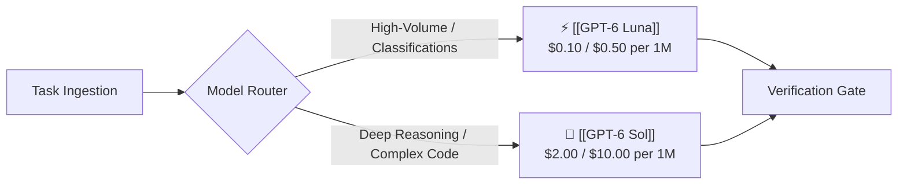
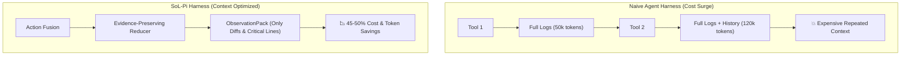
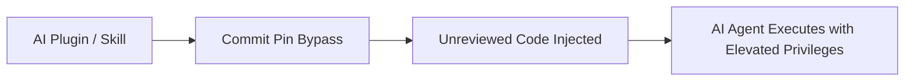
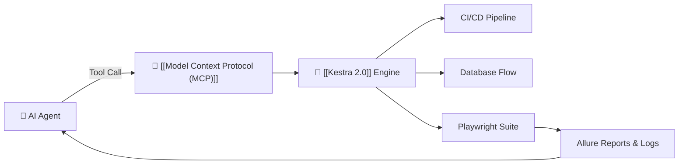
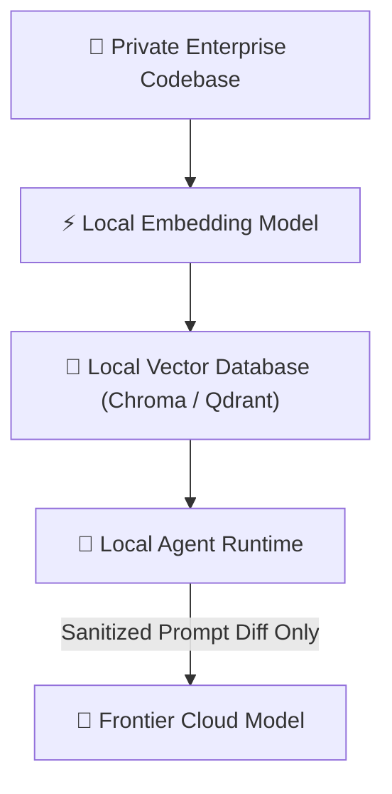

# 📉 Synthesis: Context Compression & Supply-Chain Security
> **Architecture Focus:** Harness optimization via context compression, economic model routing tiers, deterministic MCP workflow execution, and agent plugin supply-chain security. • 📚 **Master Guide:** [[Master Guide - AI & Open-Source Engineering]]

---

## ⚡ Daily Architectural Map

```mermaid
flowchart TD
    Task(["Incoming Task"]) --> Jev["🧠 [[Jev]] / Triage Router"]
    
    subgraph RoutingEngine ["Dynamic Model Routing ($/Token Curve)"]
        Jev --> Router{"[[Model Router]]"}
        Router -->|Routine / Log Triage ($0.10/$0.50)| Luna["⚡ [[GPT-6 Luna]] / Local SLM"]
        Router -->|Architecture & Heavy Debug ($2/$10)| Sol["👑 [[GPT-6 Sol]] / Frontier"]
    end
    
    subgraph HarnessOpt ["Agent Harness with Context Compression (SoL-Pi)"]
        Luna & Sol --> Harness["🧩 Agent Harness Engine"]
        Harness --> AF["Action Fusion"]
        Harness --> OCC["Online Context Compact"]
        Harness --> OP["ObservationPack & Reducer"]
        AF & OCC & OP --> Compacted["📉 45-50% Reduced Context Pressure"]
    end
    
    subgraph ToolingSecurity ["Deterministic Execution & Verified Supply Chain"]
        Compacted --> MCP["🔌 [[Model Context Protocol (MCP)]]"]
        MCP --> PinnedSec{"🛡️ [[Plugin4Shell]] Gate\n(Commit Hash Verification)"}
        PinnedSec --> Kestra["🧩 [[Kestra 2.0]]\n(Deterministic Workflows)"]
        PinnedSec --> LocalRAG["🔒 Local Embeddings & Private Index"]
        
        Kestra --> WorkflowExec["Playwright / DB / CI Pipelines"]
    end
    
    WorkflowExec --> Feedback["Evidence & Telemetry Loop"]
    Feedback --> Harness
```

---

## 1. ⚡ GPT-6 Sol & Luna: Model Routing Economics Shift

OpenAI released **GPT-6 Sol** and **GPT-6 Luna** at 50% lower price points than previous generation promotional pricing:
* **GPT-6 Sol ($2.00 / $10.00 per 1M tokens):** Positioned for deep reasoning, complex coding, and multi-agent synthesis.
* **GPT-6 Luna ($0.10 / $0.50 per 1M tokens):** High-volume, low-latency execution (triage, summarization, simple assertions).



> [!tip] Practical Takeaway for AI Test Engineer
> Implement a tiered routing policy:
> * **Luna / Local SLM:** Selector extraction, log triage, simple assertion generation.
> * **Sol / Frontier Model:** Architecture refactoring, complex root-cause failure analysis.
> * **Jev / Decision Layer:** Sub-millisecond routing decisions.

---

## 2. 🧠 NVIDIA SoL-Pi: Harness Optimization & Context Compression

Researchers from **NVIDIA, NTU, and MIT** released **SoL-Pi** (MIT License), an optimization extension for the open-source Pi coding agent that targets token bloat in agent harnesses:
* **Benchmark Results:** Achieved **44.7%–49% reduction in token traffic** and **~33% lower API cost** on EdgeBench evaluations without degrading task success rate.
* **Core Techniques:**
  1. **Action Fusion:** Batches consecutive tool actions into single operations.
  2. **Online Context Compact:** Dynamically prunes expired conversation history.
  3. **ObservationPack & Evidence-Preserving Reducer:** Compresses raw logs and DOM trees into minimal failure diffs.



> [!tip] Practical Takeaway
> When running long Playwright test sessions, never send complete raw HTML dumps and entire browser console histories back to the model. Compress state to **failure traces, visual diffs, and exact assertion lines**.

---

## 3. 🛡️ Plugin4Shell: Agent Supply-Chain Security Flaw

AIR Security disclosed **Plugin4Shell**, a critical supply-chain vulnerability affecting AI plugin resolution across Claude Code, OpenAI Codex, GitHub Copilot, and Gemini CLI:
* **The Vulnerability:** Malicious repositories manipulated Git commit pins, allowing unauthorized code to execute despite appearing pinned to a reviewed commit.
* **Key Insight:** Agents with shell, filesystem, and CI access turn plugins and MCP servers into high-privilege software dependencies.



> [!warning] Security Directive
> Treat all MCP servers, external skills, and plugins as **production dependencies**:
> * Cryptographically verify hashes and signatures.
> * Run MCP servers in isolated sandboxes with least-privilege network egress.
> * Do not trust marketplace labels blindly.

---

## 4. 🧩 Kestra 2.0: Deterministic Workflows as MCP Tools

Orchestration platform **Kestra 2.0** (Apache 2.0) introduced native **Model Context Protocol (MCP)** integration:
* Converts any deterministic Kestra pipeline (CI/CD, database migration, automated regression suite) directly into an MCP tool with automated JSON schema validation.
* **Architecture:** LLM selects *what* to run; deterministic workflow engine handles *how* it executes safely and reliably.



> [!tip] Practical Takeaway
> Let deterministic software do what it does best. Avoid having the LLM hand-roll custom bash execution logic for regression suites—expose a Kestra workflow via MCP.

---

## 5. 🔐 Z.ai / ZCode Incident: Local Code Privacy & Residency

Z.ai faced security scrutiny after its default Codebase Indexing feature uploaded local Git repositories to external cloud servers without explicit user confirmation:
* Highlights the critical importance of **data residency, local vector embeddings, and zero-data-retention policies** when building developer agents for enterprise codebases.



---

## 🔥 Tech Stack Watchlist

| Technology | Focus Area | Priority | Link |
|---|---|:---:|---|
| **[[SoL-Pi]]** | Harness optimization & context compression (45-50% savings) | ⭐⭐⭐⭐⭐ | [[SoL-Pi]] |
| **[[GPT-6 Sol and Luna]]** | Tiered cost-curve model routing ($0.10 vs $2.00) | ⭐⭐⭐⭐⭐ | [[GPT-6 Sol and Luna]] |
| **[[Kestra 2.0]]** | Deterministic workflow engine as MCP tools | ⭐⭐⭐⭐⭐ | [[Kestra 2.0]] |
| **[[Plugin4Shell]] Security** | Pinned dependency & MCP server supply-chain security | ⭐⭐⭐⭐⭐ | [[Plugin4Shell]] |
| **[[ZCode Security]]** | Local-first codebase indexing & data privacy | ⭐⭐⭐⭐ | [[ZCode Security]] |

---

## 🎯 Master Engineering Takeaway

$$\mathbf{Production\ AI\ System} = \mathbf{Model\ Routing} + \mathbf{Harness\ Compression\ (SoL-Pi)} + \mathbf{Deterministic\ Workflows\ (Kestra)} + \mathbf{Supply\ Chain\ Guardrails}$$

The frontier of agent engineering is no longer about prompt crafting—it is about **optimizing the runtime harness, slashing token overhead, enforcing supply-chain security, and executing deterministic workflows**.

---

## 🔗 Knowledge Graph Connections

- **Master Document:** [[Master Guide - AI & Open-Source Engineering]]
- **Related Syntheses:** [[Synthesis - Decision Layers & Execution Verification]] • [[Synthesis - Closed Feedback Loops & Auto-Generated MCP Tools]]
- **Parent Hub:** [[MOC - Artificial Intelligence]] • [[MOC - Agentic System Design]]
- **Related Nodes:** [[SoL-Pi]] • [[GPT-6 Sol and Luna]] • [[Kestra 2.0]] • [[Plugin4Shell]] • [[Model Context Protocol (MCP)]] • [[Playwright]]
