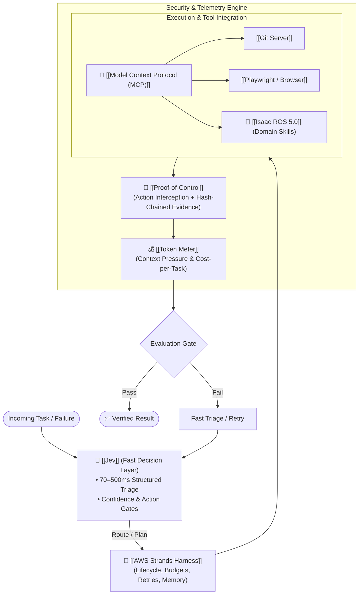
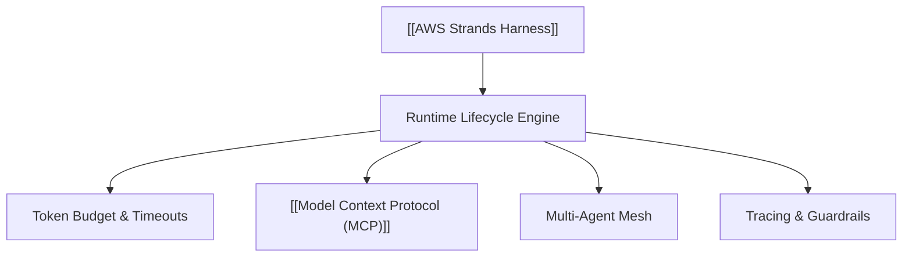
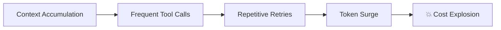
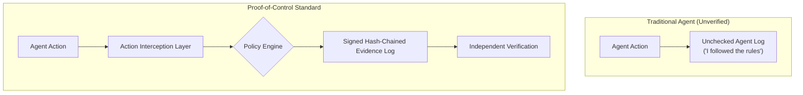

# ⚡ Synthesis: Decision Layers, Agent Harnesses & Verifiable Execution
> **Architecture Focus:** Agents maturing into modular software runtimes with fast System-1 decision layers, lifecycle harnesses, cost/token observability, and cryptographic execution proof. • 📚 **Master Guide:** [[Master Guide - AI & Open-Source Engineering]]

---

## ⚡ Daily Architectural Map



---

## 1. 🧠 Jev: Separate "Decision Layer" for AI Agents

TypeSafe AI introduced **Jev**, pioneering a new class of **"System One" models**:
* Rather than generating verbose conversational text, it takes application state and typed questions to return structured decisions (discrete choices, scores, yes/no probabilities, and calibrated confidence levels).
* **Latency:** Ultra-low response times between **70–500 ms**.
* Decouples rapid tactical decisions from heavy reasoning.

```mermaid
flowchart LR
    Agent["Autonomous Agent"] --> Fork{"Decision Point"}
    Fork -->|Fast Tactical Routing (70-500ms)| Jev["🧠 [[Jev]] (System 1)\n• Route • Filter • Triage • Score"]
    Fork -->|Deep Reasoning / Code Gen| LLM["👑 Frontier LLM (System 2)\n• Plan • Synthesize • Debug"]
```

> [!tip] Practical Takeaway for AI Test Engineer
> Do not invoke a heavy reasoning model for basic triage. Prototype a Jev-style decision gate for Playwright:
> ```text
> Playwright Failure ──> [Jev Decision Gate] ──┬──> Retry (transient flake)
>                                              ├──> Debug Agent (code break)
>                                              └──> Escalate to Human
> ```

---

## 2. 🧩 AWS Strands Harness: Agent Infrastructure as a Dedicated Layer

AWS open-sourced **Strands Harness** (Python & TypeScript SDK), replacing fragile `while True: call_llm()` loops with a production-grade agent lifecycle harness:
* **Built-in Capabilities:** Token budgets, cancellation signals, structured tool routing, MCP support, multi-agent patterns, session memory, model portability (Anthropic, OpenAI, Gemini, Bedrock, Ollama), guardrails, and telemetry.
* **Core Principle:** An agent runtime owns `context + state + tools + limits + retries + memory + observability + evaluation`.



> [!tip] Practical Takeaway
> Benchmark a single test agent across three implementations: **Google ADK vs AWS Strands vs Custom Python Loop**. Evaluate state handling, retry policies, and failover behavior.

---

## 3. 🤖 NVIDIA Isaac ROS 5.0: Domain-Specific Agent Skills

NVIDIA released **Isaac ROS 5.0** (on ROS 2 Lyrical), adding agentic skills directly into its open robotics stack:
* Rather than exposing raw, unguided REST/gRPC endpoints, NVIDIA provides **domain-specific agent skills** (e.g., environment setup, code migration, perception fine-tuning, pick-and-place configuration).
* Demonstrates that agents perform exponentially better with tailored, high-level skills rather than monolithic general-purpose tools.

> [!tip] Practical Takeaway for Playwright Testing
> Avoid giving agents a single monolithic `manage_tests` tool. Decompose testing capabilities into fine-grained, verifiable skills:
> `find_existing_step()` • `generate_gherkin()` • `run_feature()` • `inspect_failure()` • `search_logs()` • `retry_test()`

---

## 4. 💰 Token Meter: Open-Source Observability & Cost Engineering

Splunk released **Token Meter**, an open-source, local-first telemetry dashboard for AI coding agents (supporting Claude Code, Codex, Cursor, OpenCode, Kiro, Pi):
* Tracks token usage, real-time context pressure, estimated API cost, tool invocation volume, and execution wall-clock time.
* Exposes a bounded read-only **MCP interface** allowing agents to inspect their own cost and token consumption during execution.



* **Core LLMOps North Star:** **Cost per Successful Task**.

---

## 5. 🔐 Proof-of-Control: Open Verification for Autonomous Agents

The Linux Foundation (Decentralized Trust) and Advanced AI Society launched the **Proof-of-Control** open specification:
* Replaces unverifiable self-reported logs (*"The agent claims it followed policy"*) with **action interception, path-aware policy evaluation, and hash-chained cryptographically signed evidence**.



> [!tip] Practical Takeaway
> Format agent execution logs as verifiable audit evidence:
> `[task_id | agent_id | model | tool | arguments | policy_verdict | execution_hash | timestamp | approval_sig]`

---

## 🔥 Tech Stack Watchlist

| Technology | Focus Area | Priority | Link |
|---|---|:---:|---|
| **[[Jev]]** | System 1 fast decision layer (70–500ms) | ⭐⭐⭐⭐⭐ | [[Jev]] |
| **[[AWS Strands Harness]]** | Enterprise lifecycle agent SDK & token budgets | ⭐⭐⭐⭐⭐ | [[AWS Strands Harness]] |
| **[[Token Meter]]** | Local-first coding agent cost & token observability | ⭐⭐⭐⭐⭐ | [[Token Meter]] |
| **[[Proof-of-Control]]** | Tamper-evident, signed agent execution verification | ⭐⭐⭐⭐⭐ | [[Proof-of-Control]] |
| **[[Isaac ROS 5.0]]** | Domain-specific agent skills for robotics | ⭐⭐⭐⭐ | [[Isaac ROS 5.0]] |

---

## 🎯 Master Engineering Takeaway

$$\text{Production Agent Runtime} = \mathbf{Fast\ Decision\ Layer} + \mathbf{Lifecycle\ Harness} + \mathbf{Observability} + \mathbf{Verifiable\ Proof}$$

Treat **Jev, MCP, Strands Harness, Token Meter, and Proof-of-Control** as unified layers of a single emerging AI engineering runtime.

---

## 🔗 Knowledge Graph Connections

- **Master Document:** [[Master Guide - AI & Open-Source Engineering]]
- **Related Syntheses:** [[Synthesis - Multi-Agent Swarms & Governed Loops]] • [[Synthesis - Context Compression & Supply-Chain Security]]
- **Parent Hub:** [[MOC - Artificial Intelligence]] • [[MOC - Agentic System Design]]
- **Related Nodes:** [[Jev]] • [[AWS Strands Harness]] • [[Token Meter]] • [[Proof-of-Control]] • [[Isaac ROS 5.0]] • [[Model Context Protocol (MCP)]] • [[Playwright]]
