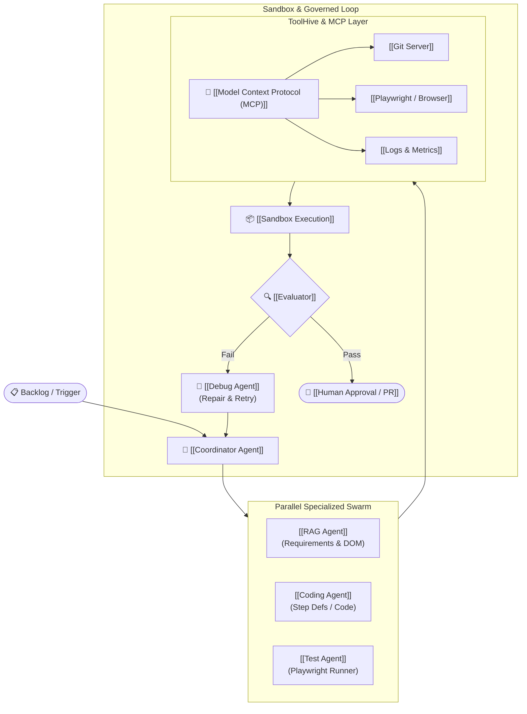
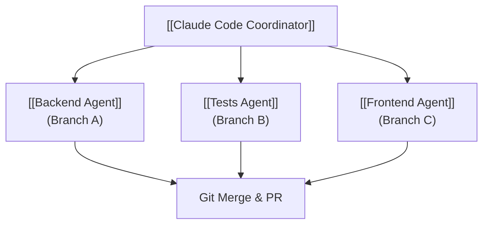
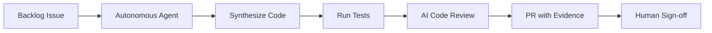
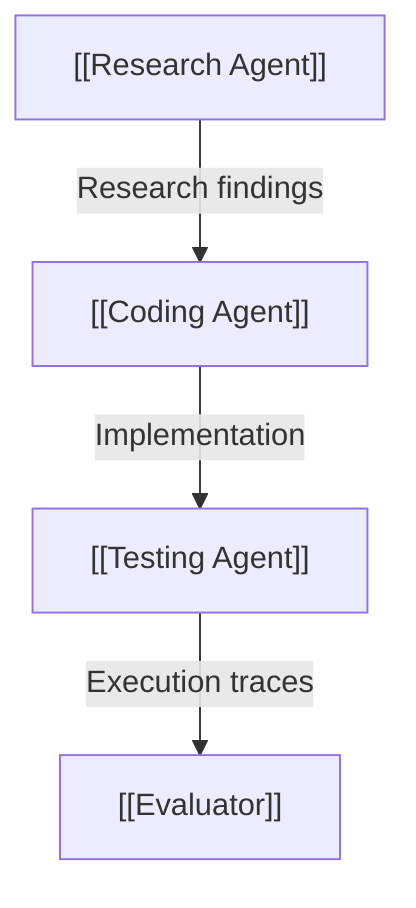
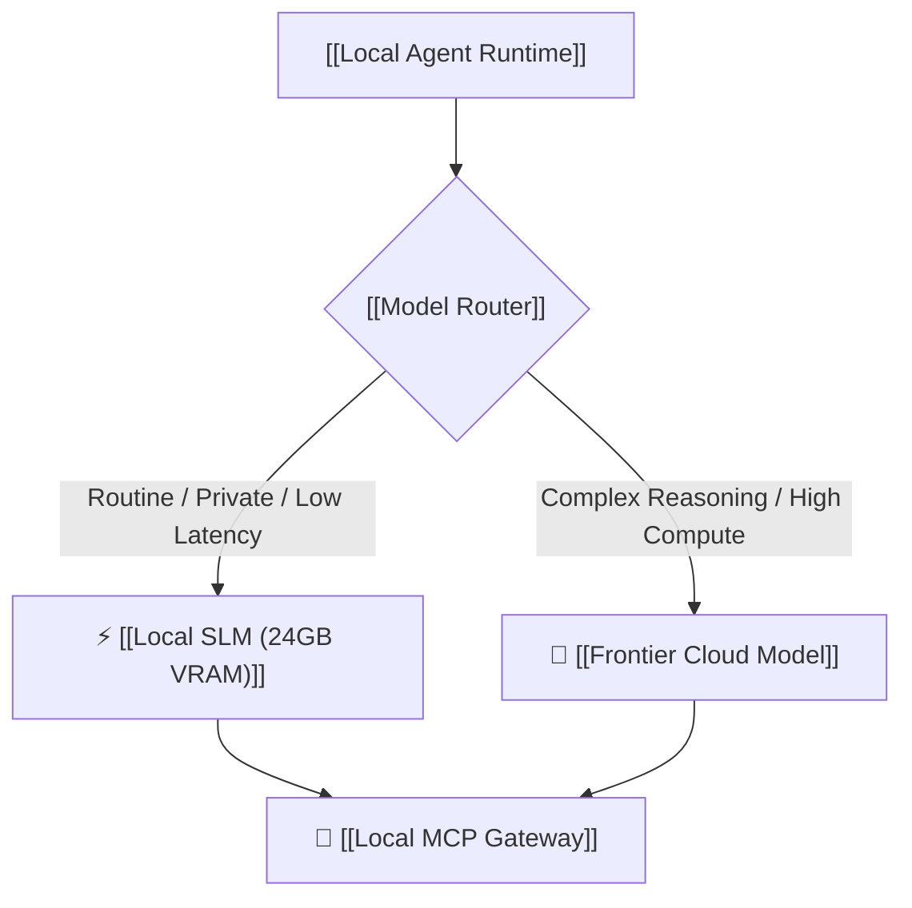
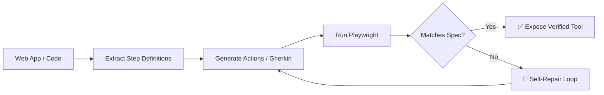

# 🤖 Synthesis: Multi-Agent Swarms & Governed Execution
> **Architecture Focus:** Shift from single-agent coding assistants to multi-agent orchestration swarms, governed execution loops, local agent runtimes, and verified tool generation. • 📚 **Master Guide:** [[Master Guide - AI & Open-Source Engineering]]

---

## ⚡ Daily Architectural Map

---

## 1. 🧑‍💻 Claude Code Projects: Multi-Agent Parallel Teams

Anthropic relaunched **Claude Code Projects** with a coordinator-worker multi-agent pattern:
* A central coordinator delegates work to parallel, independent agent sessions with shared memory and artifacts.
* Each worker operates in an isolated Git branch; overlapping edits resolve through normal merge flows.

> [!tip] Practical Takeaway for AI Test Engineer
> Parallelize tasks across specialized agents:
> 1. **Agent 1:** Ingest requirements & Gherkin scenarios.
> 2. **Agent 2:** Retrieve existing [[Playwright]] step definitions via RAG.
> 3. **Agent 3:** Synthesize missing automation logic.
> 4. **Agent 4:** Run & debug execution traces.
> 5. **Coordinator:** Validate and merge PR branch.

---

## 2. 🏗️ Atlassian: From "Assistant" $\rightarrow$ "Always-On Governed Loop"

Atlassian introduced **Governed Agent Loops** for the AI-Native SDLC:

* **Old Model:** $\text{Developer} \longrightarrow \text{Prompt} \longrightarrow \text{Agent} \longrightarrow \text{Code}$
* **Emerging Model:** $\text{Backlog Issue} \longrightarrow \text{Agent} \longrightarrow \text{Code} \longrightarrow \text{Test} \longrightarrow \text{Review} \longrightarrow \text{PR} \longrightarrow \text{Human Approval}$

* **LLMOps Rule:** Don't ask *"How do I make the LLM write code?"* Instead ask: *"What event triggers the agent, what context does it receive, what tools can it use, and what evidence must it produce before human approval?"*

---

## 3. 🐍 Hermes Agent v0.21.3 (Open-Source Multi-Agent Reference)

[[Hermes Agent]] released v0.21.3, consolidating **Bot Mode**, `hermes peer` (agent-to-agent messaging), browser control, MCP authorization, secret redaction, and protected instructions.

* **Key Takeaway:** Agents communicate directly peer-to-peer instead of stuffing entire conversation histories into one bloated context window.
* **Security Note:** Versions prior to v0.18.2 contain a known ACP prompt DoS vulnerability; always run $\ge$ v0.21.x.

---

## 4. 🖥️ Perplexity Computer Agent: Local RTX Execution

Perplexity brought its **Computer Agent** to Windows PCs for local execution on NVIDIA RTX/RTX PRO GPUs ($\ge 24\text{ GB}$ VRAM).
* Supports multi-step scheduled jobs, local [[Model Context Protocol (MCP)|MCP servers]], and local tool integrations (GitHub, Slack, Drive).

* **Core Metric:** Benchmark **cost per successful task**, not just raw tokens/sec.

---

## 5. 🧪 Paper2Agent: Automated & Verified Tool Synthesis

A *Nature* paper introduced [[Paper2Agent]], converting scientific papers and codebases into verified MCP tools through an automated execution-and-repair loop.

* **Application to Testing:** Add execution/evaluation loops to your test generation rather than generating raw `.feature` files blindly:
  $$\text{Generate} \longrightarrow \text{Execute Playwright} \longrightarrow \text{Inspect Failure} \longrightarrow \text{Repair} \longrightarrow \text{Re-run}$$

---

## 🔥 Tech Stack Watchlist

| Technology | Focus Area | Priority | Link |
|---|---|:---:|---|
| **[[Hermes Agent]]** | Memory + peer messaging + multi-agent execution | ⭐⭐⭐⭐⭐ | [[Hermes Agent]] |
| **[[OpenCode]]** | Terminal coding harness with model flexibility | ⭐⭐⭐⭐⭐ | [[OpenCode]] |
| **[[ToolHive]]** | Containerized MCP sandboxing & policy boundary | ⭐⭐⭐⭐⭐ | [[ToolHive]] |
| **[[Model Context Protocol (MCP)]]** | Universal standard agent-tool interface | ⭐⭐⭐⭐⭐ | [[Model Context Protocol (MCP)]] |
| **[[SGLang]] / [[vLLM]]** | High-throughput local model serving | ⭐⭐⭐⭐ | [[vLLM]] |
| **[[Ollama]]** | Fast local model experimentation | ⭐⭐⭐⭐ | [[Ollama]] |
| **[[Paper2Agent]]** | Continuous tool synthesis & self-healing | ⭐⭐⭐⭐ | [[Paper2Agent]] |

> [!note] Industry Standardization
> The Linux Foundation's **Agentic AI Foundation** is standardizing MCP and agent infrastructure, hosting **AGNTCon + MCPCon North America** on October 22–23, 2026.

---

## 🎯 Master Engineering Takeaway

$$\text{Core Engineering Skill} = \mathbf{Agent\ Orchestration} + \mathbf{MCP\ Tooling} + \mathbf{Automated\ Evaluation}$$

Connects **RAG, Python, Playwright, LLMOps, and Local Models** into a single production-grade software engineering discipline.

---

## 🔗 Knowledge Graph Connections

- **Master Document:** [[Master Guide - AI & Open-Source Engineering]]
- **Related Syntheses:** [[Synthesis - Agent Runtimes & MCP Sandboxing]] • [[Synthesis - Decision Layers & Execution Verification]]
- **Parent Hub:** [[MOC - Artificial Intelligence]] • [[MOC - Agentic System Design]]
- **Related Nodes:** [[Claude Code Projects]] • [[Hermes Agent]] • [[AgentScope]] • [[ToolHive]] • [[Model Context Protocol (MCP)]] • [[Paper2Agent]] • [[Playwright]]
