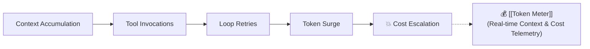

# 💰 Token Meter (Coding Agent Observability)

> **Token Meter** (by Splunk) is an open-source, local-first telemetry dashboard for tracking token volume, API spend, tool pressure, and context window saturation across AI coding agents.

---

## 📊 Core Metric: Cost Per Successful Task

$$\text{North Star Metric} = \frac{\text{Total Model \& Infrastructure Cost}}{\text{Verified Successful Task Completions}}$$



---

## 🔌 Read-Only MCP Interface
Token Meter exposes a bounded read-only MCP endpoint allowing agents to query their own usage:
```json
{
  "tool": "get_session_metrics",
  "returns": {
    "total_tokens": 42150,
    "context_pressure_pct": 34.2,
    "estimated_cost_usd": 0.084,
    "tool_calls_count": 9
  }
}
```
