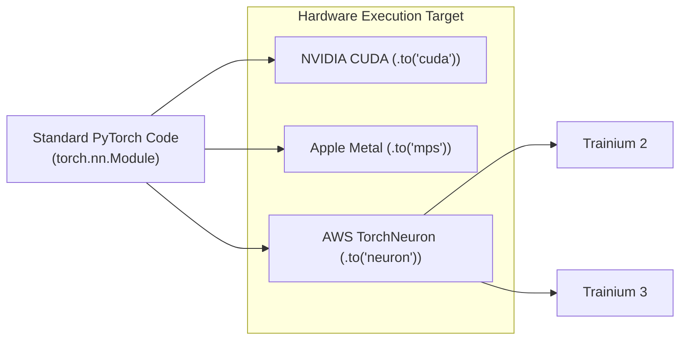

# ⚡ AWS TorchNeuron: PyTorch Workloads on Trainium

> **AWS TorchNeuron** is an open-source PyTorch backend designed to allow native PyTorch models to target AWS **Trainium 2** and **Trainium 3** custom AI accelerators without requiring hardware-specific rewrite refactors.

---

## 🏛️ Architectural Significance

Historically, running ML inference and training at scale has locked engineering teams into NVIDIA's CUDA ecosystem. AWS TorchNeuron addresses this portability barrier:
* **Familiar PyTorch Abstraction:** Developers use standard `torch.nn.Module` APIs.
* **Minimal Code Alteration:** In supported workloads, switching device placement to `.to('neuron')` allows models to compile and execute on Trainium cores.
* **Public Beta (October 2026):** Open-sourced to accelerate multi-hardware support for open-source foundation models, fine-tuning jobs, and RAG embeddings.



---

## 💻 Operational Usage

```python
import torch
import torch_neuronx

# Standard PyTorch model initialization
model = MyTransformerModel()

# Direct device placement to AWS Trainium
device = torch.device("neuron")
model = model.to(device)

# Inference execution
inputs = tokenizer("Verify test assertion", return_tensors="pt").to(device)
outputs = model(**inputs)
```

---

## 💡 Strategic Takeaway for Open-Source AI Workflows

1. **Local vs Cloud Separation:** Local experimentation continues on Apple Silicon unified memory (Mac mini M4 via Ollama / Metal Performance Shaders `mps`).
2. **Cloud Scaling Cost Optimization:** When fine-tuning local models (e.g. Qwen, Gemma, or custom BDD generator embeddings) or scaling production inference endpoints, TorchNeuron provides a cost-effective alternative to costly H100/B200 GPU instances.
