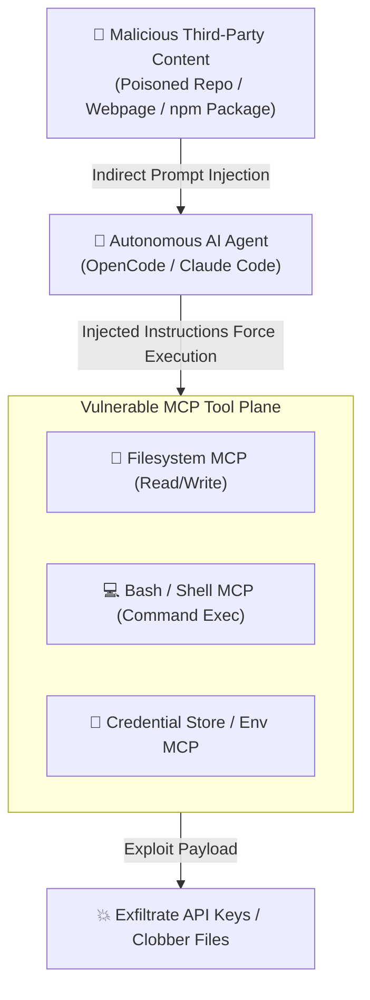

# 🛡️ mcp-scan: Open-Source MCP Security & Tool Poisoning Scanner

> **mcp-scan** is an open-source security analysis tool engineered to inspect agent configuration files, active [[Model Context Protocol (MCP)|MCP]] servers, and dynamic agent skills for **prompt injection vulnerabilities**, **tool poisoning vectors**, and **sensitive credential leaks**.

---

## 🚨 The Threat Vector: Tool Expansion of Agent Attack Surfaces

As demonstrated by BeyondTrust's October 2026 empirical research:
* **85%** of observed AI coding-agent practitioners invoke at least one MCP server.
* Connected practitioners operate an average of **4.35 distinct MCP servers** simultaneously.

When an agent gains access to external tools (filesystem read/write, terminal execution, browser navigation, git commits), an ordinary conversation turns into an attack plane:



> [!CAUTION] The Model Fallacy
> The solution is **not** simply instructing the model to "be careful" or relying on frontier reasoning. Malicious payloads embedded in untrusted tool responses or documentation bypass model safeguards. Security must be enforced **structurally outside the model** via permissions, tool auditing, and runtime sandboxing.

---

## 🛠️ CLI Security Auditing with `mcp-scan`

Authored by security researcher Praveen Vattem, `mcp-scan` statically and dynamically analyzes agent environments without complex installation:

```bash
# Scan all installed agent skills and MCP servers
uvx mcp-scan@latest --skills

# Scan specific MCP configuration files
uvx mcp-scan@latest --config ~/.config/opencode/opencode.json
```

### Core Audit Checks Performed:
1. **Tool Description Poisoning:** Detects hidden instructions, control characters, or malicious prompt injections inside MCP tool definitions (`description` fields) designed to trick the LLM during function selection.
2. **Schema Privilege Escalation:** Flags dangerous schema configurations that give broad shell wildcard execution or unbounded directory access.
3. **Hardcoded Secrets & Environment Exposure:** Inspects MCP configs for plaintext API keys, database credentials, or bearer tokens that would be leaked in prompt contexts.
4. **Unsandboxed Process Invocations:** Identifies MCP servers running directly on the host OS rather than isolated in micro-VM sandboxes.

---

## 📋 Comprehensive MCP Hardening Checklist

| Layer | Defense Mechanism | Vault Reference |
| :--- | :--- | :--- |
| **Static Audit** | Run `mcp-scan` across all agent skills and configs before execution | `[[mcp-scan]]` |
| **Runtime Isolation** | Containerize all untrusted MCP servers in lightweight micro-VMs | [[ToolHive]], [[Fly.io Sprites]] |
| **Supply-Chain Verification** | Pin exact git commit hashes to prevent dynamic skill tampering | [[Plugin4Shell]] |
| **In-Line Egress Filtering** | Block arbitrary outbound network requests and malicious packages | [[GitHub Package Firewall]] |
| **Cryptographic Accountability** | Cryptographically sign and record every tool invocation receipt | [[Proof-of-Control]] |
