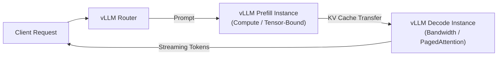

# ⚡ vLLM: High-Throughput & Disaggregated LLM Serving Engine

> **vLLM** is an open-source, production-grade LLM inference and serving engine designed for ultra-high throughput and low latency, pioneering **PagedAttention** for virtual memory management of KV caches and **[[Prefill-Decode Disaggregation]]** for decoupled cluster serving.

---

## 🏛️ Core Architectural Innovations

### 1. PagedAttention & Virtual KV Memory
Traditional inference engines allocate contiguous blocks of GPU memory for each request's KV cache, causing 60–80% memory waste due to internal and external fragmentation and reserved max-context buffers.
* **PagedAttention** partitions the KV cache into fixed-size physical memory pages (analogous to virtual memory in operating systems).
* Pages are dynamically allocated on demand as tokens are generated, enabling near-zero memory waste (<4%) and continuous dynamic batching.

### 2. Disaggregated Prefilling (v0.7.2+)
In **vLLM v0.7.2+**, vLLM introduces native support for **[[Prefill-Decode Disaggregation]]**:
* Separates instances dedicated to prompt evaluation (prefill) from instances dedicated to token generation (decode).
* Focuses on optimizing **Time to First Token (TTFT)** and **Inter-Token Latency (ITL)** under concurrent workloads with heterogeneous prompt/output ratios.
* KV caches are transmitted between prefill instances and decode instances across high-speed fabrics before generation begins.

---

## ⚖️ Performance Characteristics & Optimization Focus

| Feature | Monolithic vLLM Serving | Disaggregated vLLM Serving |
| :--- | :--- | :--- |
| **Worker Allocation** | Single GPU or pipeline processes both phases | Distinct instances tuned independently for prefill vs decode |
| **TTFT vs ITL Interference**| Heavy prompt arrivals cause ITL jitter for active requests | Prefills are isolated; ITL remains consistent |
| **KV Cache Transfer** | Stays local in GPU VRAM (zero network hop) | Transferred over network / PCIe / NVLink fabric |
| **Throughput Focus** | High aggregate token throughput | Strict latency management (TTFT and ITL compliance) |

> [!NOTE]
> As documented by the vLLM team, disaggregation is engineered primarily to solve **latency interference** (protecting ITL from massive prefill bursts). It does not automatically boost aggregate raw throughput, because transmitting the KV cache across physical nodes consumes networking and synchronization bandwidth.

---

## 🔗 Cross-Links & Serving Ecosystem
* **Decoupled Architecture:** Read [[Prefill-Decode Disaggregation]] for deep analysis of SGLang, Mooncake, NIXL, and latency trade-offs.
* **Hardware Portability:** See [[TorchNeuron]] for serving models on AWS Trainium hardware.
* **Routing & Economics:** See [[Model Routing]] for allocating tasks across local SLMs and frontier endpoints.
